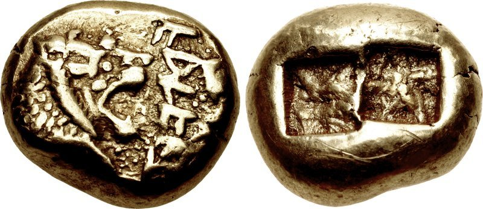
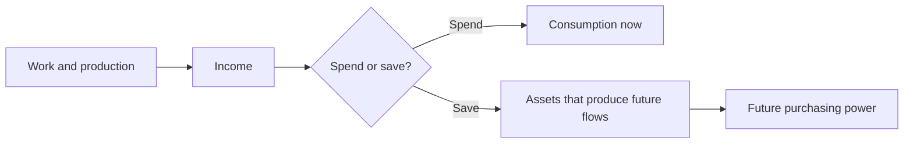

# Money and value

**Prerequisites:** none. This is the first lesson of the finance course. If you like the philosophical side of "value", the [ethics concepts](../../../philosophy/concepts/ethics/README.md) are a good parallel read.

*An electrum trite (one-third stater) of King Alyattes of Lydia, about 620–564 BC, among the earliest coins. Credit: Unknown / Photography by CNG coins. License: [CC BY-SA 3.0](http://creativecommons.org/licenses/by-sa/3.0/). Source: [File:Electrum trite, Alyattes, Lydia, 620-563 BC.jpg](https://commons.wikimedia.org/wiki/File:Electrum_trite,_Alyattes,_Lydia,_620-563_BC.jpg).*

Every finance concept in this course rests on one humble question: what is a unit of money, and why is anyone willing to hold it? Stocks, bonds and derivatives are elaborate promises written in the language of money. If you do not understand the language, the promises are noise.

## Scarcity, trade and the problem of barter

People have different skills and different resources, so they trade. In a pure **barter** economy a trade only works if there is a *double coincidence of wants*: you have fish and want grain, and the person with grain happens to want fish. In a village of a few dozen people this can be managed. In a society of thousands, with specialists such as potters, smiths, scribes and soldiers, finding the matching partner becomes the main cost of living.

Money solves this by splitting one trade into two. You sell your fish for something that everyone accepts, then use that to buy grain from whoever has it. Economists traditionally credit money with three jobs:

1. **Medium of exchange.** It is accepted in trades, so the double coincidence is no longer needed.
2. **Unit of account.** It gives prices a common scale. When a loaf costs 3 and a shirt costs 30, the shirt is worth ten loaves without anyone having to negotiate the exchange rate between shirts and loaves.
3. **Store of value.** It carries purchasing power through time: you can earn today and spend next month.

The third job matters most for finance. Almost every financial decision is a decision about *time*: give up purchasing power now to get more purchasing power later. The tools of finance are ways of moving value through time and across uncertainty.

## What makes something money

Early societies used many things: cattle, shells, grain, and metals weighed out by the shekel. Metals had useful properties: they are durable, divisible, portable and hard to counterfeit. The Kingdom of Lydia, in what is now western Turkey, is traditionally credited with some of the first stamped coins, made of a natural gold–silver alloy called electrum, in the 7th century BC. A stamp from the issuer vouched for weight and purity, which saved the receiver from re-weighing and re-testing every payment.

Over time, societies moved from *commodity money* (the coin is worth its metal), to *representative money* (paper that can be exchanged for a fixed amount of metal), to *fiat money*, which is money because a government declares it legal tender and people trust it. Modern bank balances are mostly entries in a ledger; physical cash is a small fraction of the total money supply. What matters is not the material but the shared belief that others will accept it tomorrow. The [credit and banking](02-credit-and-banking.md) lesson covers how this trust is organised.

## Value is not the same as price

Two words that are easy to confuse:

- **Price** is what you pay in a particular trade, stated in money.
- **Value** is what an asset is worth to you or to the market, which is a judgment about what it will deliver.

A loaf of bread has a price of a few dollars, but its value to a starving person is higher. The distinction lies at the heart of investing. A share trading at 50 dollars has a *price* of 50. Whether it has a *value* of more or less than 50 depends on the future profits of the company, discounted for time and risk. The whole business of valuation, which occupies much of this course, is the attempt to estimate value so you can compare it to price. A line often attributed to Warren Buffett, "price is what you pay, value is what you get," sums up the distinction; Buffett has said he learned it from his teacher Benjamin Graham.

## Assets, income and wealth

Finance divides the world into two kinds of things:

- A **flow** is an amount per period of time: income of 5,000 per month, interest of 200 per year.
- A **stock** (in the accounting sense) is an amount at a point in time: a bank balance of 10,000 today.

An **asset** is anything you own that is expected to provide future benefits: cash, a house, a machine, a share of a business, a claim that someone will pay you. A **liability** is the reverse, an obligation to pay. **Net worth** is assets minus liabilities. Investing is the act of buying assets whose future flows are worth more to you than what you give up today.

Note the last step. Saving is not hoarding; it is converting purchasing power now into a claim on purchasing power later. That conversion is where interest, risk and return will enter, starting in [simple and compound interest](03-simple-and-compound-interest.md).

## Key ideas

- Money solves the double-coincidence problem and serves as medium of exchange, unit of account and store of value.
- Modern money works because of shared trust and legal backing, not because of any metal.
- Price is what you pay; value is what you expect to receive, and the gap between them is what investors try to find.
- Assets are claims on future benefits; liabilities are obligations; finance is mostly about moving value through time.

## Where this leads

- Next: [credit, debt and banking](02-credit-and-banking.md), then [simple and compound interest](03-simple-and-compound-interest.md).
- Glossary: [money](../glossary/foundations/money.md), [asset](../glossary/firms-and-accounting/asset.md), [liability](../glossary/firms-and-accounting/liability.md), [net worth](../glossary/firms-and-accounting/net-worth.md), [fiat money](../glossary/foundations/fiat-money.md).
- Related branch: for the question of what makes something good for a person, see [eudaimonia](../../../philosophy/concepts/ethics/eudaimonia.md).
