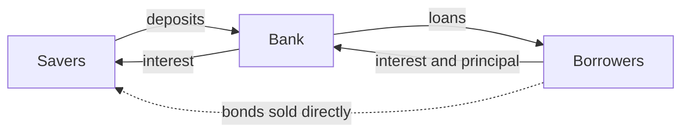

# Credit, debt and banking

**Prerequisites:** [Money and value](01-money-and-value.md).

*The Moneylender and His Wife, Quentin Massys, 1514: a lender weighs coins while his wife looks up from a prayer book. Credit: Quinten Metsys. License: Public domain. Source: [File:Massysm Quentin — The Moneylender and his Wife — 1514.jpg](https://commons.wikimedia.org/wiki/File:Massysm_Quentin_—_The_Moneylender_and_his_Wife_—_1514.jpg).*

Money lets people trade; **credit** lets them trade *across time*. A farmer needs seed in spring and will only have a harvest in autumn. A merchant needs to buy cargo now and will sell it when the ship returns. Someone with a surplus today can lend to them, if the borrower can be trusted to repay and the lender is compensated for waiting and for risk. That arrangement, a promise to pay later in exchange for resources now, is **debt**, and it is the oldest financial instrument there is.

## Lender, borrower and the price of waiting

In any loan there are three basic terms:

- the **principal**, the amount lent;
- the **interest**, the extra amount the borrower pays for the use of the principal, usually quoted as a percentage per year (the **interest rate**);
- the **maturity**, the date or schedule by which the principal must be repaid.

Why should a lender demand interest at all? Three reasons stack on top of each other, and each returns later in the course:

1. **Time preference.** Most people prefer a given benefit sooner than later. To persuade them to postpone spending, you must pay them.
2. **Risk.** The borrower might not repay. The riskier the borrower, the more the lender demands, which is the basis of [credit risk](../03-securities/02-bonds/06-credit-risk-and-ratings.md) later on.
3. **Inflation.** If prices rise while the money is out on loan, the repayment buys less than the loan did. See [inflation and real returns](07-inflation-and-real-returns.md).

Both sides gain from a well-priced loan: the borrower gets something worth more to them than the interest cost, and the lender gets a return that beats holding idle cash.

## Banks as intermediaries

You could in principle find a borrower yourself, judge their reliability and chase repayment. Most savers do not want that job, which is why **banks** exist. A bank takes deposits from many savers and lends the pooled funds to many borrowers. It earns the difference between the interest it charges on loans and the interest it pays on deposits (the **spread**), and in return it provides several services:

- **Pooling:** many small deposits become a few large loans.
- **Screening and monitoring:** the bank specialises in judging who will repay.
- **Maturity transformation:** depositors can often withdraw on demand, while loans run for years. The bank borrows short and lends long.
- **Diversification:** a bank spreads its lending over many borrowers, so one default is survivable.

Maturity transformation is also the weak point. If many depositors ask for their money at once, a bank that has lent most of it out cannot pay everyone. This is a **bank run**, and it can happen to a perfectly sound bank if people believe others are about to withdraw. Modern systems answer with deposit insurance (in Canada, the CDIC insures eligible deposits up to a limit per category, currently $100,000, confirm at cdic.ca), capital requirements and a central bank that can lend in a crisis. The [central banks lesson](../05-regulation/06-central-banks-and-monetary-policy.md) takes this up.

## Where banking began

Credit predates coinage. Clay tablets from ancient Mesopotamia record loans of silver and grain, as the [next lesson](03-simple-and-compound-interest.md) shows. In medieval and Renaissance Italy, merchant-bankers in cities such as Florence and Venice ran networks that took deposits, made loans, and moved money across Europe by *bills of exchange*, a written order to pay a sum in another place and currency. The Medici bank of Florence in the 15th century is the best-known example. Quentin Massys's painting *The Moneylender and His Wife* (1514) shows how ordinary the trade had become by then. The [history branch](../08-history/01-lending-and-banking-before-stock-markets.md) picks up the story.

## From loans to securities

A bank loan is a private agreement: only the bank and the borrower hold the claim, and it is hard to sell. A natural step is to make debt *tradable*. If a government or a large company wants to borrow from many people at once, it can split the loan into many identical pieces, sell them, and let the holders trade them. These pieces are **bonds**, and they are an early example of a [security](../02-firms-and-capital/07-what-is-a-security.md). The same idea applied to ownership rather than loans produces shares. That path, from private loans to public, tradable claims, is the plot of this entire course.

The dotted line is the alternative route: borrowers can skip the bank and sell debt directly to investors.

## Key ideas

- Credit moves purchasing power through time; interest is the price of that movement.
- A loan has principal, interest and maturity. Interest compensates for time, risk and inflation.
- Banks pool deposits, screen borrowers and transform short-term deposits into long-term loans, which creates run risk.
- Making debt tradable turns a private loan into a security.

## Where this leads

- Next: [simple and compound interest](03-simple-and-compound-interest.md).
- Later: [equity and debt](../02-firms-and-capital/03-equity-and-debt.md), [bonds](../03-securities/02-bonds/01-what-is-a-bond.md), [central banks](../05-regulation/06-central-banks-and-monetary-policy.md).
- Glossary: [principal](../glossary/foundations/principal.md), [interest rate](../glossary/foundations/interest-rate.md), [maturity](../glossary/bonds/maturity.md), [bank run](../glossary/foundations/bank-run.md), [CDIC](../glossary/regulation/cdic.md).
