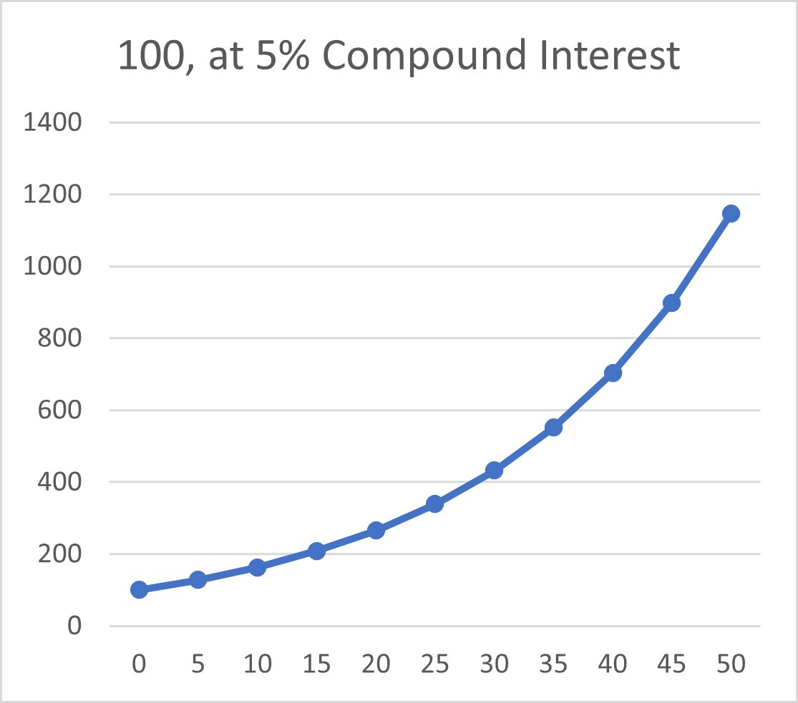

# Simple and compound interest

**Prerequisites:** [Money and value](money-and-value.md), [Credit, debt and banking](credit-and-banking.md).

*A cuneiform tablet recording a loan of silver from ancient Mesopotamia, Metropolitan Museum of Art. Credit: The Metropolitan Museum of Art (Open Access). License: [CC0](http://creativecommons.org/publicdomain/zero/1.0/deed.en). Source: [File:Cuneiform tablet- loan of silver MET DP-13441-009.jpg](https://commons.wikimedia.org/wiki/File:Cuneiform_tablet-_loan_of_silver_MET_DP-13441-009.jpg).*

*Growth of a sum under compound interest compared with simple interest. Credit: Pbergerd. License: [CC BY-SA 4.0](https://creativecommons.org/licenses/by-sa/4.0). Source: [File:Compound interest.png](https://commons.wikimedia.org/wiki/File:Compound_interest.png).*

Interest is the price of time. How that price is calculated, whether once on the original amount or repeatedly on a growing balance, makes an enormous difference over long periods. This lesson builds the arithmetic you will use for the rest of the course.

## Simple interest

With **simple interest**, interest is calculated only on the original principal. If you lend 1,000 at 5% simple interest per year, you earn 50 each year, no matter how long you wait.

> Simple interest = Principal × rate × time

After 10 years the interest totals 1,000 × 0.05 × 10 = 500, so the account holds 1,500. After 30 years it holds 2,500. The growth is a straight line: the same dollar amount is added each period.

## Compound interest

With **compound interest**, each period's interest is added to the balance, and the next period's interest is calculated on the larger amount. You earn interest on your interest.

> Future value = Principal × (1 + r)^n

where r is the interest rate per period and n is the number of periods. With 1,000 at 5% compounded annually:

| Year | Balance |
|------|---------|
| 0 | 1,000.00 |
| 1 | 1,050.00 |
| 2 | 1,102.50 |
| 3 | 1,157.63 |
| 10 | 1,628.89 |
| 30 | 4,321.94 |

Compare with simple interest: after 10 years 1,628.89 against 1,500, a difference of about 129; after 30 years 4,321.94 against 2,500, a difference of about 1,822. The gap is small early and enormous late, because compounding is exponential growth rather than linear.

## The rule of 72

A handy shortcut for how long money takes to double: divide 72 by the annual percentage rate. At 6%, 72 ÷ 6 = 12 years; the exact figure is about 11.9 years. At 9%, 72 ÷ 9 = 8 years; the exact figure is about 8.04. The rule is an approximation that works best for rates between roughly 6% and 10%. It also works backwards: if prices double in 24 years, inflation is running at roughly 3% per year.

## Compounding frequency

Interest can be compounded annually, monthly, daily or continuously. More frequent compounding means a slightly higher effective result. Take 1,000 at a **nominal** (quoted) annual rate of 12%:

- compounded annually: 1,000 × 1.12 = 1,120.00
- compounded monthly at 1% per month: 1,000 × 1.01^12 = 1,126.83

The second figure corresponds to an **effective annual rate** (EAR) of 12.68%. In general, EAR = (1 + nominal rate ÷ m)^m − 1, where m is the number of compounding periods per year. This is why lenders in many countries must disclose the annual percentage rate or effective rate: two loans with the same nominal rate but different compounding are not equally expensive. As m grows without limit you reach **continuous compounding**, where 1,000 at 5% for 10 years becomes 1,000 × e^(0.05 × 10), about 1,648.72. The difference from annual compounding (1,628.89) is modest, so the headline rate matters far more than the compounding frequency.

## Compounding cuts both ways

The same mathematics that grows savings makes debt dangerous. A balance carried at a high rate grows quickly if no payments are made, and the interest itself starts charging interest. Compound interest is a friend to a saver and a trap to a borrower who only makes minimum payments. It also works on costs: an investment fee of 1% per year does not take 1% of your final wealth, it takes 1% every year of a base that would otherwise have compounded, which is one reason the [fees lesson](../03-securities/03-funds/04-fees-and-the-cost-of-investing.md) later spends so much effort on the topic.

## A short note on history

Interest is ancient. Cuneiform tablets from Mesopotamia record loans of silver and barley with interest, and societies from Babylon to medieval Europe debated whether charging interest was fair, with religious traditions sometimes restricting it. The mathematics of compounding appears in medieval texts such as Fibonacci's *Liber Abaci* (1202). Modern finance treats interest as a normal price, but it never stopped being morally and politically contested.

## Key ideas

- Simple interest is linear; compound interest is exponential.
- Future value = P × (1 + r)^n. The longer the horizon, the more compounding dominates.
- The rule of 72 estimates doubling time: 72 ÷ rate (in percent).
- Compare loans and savings using the effective annual rate, not the nominal rate.

## Where this leads

- Next: [the time value of money](time-value-of-money.md), then [present value and discounting](present-value-and-discounting.md).
- Glossary: [[g:compound-interest|compound interest]], [[g:simple-interest|simple interest]], [[g:effective-annual-rate|effective annual rate]], [[g:rule-of-72|rule of 72]].
