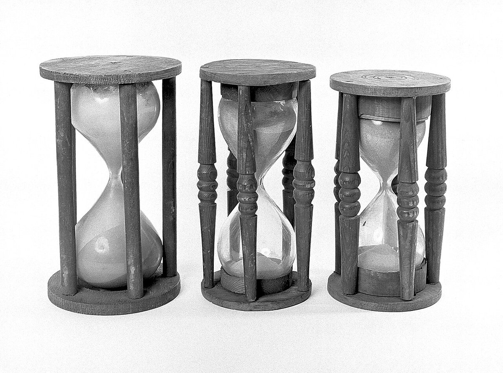

# The time value of money

**Prerequisites:** [Simple and compound interest](simple-and-compound-interest.md).

*Three hourglasses: a reminder that the same sum is worth different amounts at different dates. Credit: https://wellcomeimages.org/indexplus/obf_images/54/00/bd7a7e84b936c977e96b6817e4c6.jpg Gallery: https://wellcomeimages.org/indexplus/image/L0011331.html Wellcom. License: [CC BY 4.0](https://creativecommons.org/licenses/by/4.0). Source: [File:3 Hourglasses Wellcome L0011331.jpg](https://commons.wikimedia.org/wiki/File:3_Hourglasses_Wellcome_L0011331.jpg).*

Would you rather have 1,000 today or 1,000 a year from now? Almost everyone chooses today. The reasons are not mysterious, and spelling them out gives finance its central principle: **a dollar today is worth more than a dollar tomorrow**. Every valuation in this course, whether of a bond, a share or a whole company, is an application of this idea.

## Why earlier is better

- **You can invest it.** With 1,000 today you can earn interest and have more than 1,000 a year from now. If a safe account pays 5%, today's 1,000 becomes 1,050 in a year, so "1,000 a year from now" must be worth less than 1,000 today.
- **Inflation.** Prices tend to rise, so a later dollar buys less. See [inflation and real returns](inflation-and-real-returns.md).
- **Risk.** A promise of future money might not be kept. Money in hand has no such risk.
- **Preference.** People also simply prefer consuming sooner, as the lending lesson noted.

Notice that the first reason alone is enough to make the principle precise: if you can earn a return, time has a price, and that price is the interest rate.

## Moving money through time

Finance gives you two operations, both built from the compounding formula.

**Compounding (moving forward).** To find what a sum today will be worth in n periods at rate r:

> FV = PV × (1 + r)^n

**Discounting (moving backward).** To find what a sum received in n periods is worth today:

> PV = FV ÷ (1 + r)^n

These are the same equation solved in opposite directions. With r = 5%:

- 1,000 today → 1,050 in one year; 1,102.50 in two; 1,276.28 in five.
- 1,000 received in one year is worth 1,000 ÷ 1.05 = 952.38 today.
- 1,000 received in three years is worth 1,000 ÷ 1.05^3 = 863.84 today.

The sooner a payment arrives, the more it is worth today. The higher the rate, the less distant payments are worth.

## Comparing cash flows at one date

The practical use is *comparability*. Money at different dates cannot be added up directly, just as you cannot add 3 metres to 4 kilograms. You must first convert every amount to a common date, usually today (**present value**) or some future date (**future value**). Once everything is at the same date, you can add, subtract and compare.

Consider two offers for selling a small business: 100,000 now, or 40,000 now plus 70,000 in two years. With a discount rate of 6%, the second offer has a present value of 40,000 + 70,000 ÷ 1.06^2 = 40,000 + 62,300 = 102,300 (rounded). So at 6% the second offer is slightly better, but at 10% it is worth 40,000 + 57,851 = 97,851 and the first wins. The decision depends on the rate, which is exactly why choosing the rate is one of the central problems of finance.

## What rate should you use?

There is no single "right" rate; it is the return you could earn on an alternative with similar risk. This is called the **opportunity cost of capital** or **discount rate**. A government-backed deposit justifies a low rate, because the future payment is nearly certain; a speculative start-up justifies a high one, because the payment is doubtful. The next lessons build the machinery for risky cash flows: [present value and discounting](present-value-and-discounting.md) for several payments, then [risk and return](risk-and-return.md) for how risk raises the required rate.

## Time value in everyday life

- A mortgage or car loan: you receive money now in exchange for a stream of future payments, and the interest rate sets the exchange rate between the two.
- A lottery with a lump sum versus an annuity: the lump sum is smaller than the total of the annual payments precisely because later payments are discounted.
- Saving early: 10,000 invested at 7% for 25 years grows to 54,274, while the same sum for 15 years grows to 27,590. The first 10 years of extra waiting nearly double the result.

## Key ideas

- A dollar today is worth more than a dollar later because it can earn a return, and because of inflation, risk and preference.
- FV = PV × (1 + r)^n; PV = FV ÷ (1 + r)^n.
- Only cash flows at the same date can be compared; convert them with compounding or discounting first.
- The right rate is the opportunity cost of capital, which depends on risk.

## Where this leads

- Next: [present value and discounting](present-value-and-discounting.md), then [annuities and perpetuities](annuities-and-perpetuities.md).
- Applications: [bond pricing](../03-securities/02-bonds/02-pricing-a-bond.md), [discounted cash flow valuation](../03-securities/01-stocks/09-discounted-cash-flow-valuation.md).
- Glossary: [[g:time-value-of-money|time value of money]], [[g:discount-rate|discount rate]], [[g:future-value|future value]], [[g:opportunity-cost|opportunity cost]].
