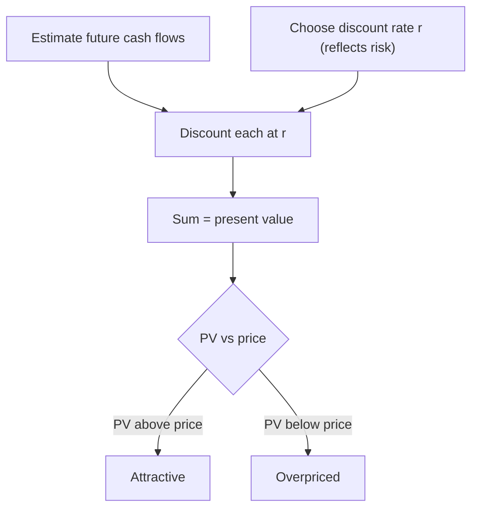

# Present value and discounting

**Prerequisites:** [The time value of money](04-time-value-of-money.md).

*A page of Fibonacci's Liber Abaci (1202), which taught Europeans Hindu-Arabic arithmetic with worked commercial examples. Credit: Credit as given on Wikimedia Commons. License: Public domain. Source: [File:Liber abbaci magliab f124r.jpg](https://commons.wikimedia.org/wiki/File:Liber_abbaci_magliab_f124r.jpg).*

The last lesson moved a single payment through time. Real assets pay in streams: a bond pays coupons then principal, a rental property pays rent, a business pays profits. **Present value** (PV) is the tool for pricing the whole stream. It is arguably the most important single calculation in finance.

## Present value of a stream

The present value of a series of future cash flows is the sum of each flow discounted back to today:

> PV = CF₁ ÷ (1+r) + CF₂ ÷ (1+r)² + … + CFₙ ÷ (1+r)ⁿ

Each term answers "what is this payment worth today?", and the sum is what the whole stream is worth today. Example: a contract pays 100 at the end of year 1, 200 at the end of year 2 and 300 at the end of year 3. At r = 8%:

- 100 ÷ 1.08 = 92.59
- 200 ÷ 1.08² = 171.47
- 300 ÷ 1.08³ = 238.15
- PV = 502.21

So you should be willing to pay at most about 502 for this contract if 8% is the right rate for its risk. If it is offered for less, it is a bargain at that rate; if for more, it is overpriced.

## Net present value and the investment decision

**Net present value** (NPV) is the present value of all inflows minus the present value of the outlays. Suppose a project costs 450 today and returns the cash flows above. NPV = 502.21 − 450 = 52.21. A positive NPV means the project earns more than the required 8%: it adds value. The classic decision rule for companies is to undertake every project with positive NPV and skip those with negative NPV. Applied to a share or bond, the same logic says to buy if the PV of what you will receive exceeds the price.

## The internal rate of return

Instead of fixing r and finding the value, you can fix the price and find the rate. The **internal rate of return** (IRR) is the rate that makes NPV equal to zero. If you pay 450 for the contract above, the IRR is the rate r solving 100/(1+r) + 200/(1+r)² + 300/(1+r)³ = 450, which works out to about 13.3%. IRR is a handy way to express a return, and for a bond it is called the [yield to maturity](../03-securities/02-bonds/03-yield-to-maturity.md). It has known quirks: it can give multiple answers when cash flows change sign more than once, and it can mislead when comparing projects of different size or length. NPV is generally the safer guide.

## How discount rates behave

Present value is **inversely related** to the discount rate and falls faster for distant payments. A payment of 1,000 due in 20 years is worth 1,000 ÷ 1.04^20 = 456.39 today at 4%, but only 1,000 ÷ 1.10^20 = 148.64 at 10%. A payment due in one year barely cares: 961.54 at 4% against 909.09 at 10%. This asymmetry is the root of an idea you will meet repeatedly: assets whose cash flows come mostly far in the future (long-term bonds, growth stocks) are much more sensitive to changes in interest rates than those paying soon. See [duration and convexity](../03-securities/02-bonds/05-duration-and-convexity.md).

## Two sources of error

The mathematics is simple; the inputs are not. Present value rests on two estimates, and mistakes in either multiply:

1. **The cash flows.** For a government bond they are written in the contract; for a business they are forecasts.
2. **The discount rate.** A small change in r can shift a long-dated valuation substantially.

This is why professional valuation focuses less on the arithmetic and more on the assumptions. The [DCF lesson](../03-securities/01-stocks/09-discounted-cash-flow-valuation.md) applies exactly this method to companies, and you will see how sensitive it is.

## A note on timing

The formulas above assume each cash flow arrives at the *end* of its period. Real flows can arrive at the start or throughout the period, and spreadsheets and calculators have conventions for this. It is a detail, but a loan or lease that pays at the start of each month is worth slightly more than one paying at the end, so when you compare contracts check the timing.

## Key ideas

- The present value of a stream is the sum of each cash flow discounted at the appropriate rate.
- NPV = PV of inflows − PV of outflows. Accept positive-NPV opportunities.
- IRR is the rate at which NPV is zero; for a bond it is the yield to maturity.
- Present value falls as the discount rate rises, and distant cash flows are the most sensitive.

## Where this leads

- Next: [annuities and perpetuities](06-annuities-and-perpetuities.md), shortcuts for regular streams.
- Applications: [pricing a bond](../03-securities/02-bonds/02-pricing-a-bond.md), [the dividend discount model](../03-securities/01-stocks/08-the-dividend-discount-model.md).
- Glossary: [present value](../glossary/foundations/present-value.md), [net present value](../glossary/foundations/net-present-value.md), [internal rate of return](../glossary/foundations/internal-rate-of-return.md), [discounting](../glossary/foundations/discounting.md).
