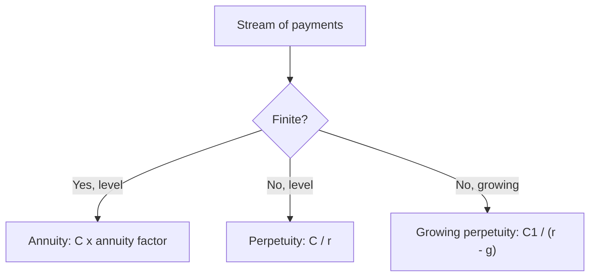

# Annuities and perpetuities

**Prerequisites:** [Present value and discounting](05-present-value-and-discounting.md).

*The Bank of England on Threadneedle Street, London, the institution that managed Britain's perpetual government annuities (consols). Credit: Steve Daniels. License: [CC BY-SA 2.0](https://creativecommons.org/licenses/by-sa/2.0). Source: [File:The Bank of England on Threadneedle Street - geograph.org.uk - 3898549.jpg](https://commons.wikimedia.org/wiki/File:The_Bank_of_England_on_Threadneedle_Street_-_geograph.org.uk_-_3898549.jpg).*

Many financial claims pay the same amount at regular intervals: a mortgage payment, a bond coupon, a pension, a steady dividend. Adding up dozens of discounted payments one by one is tedious, so finance uses closed-form shortcuts for the most common patterns.

## Ordinary annuity

An **annuity** is a fixed payment C made at the end of each period for n periods. Its present value is

> PV = C × [1 − (1 + r)^(−n)] ÷ r

Example: you will receive 100 per year for 10 years, and r = 5%. Then PV = 100 × (1 − 1.05^(−10)) ÷ 0.05 = 100 × 7.7217 = 772.17. The total of the payments is 1,000, but their present value is only 772.17, because later payments are discounted. The factor in brackets is called the **annuity factor**.

The same formula run backwards gives a loan payment. A loan of L at rate r per period over n periods is repaid by a level payment C = L × r ÷ [1 − (1 + r)^(−n)]. That is the logic of a standard mortgage: each payment is the same, but early payments are mostly interest and later payments mostly principal, because the interest portion shrinks as the balance falls.

Annuities can also be run forward. Saving 500 per year for 30 years at 6% yields 500 × (1.06³⁰ − 1) ÷ 0.06 = 39,529 in future value, from total deposits of only 15,000. This is compounding applied to regular saving, and it is why consistent contributions to a retirement account matter more than most people expect.

## Annuity due

If the payments come at the *start* of each period (rent paid in advance, for instance), the annuity is an **annuity due**, and every payment arrives one period earlier. Its present value is the ordinary-annuity value multiplied by (1 + r). For the 100-per-year example, 772.17 × 1.05 = 810.78.

## Perpetuity

What if the payments never stop? A **perpetuity** pays C every period forever. The infinite sum collapses to

> PV = C ÷ r

A perpetuity of 100 per year at 5% is worth 100 ÷ 0.05 = 2,000. That seems startling, since the payments are infinite, but each is discounted, and the far-future ones are worth almost nothing. The formula also shows something intuitive: the price of a perpetuity moves inversely with the rate. If r doubles to 10%, the value halves to 1,000.

Perpetuities exist in practice. The British government issued **consols** (consolidated annuities) in the 18th century, which paid a fixed amount forever and could be bought and sold on the market; the Bank of England administered government debt. A preferred share with a fixed dividend and no maturity is approximately a perpetuity, as you will see in [common and preferred shares](../03-securities/01-stocks/02-common-and-preferred-shares.md).

## Growing perpetuity

Dividends and profits often grow. A **growing perpetuity** starts with a payment C₁ next period and grows at a constant rate g forever:

> PV = C₁ ÷ (r − g), valid only if r > g

If the first payment is 100, growth is 2% and r = 7%, then PV = 100 ÷ 0.05 = 2,000. Note the sensitivity: with r − g shrinking to 0.03 the value rises to 3,333, and as g approaches r the value explodes. This formula is the heart of the Gordon growth model in [the dividend discount model](../03-securities/01-stocks/08-the-dividend-discount-model.md) and of the terminal value in [DCF valuation](../03-securities/01-stocks/09-discounted-cash-flow-valuation.md).

## Key ideas

- An annuity is a level payment for n periods; its PV is C × [1 − (1+r)^−n] ÷ r.
- Loan payments, bond coupons and regular savings are annuity problems.
- A perpetuity pays forever; PV = C ÷ r. A growing perpetuity has PV = C₁ ÷ (r − g).
- Valuations get extremely sensitive when r − g is small.

## Where this leads

- Next: [inflation and real returns](07-inflation-and-real-returns.md).
- Applications: [pricing a bond](../03-securities/02-bonds/02-pricing-a-bond.md), [dividend discount model](../03-securities/01-stocks/08-the-dividend-discount-model.md), [the TFSA](../09-personal-investing-canada/03-the-tfsa.md) (regular saving).
- Glossary: [annuity](../glossary/foundations/annuity.md), [perpetuity](../glossary/foundations/perpetuity.md), [consol](../glossary/foundations/consol.md), [amortization](../glossary/foundations/amortization.md).
