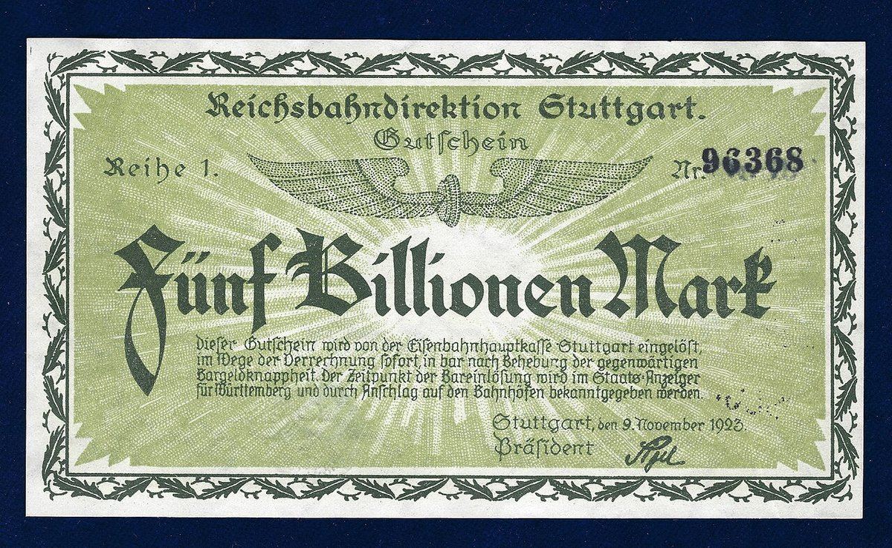
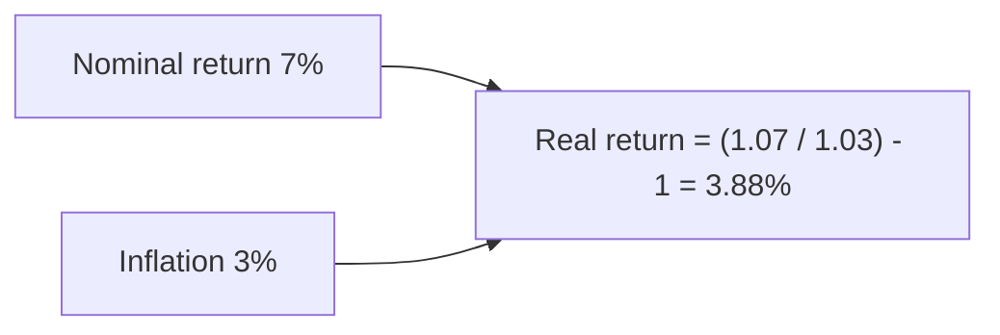

# Inflation and real returns

**Prerequisites:** [Simple and compound interest](simple-and-compound-interest.md).

*A 5 trillion mark emergency banknote from Germany's 1923 hyperinflation. Credit: Berlin-George. License: Public domain. Source: [File:German Railways Banknote 5 Billionen Mark 1923 Hyperinflation Notgeld Stuttgart, obverse.jpg](https://commons.wikimedia.org/wiki/File:German_Railways_Banknote_5_Billionen_Mark_1923_Hyperinflation_Notgeld_Stuttgart,_obverse.jpg).*

A return of 5% sounds good until you learn that prices rose 6%. **Inflation** is a general rise in prices, which means each unit of money buys less. It makes the money you hold a melting asset, and it changes how every investment should be judged.

## Measuring inflation

Statistical agencies track the price of a fixed basket of goods and services bought by typical households. In Canada, Statistics Canada publishes the **Consumer Price Index** (CPI); the annual percentage change in the CPI is the headline inflation rate. A CPI basket includes shelter, food, transportation and so on, and any single household's experience will differ from the average. The Bank of Canada has a target of 2% inflation, the midpoint of a 1% to 3% control range (confirm the current framework at bankofcanada.ca). The [central banks lesson](../05-regulation/06-central-banks-and-monetary-policy.md) explains why central banks target a low, stable positive rate rather than zero.

## The cost of inflation to savers

Inflation compounds, just like interest. At 3% a year, 100 of purchasing power today is worth 100 ÷ 1.03^20 = 55.37 after 20 years: it has lost almost half its value. Cash under a mattress, or in an account paying less than inflation, loses purchasing power quietly. The same is true of fixed-payment promises: a bond paying a fixed coupon pays in dollars of declining value.

## Nominal versus real

- The **nominal** return is the stated percentage, measured in current money.
- The **real** return is the percentage change in purchasing power, after inflation.

The exact relationship is the **Fisher equation**, named after Irving Fisher:

> 1 + real = (1 + nominal) ÷ (1 + inflation)

If an investment earns 7% while inflation is 3%, the real return is 1.07 ÷ 1.03 − 1 = 3.88%. The common shortcut, real ≈ nominal − inflation, gives 4%, which is close enough for low rates but increasingly off when rates are high. Because Fisher argued that nominal interest rates should rise to compensate lenders for expected inflation, the **real interest rate** is one of the key variables in finance: it is the true price of waiting.

Be careful with taxes as well. Interest income is taxed on the nominal amount, so a saver can pay tax on returns that are entirely eaten by inflation. After-tax, after-inflation returns are what matter, which is a strong reason to understand the [tax-sheltered accounts](../09-personal-investing-canada/02-registered-and-non-registered-accounts.md) available in Canada.

## Why prices rise

Economists argue about causes, and a full account belongs in a macroeconomics branch. In outline: inflation can come from too much demand chasing too little supply, from rising costs such as energy or wages, from expectations that become self-fulfilling, and, over long periods, from growth in the money supply faster than growth in output. At the extreme, **hyperinflation**, prices rise so fast that money loses its function. Germany in 1923 is the classic case, when emergency banknotes were printed in values of trillions of marks, and Zimbabwe in 2008 to 2009, when a 100 trillion dollar note was issued. In such conditions people stop saving in money at all, which shows why trust in a currency is the foundation of finance.

## Inflation and asset classes

Different assets respond differently, which is why it matters:

- **Cash and fixed-rate bonds** lose real value when inflation is higher than expected.
- **Inflation-linked bonds** adjust principal or payments with the CPI; see [inflation-linked bonds](../03-securities/02-bonds/10-inflation-linked-zero-coupon-and-gics.md).
- **Stocks** are claims on real businesses that can raise prices, so they tend to keep pace with inflation over long periods, though not reliably in the short run.
- **Real estate and commodities** are real assets whose prices often rise with inflation.

None of these relationships are guaranteed, but the principle stands: always ask whether a return is stated in nominal or real terms.

## Key ideas

- Inflation erodes purchasing power and compounds over time.
- The real return is (1 + nominal) ÷ (1 + inflation) − 1.
- Fixed-rate claims are hurt most by unexpected inflation; real assets and inflation-linked bonds are partial protection.
- Taxes are usually charged on nominal gains, so real after-tax returns can be much lower than stated.

## Where this leads

- Next: [probability and expected value](probability-and-expected-value.md), the start of the risk half of the foundations.
- Later: [inflation-linked bonds](../03-securities/02-bonds/10-inflation-linked-zero-coupon-and-gics.md), [central banks](../05-regulation/06-central-banks-and-monetary-policy.md), [the 1970s inflation shock](../08-history/08-bretton-woods-and-the-postwar-order.md).
- Glossary: [[g:inflation|inflation]], [[g:real-return|real return]], [[g:nominal-return|nominal return]], [[g:cpi|CPI]], [[g:hyperinflation|hyperinflation]].
