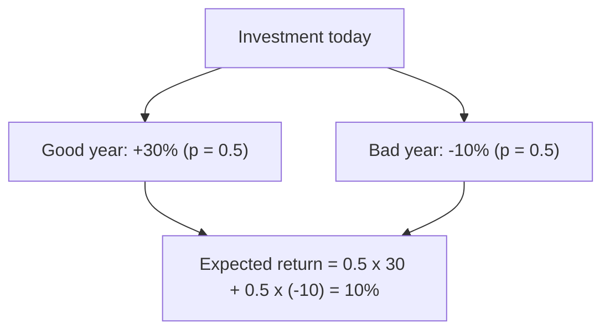

# Probability and expected value

**Prerequisites:** [The time value of money](time-value-of-money.md).

*Blaise Pascal, who with Pierre de Fermat worked out the first rules of probability and expected value in 1654. Credit: unknown; a copy of the painting of François II Quesnel, which was made for Gérard Edelinck en 1691[réf. nécessaire].. License: Public domain. Source: [File:Blaise Pascal Versailles.JPG](https://commons.wikimedia.org/wiki/File:Blaise_Pascal_Versailles.JPG).*

So far every payment was certain. Real investments are not: a share may rise or fall, a borrower may default. To reason about uncertain payoffs you need a little probability. Fortunately, the part finance uses most is small: probabilities, expected values and the idea of a distribution.

## Where the mathematics came from

Modern probability began with a question about gambling. In 1654, the French mathematicians Blaise Pascal and Pierre de Fermat corresponded about how to fairly divide the stakes of an interrupted game of chance. Their solution introduced the idea that the fair value of an uncertain prize is its probability-weighted average. The Dutch scientist Christiaan Huygens published the first printed treatise on the subject a few years later. Insurance, annuities and the pricing of risk grew from the same roots, as you will see when risk enters the picture in [risk and return](risk-and-return.md).

## Probabilities and outcomes

A **random variable** is a quantity whose value is uncertain, such as next year's return on a share. A **probability distribution** lists the possible outcomes and how likely each is. Probabilities lie between 0 and 1 and, for a complete list of mutually exclusive outcomes, sum to 1.

A simple illustration: a stock could, in one year, return +30% in a good scenario (probability 50%) or −10% in a bad one (probability 50%). Real returns have a continuum of outcomes, but a few scenarios often capture the idea.

## Expected value

The **expected value** (or mean) is the probability-weighted average of outcomes:

> E[X] = Σ pᵢ × xᵢ

For the stock above, E[R] = 0.5 × 30% + 0.5 × (−10%) = 10%. This does not mean you will get 10%; you will get either +30% or −10%. It means that if you could repeat the experiment many times, the average would approach 10%. The expected value is a summary of the distribution's centre, not a prediction.

A second example with three scenarios: boom (25% chance, +25% return), normal (50%, +8%), recession (25%, −15%). E[R] = 0.25 × 25 + 0.5 × 8 + 0.25 × (−15) = 6.25 + 4 − 3.75 = 6.5%.

## Expected value as a decision rule, and its limits

If you were asked to pay 100 for a ticket paying 300 with probability 40% and nothing otherwise, the expected payoff is 120, so on average you would gain 20. The rule "take bets with positive expected value" is sensible when the stakes are small compared with your wealth and you can repeat the bet many times.

It fails in two ways. First, **risk**: two bets with the same expected value can differ greatly in how much they can hurt you. A coin flip paying 1,000,000 or nothing has the same expected value as a sure 500,000, but almost nobody values them equally. This is the subject of the [next lessons](variance-and-standard-deviation.md). Second, **ruin**: a bet with a high expected value can still be unwise if a bad outcome wipes you out, because you cannot play again. Investors speak of avoiding "risk of ruin" for this reason.

The mathematician Daniel Bernoulli proposed in 1738 that people evaluate gambles not by money but by the *utility* of money, which rises more slowly as wealth increases. This idea of diminishing marginal utility is the standard explanation of risk aversion, and it returns in [prospect theory](../07-behavioural-finance/02-prospect-theory-and-loss-aversion.md).

## Estimating probabilities in finance

Where do probabilities come from? For a die or a coin, from symmetry. For a bond defaulting or a share rising, there is no symmetry, so analysts use history, models and judgment. Historical frequencies are useful but imperfect, because the future does not have to resemble the past, and rare events (crashes) are, by definition, poorly sampled. Professional humility about probabilities is a recurring theme in the [history lessons](../08-history/07-the-crash-of-1929-and-the-great-depression.md).

## Key ideas

- A probability distribution lists outcomes and their likelihoods; probabilities sum to 1.
- Expected value is the probability-weighted average, a centre of the distribution, not a forecast of one outcome.
- Expected value alone ignores risk and the possibility of ruin.
- Probabilities in finance are estimated, and estimates can be wrong.

## Where this leads

- Next: [variance and standard deviation](variance-and-standard-deviation.md), measuring how spread out outcomes are.
- Related: [risk and return](risk-and-return.md), [behavioural finance](../07-behavioural-finance/01-from-rational-to-behavioural.md).
- Glossary: [[g:expected-value|expected value]], [[g:probability-distribution|probability distribution]], [[g:random-variable|random variable]], [[g:risk-aversion|risk aversion]].
