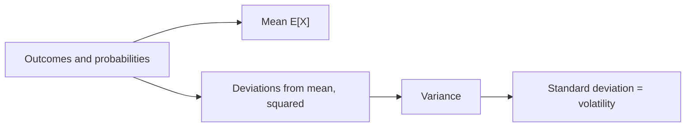

# Variance and standard deviation

**Prerequisites:** [Probability and expected value](probability-and-expected-value.md).

*A Galton board before and after: many small random shocks pile up into a bell-shaped distribution. Credit: Exhibit made by Estes Objethos Atelier, photo by Rodrigo Tetsuo Argenton. License: [CC BY-SA 4.0](https://creativecommons.org/licenses/by-sa/4.0). Source: [File:Tabuleiros de Galton (antes e depois).jpg](https://commons.wikimedia.org/wiki/File:Tabuleiros_de_Galton_(antes_e_depois).jpg).*

Two investments can have the same expected return and feel completely different. One is steady; the other swings wildly. To measure how widely returns scatter around their average you need a number for **dispersion**. In finance that number is usually the standard deviation, and it is the most common measure of risk.

## Variance

The **variance** of a random variable is the probability-weighted average of the squared deviations from the mean:

> Var(X) = Σ pᵢ × (xᵢ − E[X])²

Squaring does two things: it prevents positive and negative deviations from cancelling out, and it penalises large deviations more than small ones. Take the two-scenario stock from the last lesson: +30% or −10% with equal probability, mean 10%. The deviations are +20 and −20 points, so the variance is 0.5 × 20² + 0.5 × (−20)² = 400 (in percent squared). The units are awkward, which leads to the next step.

## Standard deviation

The **standard deviation** is the square root of the variance, returning to the original units:

> σ = √Var(X)

Here σ = √400 = 20%. Interpreted roughly: returns typically land about 20 points away from the mean. For the three-scenario example (mean 6.5%), the variance is 0.25 × (25 − 6.5)² + 0.5 × (8 − 6.5)² + 0.25 × (−15 − 6.5)² = 85.5625 + 1.125 + 115.5625 = 202.25, so σ ≈ 14.2%.

In finance, the standard deviation of returns is called **volatility**. It is usually quoted annualised. A stock with an expected return of 8% and a volatility of 20% is a different animal from a government bond with an expected return of 3% and a volatility of 5%.

## Estimating from history

In practice you rarely know the probabilities. Instead you collect past returns r₁ … rₙ and compute the sample mean and the sample standard deviation, dividing the squared deviations by (n − 1) rather than n. Monthly volatility is annualised by multiplying by √12; daily by √252, the approximate number of trading days in a year. The scaling by a square root, not by the number of periods, arises because, if returns are independent from period to period, variances add, not standard deviations.

## The bell curve

Many random outcomes are well described by the **normal distribution**, the bell curve. Its shape is set by the mean and standard deviation. For a normal distribution, about 68% of outcomes fall within one standard deviation of the mean, about 95% within two, and about 99.7% within three. The *Galton board* pictured above is a physical demonstration of why: many small independent random shocks add up to a bell-shaped total, a result called the **central limit theorem**. The mathematician Carl Friedrich Gauss studied the distribution in the context of measurement errors, so it is also called the Gaussian.

If annual stock returns were normal with a mean of 8% and a volatility of 20%, then roughly 95% of years would fall between −32% and +48%. Real markets are less tidy. Returns show **fat tails**: extreme moves happen more often than the normal curve predicts, as in October 1987 or autumn 2008. They also show **skewness**, where large losses are more frequent or larger than large gains. Standard deviation is therefore a convenient but incomplete measure, and risk managers supplement it with others, such as the maximum drawdown (the worst peak-to-trough fall) and value at risk.

## Standard deviation as a measure of risk: strengths and critiques

Why use σ as risk? It is simple, additive in a clever way (as the [diversification lesson](correlation-and-diversification.md) shows), and it is the foundation of [modern portfolio theory](../06-portfolio-theory/01-portfolio-return-and-risk.md). Critics point out that it treats upside surprises and downside surprises alike, whereas investors dislike only the latter, and that it says nothing about the chance of permanent loss. A bond that defaults and a stock that merely fluctuates can have similar σ in a calm year. Think of volatility as a measure of *uncertainty of the path*, and keep a separate eye on the possibility of *permanent loss of capital*.

## Key ideas

- Variance averages squared deviations from the mean; the standard deviation is its square root, in the original units.
- In finance, the standard deviation of returns is volatility, the usual measure of risk.
- Annualise by √12 for monthly data and √252 for daily.
- In a normal distribution, about 68% / 95% / 99.7% of outcomes lie within 1 / 2 / 3 standard deviations. Real returns have fatter tails.

## Where this leads

- Next: [risk and return](risk-and-return.md), then [correlation and diversification](correlation-and-diversification.md).
- Later: [portfolio return and risk](../06-portfolio-theory/01-portfolio-return-and-risk.md), [measuring performance](../06-portfolio-theory/08-measuring-performance.md).
- Glossary: [[g:variance|variance]], [[g:standard-deviation|standard deviation]], [[g:volatility|volatility]], [[g:normal-distribution|normal distribution]], [[g:fat-tails|fat tails]].
