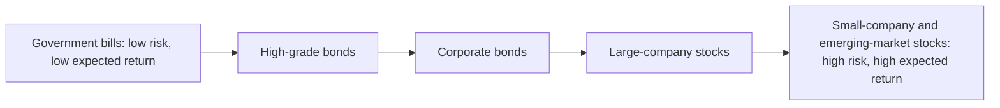

# Risk and return

**Prerequisites:** [Probability and expected value](08-probability-and-expected-value.md), [Variance and standard deviation](09-variance-and-standard-deviation.md).

*Ships in Distress in a Raging Storm, Ludolf Backhuysen, c. 1690. Credit: Ludolf Bakhuizen. License: Public domain. Source: [File:Ships in Distress in a Raging Storm c1690 Ludolf Backhuysen.jpg](https://commons.wikimedia.org/wiki/File:Ships_in_Distress_in_a_Raging_Storm_c1690_Ludolf_Backhuysen.jpg).*

Why does a savings account pay less than a share in a start-up? Because investors who take on more risk demand more expected return. The **risk–return trade-off** is the single most important empirical regularity and the main organising idea of investing.

## What "risk" means

In everyday speech risk means danger. In finance **risk** means uncertainty about the outcome, particularly the chance that the actual return differs from the expected return. An asset that always pays exactly what was promised has no risk in this sense, even if its return is low. A risky asset may pay more or less than expected.

Several kinds of risk appear in the rest of the course:

- **Market risk:** broad movements that affect nearly all assets, such as a recession or a rise in interest rates.
- **Specific (idiosyncratic) risk:** events affecting one company, such as a failed product or a fraud.
- **Credit risk:** a borrower fails to pay; see [credit risk and ratings](../03-securities/02-bonds/06-credit-risk-and-ratings.md).
- **Interest-rate risk:** bond prices fall when rates rise; see [price–yield relationship](../03-securities/02-bonds/04-the-price-yield-relationship.md).
- **Inflation risk:** the real value of a return is eroded.
- **Liquidity risk:** you cannot sell without accepting a big discount.
- **Currency risk:** a foreign asset is worth less after converting back; see [foreign exchange](../03-securities/05-alternatives/03-foreign-exchange.md).

## Risk aversion

Most investors are **risk averse**: offered a sure 100 or a coin flip paying 200 or 0 (the same expected value), they take the sure thing. To accept the gamble they need compensation, a higher expected payoff. That compensation is the **risk premium**. Bernoulli's idea that extra money brings diminishing extra satisfaction explains why. Companies do not offer to pay the premium for fun: it is the price they must pay to attract capital for uncertain projects.

## The risk-free rate and the risk premium

The benchmark is the **risk-free rate**: the return on an asset with no default risk, typically short-term government bills in the issuer's own currency. Everything else is priced as the risk-free rate plus a premium for risk:

> Expected return = risk-free rate + risk premium

The **equity risk premium** is the extra return that stocks are expected to earn over the risk-free asset. Historical studies in several countries find that stocks have, over very long periods, earned a premium over government bills, but it varies widely by period and country, and the size of the premium going forward is debated. An investor should not assume any particular figure; the point is the principle that a premium exists because risk is real. Periods such as 1929 to 1932, 2000 to 2002 or 2008 show what the risk looks like when it arrives.

## Risk and return in a picture

If you plot the risk (σ) of different asset types on the horizontal axis and their expected return on the vertical axis, they generally line up from lower-left to upper-right: government bills at the bottom, then high-quality bonds, then corporate bonds, then equities, then small or emerging-market equities. Different assets have different positions, but no asset class offers high return with low risk for long: if one did, investors would pile in and push its price up (and expected return down) until the free lunch disappeared.

## A crucial caution

"Higher risk means higher return" is a statement about *expected* returns *across* assets, not a promise. Risk means that the outcome can be worse. A high-risk asset has a higher expected return only if investors are priced properly; some risks are not compensated at all, notably the specific risk of a single company, which can be avoided for free. The [next lesson](11-correlation-and-diversification.md) explains why.

## Worked example

Suppose government bills pay 3% and a stock fund has an expected return of 8% with volatility of 16%. The expected excess return is 5%, and the return per unit of risk is 5 ÷ 16 = 0.31. This ratio, the Sharpe ratio, is covered in [measuring performance](../06-portfolio-theory/08-measuring-performance.md). Comparing it across investments tells you whether you are paid fairly for the risk you carry.

## Key ideas

- Risk is uncertainty of outcome; investors are generally risk averse and demand a premium for bearing it.
- Expected return = risk-free rate + risk premium.
- There are many kinds of risk (market, credit, interest-rate, inflation, liquidity, currency).
- The trade-off is about expected returns across assets, never a guarantee for any one.

## Where this leads

- Next: [correlation and diversification](11-correlation-and-diversification.md).
- Later: [CAPM and beta](../06-portfolio-theory/03-capm-and-beta.md), [asset allocation](../06-portfolio-theory/06-asset-allocation-and-rebalancing.md).
- Glossary: [risk](../glossary/foundations/risk.md), [risk premium](../glossary/foundations/risk-premium.md), [risk-free rate](../glossary/foundations/risk-free-rate.md), [equity risk premium](../glossary/foundations/equity-risk-premium.md).
