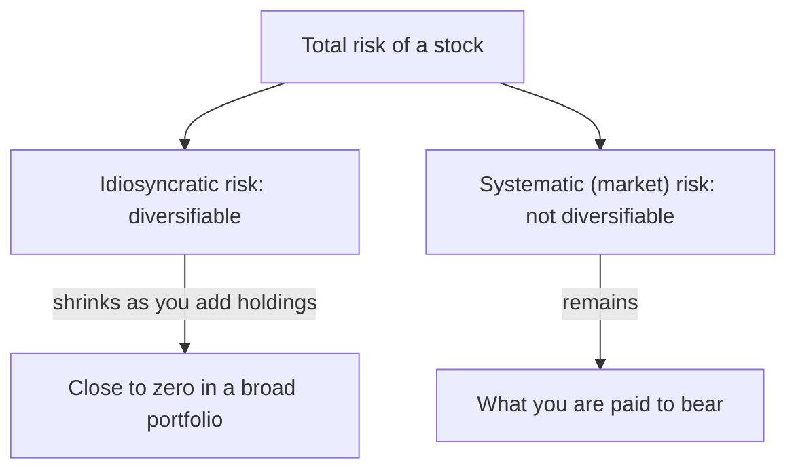

# Correlation and diversification

**Prerequisites:** [Variance and standard deviation](variance-and-standard-deviation.md), [Risk and return](risk-and-return.md).

*A marginal drawing by Hans Holbein the Younger: a scholar treads on a market woman's basket of eggs. Credit: Hans Holbein the Younger. License: Public domain. Source: [File:A Scholar Treads on a Market Woman's Basket of Eggs, marginal drawing by Hans Holbein the Younger.jpg](https://commons.wikimedia.org/wiki/File:A_Scholar_Treads_on_a_Market_Woman's_Basket_of_Eggs,_marginal_drawing_by_Hans_Holbein_the_Younger.jpg).*

"Don't put all your eggs in one basket" is an old proverb. Finance turned it into mathematics, and the result is one of the few near-free lunches in investing: combining assets can reduce risk without reducing expected return in proportion.

## Correlation

Two assets rarely move independently. The **correlation coefficient** ρ (rho) measures how closely their returns move together, on a scale from −1 to +1:

- **ρ = +1:** perfectly in step. When one rises 10%, the other rises in proportion.
- **ρ = 0:** unrelated movements.
- **ρ = −1:** perfectly opposite. One rises exactly when the other falls.

Related is **covariance**, the average product of the two assets' deviations from their means; correlation is covariance divided by the product of the two standard deviations, which rescales it to lie between −1 and +1.

## Combining two assets

Suppose two assets each have a volatility of 20%, and you put half your money in each. The portfolio's variance is

> σₚ² = w₁²σ₁² + w₂²σ₂² + 2·w₁·w₂·ρ·σ₁·σ₂

With w₁ = w₂ = 0.5 and σ₁ = σ₂ = 20%, the portfolio volatility depends only on ρ:

| Correlation ρ | Portfolio volatility |
|---|---|
| +1.0 | 20.0% |
| +0.5 | 17.3% |
| 0 | 14.1% |
| −0.5 | 10.0% |
| −1.0 | 0% |

The expected return of the portfolio is simply the average of the two expected returns, so for the same expected return you have lowered the risk. That reduction, from 20% down to 14.1% when the assets are uncorrelated, is the benefit of **diversification**, and it needs only that the correlation be below +1. With perfect negative correlation, in theory, the risk disappears completely, though real assets are never that cooperative.

## Many assets

With more assets the benefit grows, but with diminishing returns. If you hold n equally weighted assets with the same volatility and the same average pairwise correlation, portfolio variance falls toward the average covariance as n grows. The risk that can be eliminated is the **idiosyncratic risk** of individual companies: a lawsuit here, a bad harvest there. Roughly, going from one stock to 20 to 30 removes most of it, though precise numbers differ by study and period. What remains is **systematic risk**, also called market risk, shared across most assets, which cannot be diversified away within a market because every holding is exposed to the same economy.

This distinction is the heart of the next big ideas: markets compensate you only for systematic risk, because diversifiable risk can be removed at no cost, so no one needs to be paid to hold it. See [CAPM and beta](../06-portfolio-theory/03-capm-and-beta.md).

## Diversification in practice

- **Across companies:** a broad index fund holds hundreds or thousands of firms; see [index funds](../03-securities/03-funds/03-index-funds.md).
- **Across asset classes:** stocks, bonds, real estate and cash respond differently to economic conditions; see [asset allocation](../06-portfolio-theory/06-asset-allocation-and-rebalancing.md).
- **Across countries and currencies:** a single country can stagnate for decades while others grow.
- **Across time:** investing regularly smooths entry prices.

## Limits and warnings

Correlations are not constant. In a crisis, assets that normally behave differently often fall together, because investors sell everything to raise cash; correlations tend to rise exactly when you most need diversification. Holding 30 stocks from one sector is not diversified. And diversification protects against specific risk, not against the possibility that the whole market falls: the market portfolio itself lost around 85% to 90% of its value in the US between 1929 and 1932 by some measures. Diversification does not guarantee profit or prevent loss in a falling market, but it does prevent avoidable losses from a single failure.

The economist Harry Markowitz formalised this arithmetic in 1952, and it won him a share of the 1990 Nobel Memorial Prize in Economic Sciences, as covered in [portfolio return and risk](../06-portfolio-theory/01-portfolio-return-and-risk.md).

## Key ideas

- Correlation (−1 to +1) measures how assets move together; lower correlation gives greater risk reduction.
- Portfolio volatility is below the average of the components whenever ρ < 1; expected return is just the weighted average.
- Diversification removes idiosyncratic risk but not systematic market risk.
- Correlations rise in crises, so diversification is imperfect protection.

## Where this leads

- Next section: [what a company is](../02-firms-and-capital/01-what-is-a-company.md), the first step toward securities.
- Later: [portfolio theory](../06-portfolio-theory/README.md), especially [the efficient frontier](../06-portfolio-theory/02-the-efficient-frontier.md).
- Glossary: [[g:correlation|correlation]], [[g:covariance|covariance]], [[g:diversification|diversification]], [[g:systematic-risk|systematic risk]], [[g:idiosyncratic-risk|idiosyncratic risk]].
