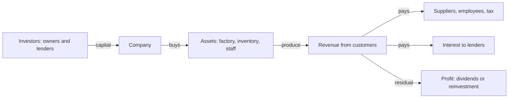

# What a company is

**Prerequisites:** [Foundations](../01-foundations/README.md), especially [credit and banking](../01-foundations/02-credit-and-banking.md).

*The East India House in Amsterdam, headquarters of the Dutch East India Company (VOC). Credit: Rijksmuseum. License: [CC0](http://creativecommons.org/publicdomain/zero/1.0/deed.en). Source: [File:Gezicht op het Oost-Indisch Huis in Amsterdam, RP-F-F19459.jpg](https://commons.wikimedia.org/wiki/File:Gezicht_op_het_Oost-Indisch_Huis_in_Amsterdam,_RP-F-F19459.jpg).*

A share of stock is a piece of a company, and a corporate bond is a loan to one. Before we study either, we need to understand the thing they are claims on. A **company** (or firm) is an organisation that combines labour, equipment, ideas and money to produce goods or services that it hopes to sell for more than they cost.

## Why firms exist

If markets work so well, why is production not just a swarm of individuals trading with each other? The economist Ronald Coase asked this in his 1937 essay "The Nature of the Firm". His answer was that using the market has costs: finding partners, negotiating, writing and enforcing contracts for every transaction. Inside a firm, a manager can direct work without re-negotiating each task. Firms exist where the cost of organising activity internally is lower than the cost of buying it on the market. Firms grow until the extra management cost of one more activity equals its market cost.

For finance, a second reason matters: **scale and risk-sharing**. Building a railway, a steelworks or an ocean-going fleet needs more capital than one person has, and the outcome is risky. A firm lets many people contribute money and share the outcome.

## Forms of business

- **Sole proprietorship:** one owner, who is personally responsible for everything. Simple, but the owner's personal wealth is exposed to the business's debts.
- **Partnership:** two or more owners who share profits and, in a general partnership, liability.
- **Corporation:** a legal entity separate from its owners, with its own rights and obligations. It can own property, sign contracts, borrow and be sued. Its owners are the **shareholders**. The corporation continues to exist even when its shareholders change, which is what makes shares tradable.

The [next lesson](02-limited-liability-and-the-corporation.md) shows how the corporation came about and why *limited liability* is so important.

## What a company does with money

Following the money round the loop clarifies a company's financial life:

1. **Raise capital** from owners (equity) and lenders (debt).
2. **Invest** it in assets: buildings, machines, inventory, software, people.
3. **Operate**: sell products and collect revenue, paying costs along the way.
4. **Distribute** the surplus: pay interest to lenders, taxes to the government, and then either pay dividends to shareholders or **retain** profits to reinvest.

The ordering in step 4 is critical. The shareholders are the **residual claimants**: they receive whatever is left after everyone else has been paid. That is why shares are riskier than loans, and why they can also be worth far more if the company does well. Lenders have a fixed claim; owners have an open-ended one.

## The goals of the firm

The standard textbook answer is that managers should maximise the value of the owners' stake. In practice, firms balance many goals, and shareholder value is only one view. Debates continue over whether companies should serve only shareholders or a wider group of stakeholders (employees, customers, communities). This course takes the narrower, financial perspective because that is the one securities prices reflect, while noting that it is a choice. For philosophical background on how to weigh competing interests, see [impartial care](../../../philosophy/concepts/ethics/impartial-care.md).

An important practical issue is the **agency problem**: managers run the firm day to day, but owners are the ones who bear the risk. Managers may pursue their own interests, such as growth for its own sake or comfortable perks. Boards of directors, executive pay tied to share prices, shareholder votes and the threat of takeover are all attempts to align interests.

## Companies and securities

Because a corporation's ownership can be split into small equal pieces and its debts into small equal loans, it can issue many identical claims to many investors. Each claim is a *security*, defined in [what a security is](07-what-is-a-security.md). The market value of all a firm's equity is its **market capitalisation**; the value of all its financing, debt plus equity, is the firm's **enterprise value** (roughly, net of cash). These two numbers will recur constantly in later lessons.

## Key ideas

- A firm combines capital, labour and ideas to produce goods or services; Coase argued firms exist because internal organisation can be cheaper than market contracting.
- Corporations are separate legal entities, which makes ownership transferable.
- Shareholders are residual claimants: paid after employees, suppliers, lenders and tax.
- Agency problems arise because managers are not the owners.

## Where this leads

- Next: [limited liability and the corporation](02-limited-liability-and-the-corporation.md), then [equity and debt](03-equity-and-debt.md).
- Later: [shares](../03-securities/01-stocks/01-what-is-a-share.md), [the Dutch East India Company](../08-history/02-the-dutch-east-india-company-and-the-first-stock-exchange.md).
- Glossary: [company](../glossary/firms-and-accounting/company.md), [corporation](../glossary/firms-and-accounting/corporation.md), [shareholder](../glossary/stocks/shareholder.md), [residual claim](../glossary/firms-and-accounting/residual-claim.md), [agency problem](../glossary/firms-and-accounting/agency-problem.md), [market capitalization](../glossary/stocks/market-capitalization.md).
