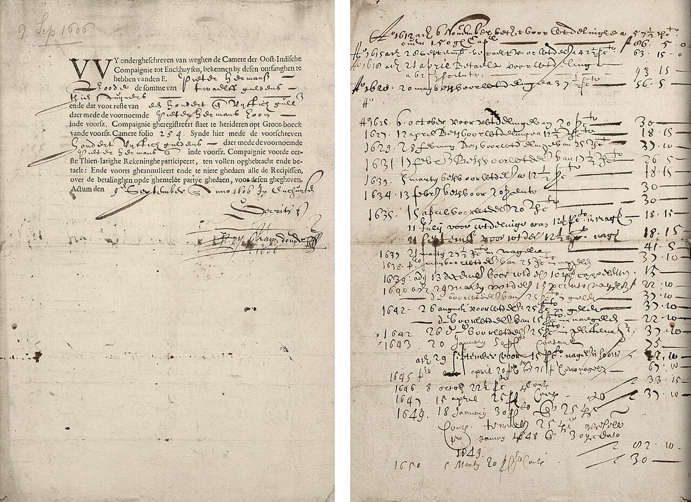
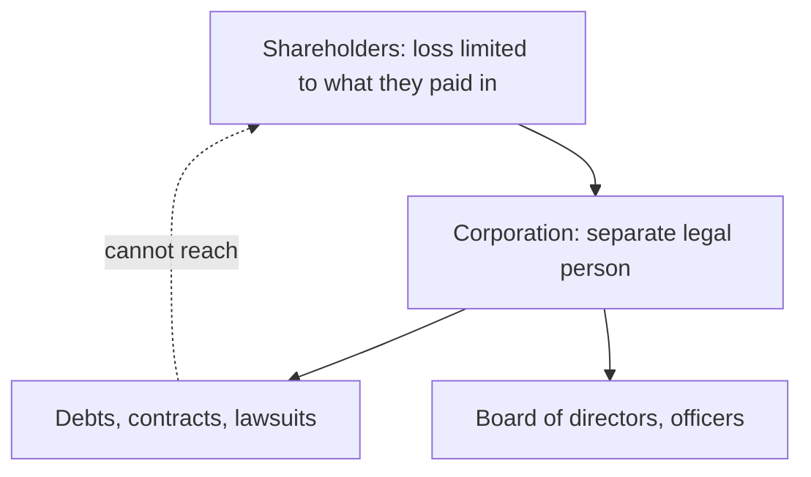

# Limited liability and the corporation

**Prerequisites:** [What a company is](what-is-a-company.md).

*A share certificate of the Dutch East India Company (VOC), 9 September 1606. Credit: VOC. License: Public domain. Source: [File:VOC aandeel 9 september 1606.jpg](https://commons.wikimedia.org/wiki/File:VOC_aandeel_9_september_1606.jpg).*

The corporation is a financial invention as much as a legal one. Its signature feature, **limited liability**, is what makes it possible for strangers to pool money in a business without risking their entire fortune. Understanding it explains why shares exist and why they can be traded freely.

## The problem it solves

Imagine a partnership trading with the East Indies. If the venture fails and owes 100,000 to creditors while the partners have only put in 20,000, in an ordinary partnership the creditors can pursue each partner's personal wealth for the balance. No sensible person would lend their savings to a stranger's business on such terms. Ventures needed either very close-knit partners or a different legal structure.

**Limited liability** means that a shareholder can lose at most what they paid for their shares. The company's debts belong to the company, not to its owners. A creditor cannot reach a shareholder's house or savings. This makes ownership of a corporation a bounded risk, comparable to buying a lottery ticket where the worst case is the loss of the ticket price. It also allows investors to hold small stakes in many companies without having to investigate each partner personally.

## Early joint-stock companies

Ventures with transferable shares existed in medieval Europe, but the model took recognisable form in the early 17th century. The English East India Company received its royal charter in 1600. The Dutch East India Company (the *Vereenigde Oostindische Compagnie*, or VOC) was chartered by the States General of the Netherlands in 1602 and is often described as the first company to issue shares to the general public and have them trade continuously on an exchange. Earlier trading ventures raised money voyage by voyage and wound up when the ships returned; the VOC's capital was initially committed for a fixed period and then effectively permanent, so investors who wanted their money back had to sell their shares to someone else. That need created the secondary market in Amsterdam. See [the VOC and the first stock exchange](../08-history/02-the-dutch-east-india-company-and-the-first-stock-exchange.md). The Hudson's Bay Company, chartered in 1670, is a Canadian example whose charter shaped much of the country's early history.

In England, the early joint-stock companies often had no strong limited liability protection by modern standards. In the 18th century, after the South Sea Bubble of 1720, Parliament restricted the formation of joint-stock companies through the Bubble Act. General limited liability for ordinary companies came in the 19th century: Britain's Limited Liability Act of 1855 and the Joint Stock Companies Act of 1856 made it routinely available, and similar general incorporation laws spread through the US states and, later, Canada. Because a company could now be created by registering rather than by obtaining a special charter, the number of corporations exploded, especially in railways, canals, mining and manufacturing.

## What incorporation means today

A corporation, once formed:

- is a separate **legal person** with its own bank account, property and contracts;
- is owned by shareholders, who elect a **board of directors**;
- is run day to day by officers (the CEO, CFO and so on) appointed by the board;
- has **perpetual existence**: it continues when owners die or sell;
- is subject to **corporate tax** on its profits, so profits can be taxed twice: once in the company and again when paid to shareholders as dividends. Many tax systems soften this, as Canada does with the dividend tax credit, discussed in [taxes on investments](../09-personal-investing-canada/06-taxes-on-investments.md).

In Canada a company can incorporate federally (under the Canada Business Corporations Act) or in a province; Ontario, for instance, has its own Business Corporations Act. Shares of a corporation can be **private** (held by a few holders, with transfer restrictions) or **public** (listed on an exchange and available to anyone). Many of the rules in the [regulation section](../05-regulation/01-why-markets-are-regulated.md) apply to public companies because they sell securities to the public.

## The costs of limited liability

Limited liability is not free. Because shareholders are shielded from loss beyond their stake, they have some incentive to take larger risks with creditors' money: if the bet pays off, shareholders keep the gain; if it fails, creditors absorb part of the loss. Lenders know this and respond with higher interest rates, covenants (restrictions written into loan contracts), security over assets, and sometimes personal guarantees from owners of small businesses. The tension between owners and lenders is a central theme of [equity and debt](equity-and-debt.md) and [capital structure](capital-structure-and-cost-of-capital.md).

There are also society-wide debates: when a corporation causes harm exceeding its assets, should the cost fall on victims, creditors or owners? Limited liability is a deliberate trade, accepted because it enables investment, but it remains a legal construction, not a law of nature.

## Key ideas

- Limited liability caps an investor's loss at the amount invested.
- Joint-stock companies such as the VOC (1602) pooled capital from many investors, and transferable shares created the need for a stock market.
- Modern general incorporation (19th century) made limited liability routine.
- Limited liability shifts some risk to creditors, who price it into loans.

## Where this leads

- Next: [equity and debt](equity-and-debt.md).
- Later: [the history of the VOC and the first stock exchange](../08-history/02-the-dutch-east-india-company-and-the-first-stock-exchange.md), [what a share is](../03-securities/01-stocks/01-what-is-a-share.md).
- Glossary: [[g:limited-liability|limited liability]], [[g:joint-stock-company|joint-stock company]], [[g:board-of-directors|board of directors]], [[g:public-company|public company]].
