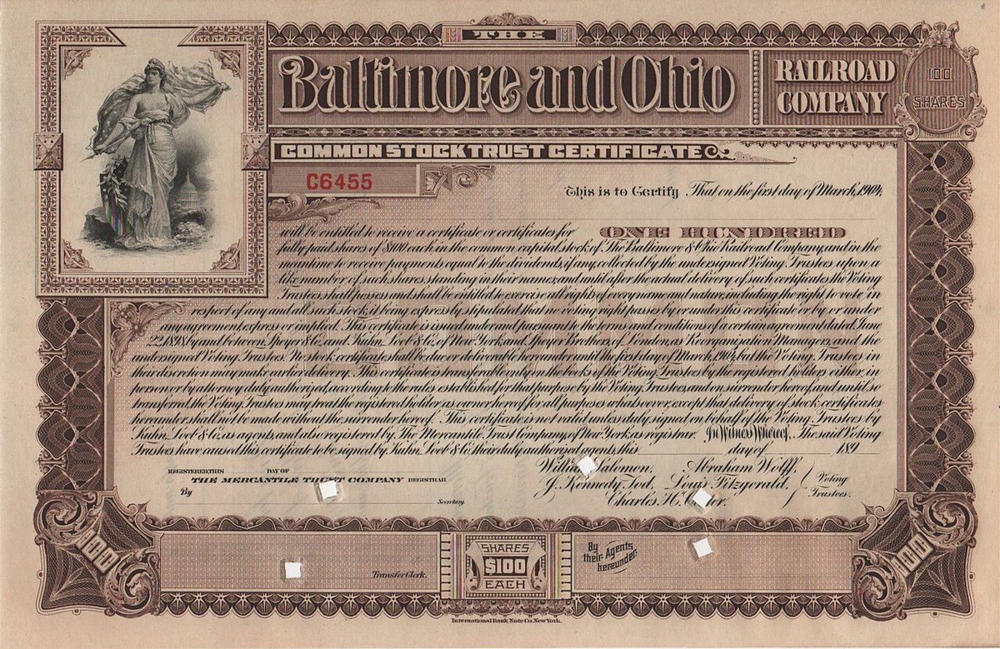
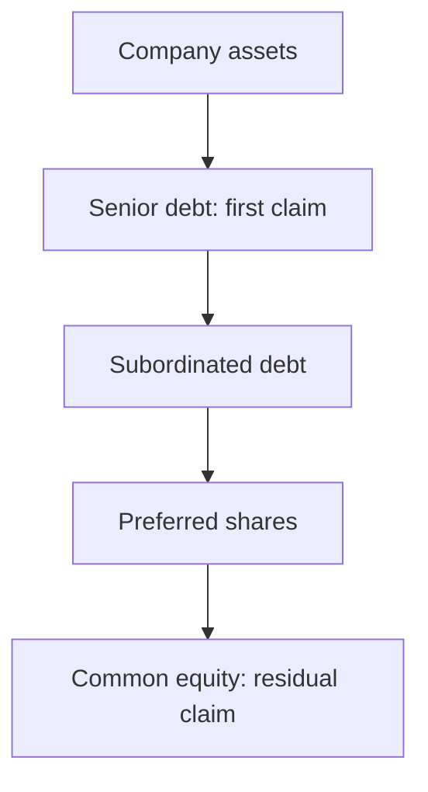

# Equity and debt

**Prerequisites:** [What a company is](01-what-is-a-company.md), [Limited liability and the corporation](02-limited-liability-and-the-corporation.md).

*A stock certificate of the Baltimore and Ohio Railroad: railroads were among the first great users of both equity and debt. Credit: Baltimore and Ohio Railroad. License: Public domain. Source: [File:Baltimore and Ohio Railroad stock certificate.jpg](https://commons.wikimedia.org/wiki/File:Baltimore_and_Ohio_Railroad_stock_certificate.jpg).*

A company raises money from outsiders in two basic ways. It can sell a share of ownership, which is **equity**. Or it can borrow, which is **debt**. Almost every security in this course is a version of one or the other, or a blend, so this is the central classification of finance.

## Debt: a fixed promise

**Debt** is a loan. The company promises to pay interest on a schedule and repay the principal at a stated time. Lenders include banks and bondholders. Key features:

- **Fixed claim.** The lender is owed a specified amount, regardless of how well the business does. A lender does not share in extraordinary success.
- **Priority.** Interest is paid before shareholders see anything, and in a liquidation, debt is repaid before equity.
- **Legal enforceability.** Missing a payment is a **default**. The lender can take legal action, seize collateral or force the firm into bankruptcy or restructuring.
- **Tax treatment.** In most tax systems, interest is deductible from a company's taxable profits, while dividends are not. This is a significant reason firms use debt.
- **Finite life.** Debt matures; the borrower must repay or refinance.

## Equity: the residual

**Equity** represents ownership. Shareholders have:

- a **residual claim** on profits and assets after all other claims are paid;
- **no guaranteed payment**: dividends are decided by the board;
- usually **voting rights** on matters such as electing directors;
- **limited liability**, but also a limit on what they can get back in distress: if the firm cannot pay its debts, equity is typically wiped out first;
- **unlimited upside**: if the firm does extremely well, all the extra goes to shareholders.

## Comparing the two

| Feature | Debt | Equity |
|---|---|---|
| Nature of claim | Fixed amount, contractual | Residual, open-ended |
| Return to holder | Interest and principal | Dividends and share-price gains |
| Order in bankruptcy | First | Last |
| Risk to holder | Lower (but not zero) | Higher |
| Expected return | Lower | Higher |
| Control | None, unless the borrower defaults | Votes for directors |
| Cost to firm | Interest, usually tax-deductible | Dividends and expected share-price gains, not deductible |
| Maturity | Fixed date | Permanent |

The relationship between risk and return follows directly from the position in the queue. Lenders accept a lower expected return because they are paid first; shareholders require a higher expected return because they absorb the shocks. That is [the risk–return trade-off](../01-foundations/10-risk-and-return.md) in action within a single company.

## An example of the priority order

A company liquidates, and its assets sell for 130. It owes 80 to a bank, 40 to bondholders (with equal claim on the remaining assets, by simplification) and has 200 in shareholder equity on its books. The bank and bondholders are paid in full (120), leaving 10 for shareholders. If the assets had sold for only 100, lenders would share 100 against claims of 120, and shareholders would get nothing. If the assets had sold for 400, lenders would still get exactly 120 and shareholders would receive 280. The lender's payoff is capped; the shareholder's is not.

The payoff is therefore like a **call option** on the firm's assets for shareholders and a bond plus a sold **put option** for lenders, an insight developed by Robert Merton in 1974 that links corporate finance to [derivatives](../03-securities/04-derivatives/03-options-calls-and-puts.md).

## Hybrids

Between pure debt and pure equity there is a spectrum:

- **Preferred shares** pay a fixed dividend and rank ahead of common shares but behind debt; see [common and preferred shares](../03-securities/01-stocks/02-common-and-preferred-shares.md).
- **Convertible bonds** are loans that the holder can swap for shares.
- **Subordinated debt** ranks below senior debt but above equity.
- **Warrants** give the right to buy shares at a set price.

## Why it matters to an investor

When you buy a bond you are lending; when you buy a share you are becoming a part-owner. Both can be issued by the same company, and which is better depends on price, risk and your goals. A company's choice of mix also affects the risk of its shares: more debt makes the equity riskier because fixed interest payments must be met before shareholders receive anything, a point developed in [capital structure and cost of capital](08-capital-structure-and-cost-of-capital.md).

## Key ideas

- Debt is a fixed contractual claim paid first; equity is the residual claim paid last.
- Higher position in the queue means lower risk and lower expected return.
- Interest is generally tax-deductible; dividends are not.
- Hybrids (preferred shares, convertibles) blend features of both.

## Where this leads

- Next: the financial statements, starting with [the balance sheet](04-the-balance-sheet.md).
- Later: [bonds](../03-securities/02-bonds/01-what-is-a-bond.md), [shares](../03-securities/01-stocks/01-what-is-a-share.md).
- Glossary: [equity](../glossary/firms-and-accounting/equity.md), [debt](../glossary/firms-and-accounting/debt.md), [default](../glossary/firms-and-accounting/default.md), [seniority](../glossary/firms-and-accounting/seniority.md), [convertible bond](../glossary/firms-and-accounting/convertible-bond.md), [collateral](../glossary/firms-and-accounting/collateral.md).
