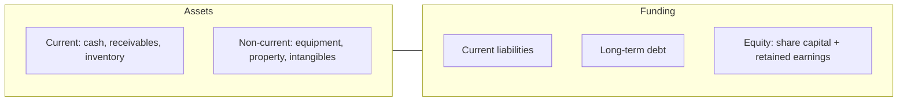

# The balance sheet

**Prerequisites:** [Equity and debt](03-equity-and-debt.md).

*Portrait of Luca Pacioli with a student, attributed to Jacopo de' Barbari, c. 1495–1500; Pacioli's 1494 Summa described double-entry bookkeeping. Credit: Jacopo de' Barbari. License: Public domain. Source: [File:Jacopo de' Barbari (attributed to) Portrait of Luca Pacioli (1445 1517) with a student (Guidobaldo da Montefeltro) (2).jpg](https://commons.wikimedia.org/wiki/File:Jacopo_de'_Barbari_(attributed_to)_Portrait_of_Luca_Pacioli_(1445_1517)_with_a_student_(Guidobaldo_da_Montefeltro)_(2).jpg).*

To value a company, you need to see what it owns, what it owes and how it earns. Three statements provide this: the balance sheet, the income statement and the cash flow statement. They are the standard language in which firms report to investors. This lesson covers the first.

## A snapshot at one date

The **balance sheet** (or statement of financial position) lists a company's **assets**, **liabilities** and **shareholders' equity** at a particular date. It rests on one identity:

> Assets = Liabilities + Equity

Everything the company owns was financed either by borrowing (liabilities) or by owners' money, including retained profits (equity). The two sides must balance, because equity is *defined* as what is left of the assets after subtracting liabilities. The identity is the logical form of the double-entry bookkeeping system, which the Franciscan friar Luca Pacioli described in his 1494 mathematics textbook *Summa de arithmetica*, drawing on practice already used by Italian merchants.

## The parts

**Assets**, usually listed in order of liquidity:

- *Current assets*, expected to turn into cash within a year: cash, accounts receivable (money customers owe), inventory.
- *Non-current assets*: property, plant and equipment; intangible assets such as patents and goodwill; long-term investments.

**Liabilities**:

- *Current liabilities*, due within a year: accounts payable (money owed to suppliers), short-term debt, accrued expenses.
- *Non-current liabilities*: long-term loans, bonds issued, lease obligations, pensions.

**Shareholders' equity**: the amount paid in by owners (share capital) plus **retained earnings**, the cumulative profits kept in the business rather than paid out.

## A worked example

Maple Bakery Ltd. reports the following at the end of its year (in thousands of dollars):

| Assets | | Liabilities and equity | |
|---|---|---|---|
| Cash | 20 | Accounts payable | 30 |
| Receivables | 15 | Bank loan | 80 |
| Inventory | 25 | **Total liabilities** | **110** |
| Equipment (net) | 140 | Share capital | 40 |
| | | Retained earnings | 50 |
| | | **Total equity** | **90** |
| **Total assets** | **200** | **Total liabilities and equity** | **200** |

The balance sheet balances: 200 = 110 + 90. The **book value of equity** is 90. Dividing it by the number of shares gives book value per share.

## Reading ratios from the balance sheet

A few simple ratios turn the statement into information:

- **Current ratio** = current assets ÷ current liabilities. For Maple: (20 + 15 + 25) ÷ 30 = 2.0. The company has two dollars of short-term assets for each dollar of short-term obligations, a measure of **liquidity**.
- **Debt-to-equity** = total debt ÷ equity = 80 ÷ 90 ≈ 0.89, a measure of **leverage**, discussed in [capital structure](08-capital-structure-and-cost-of-capital.md).
- **Equity ratio** = equity ÷ assets = 90 ÷ 200 = 45%.

## Book value versus market value

The balance sheet records many items at **historical cost** less depreciation, not at what they would fetch today. A factory bought 30 years ago may be worth far more or far less than its recorded value. More important, the balance sheet leaves out much of what makes companies valuable: brands, know-how, customer relationships and talented employees, unless they were purchased in an acquisition. So a company's **market capitalisation** can differ greatly from its book equity. The ratio of the two, price to book, is a widely watched valuation measure: see [other valuation ratios](../03-securities/01-stocks/07-other-valuation-ratios.md). For asset-heavy businesses such as banks and insurers, book value is a more reliable guide; for software firms it is a poor one.

Accounting also depends on judgments: estimating how long equipment lasts, how many receivables will never be collected, how much to set aside for lawsuits. The rules are set by standards: International Financial Reporting Standards (IFRS), which publicly accountable Canadian companies follow, or US GAAP in the United States. Auditors give an independent opinion on whether statements follow the rules, but they cannot make them certain.

## Key ideas

- The balance sheet is a snapshot: Assets = Liabilities + Equity.
- Assets and liabilities are split into current (within a year) and non-current.
- Equity includes paid-in capital and retained earnings; book value is not market value.
- Ratios such as current ratio and debt-to-equity summarise liquidity and leverage.

## Where this leads

- Next: [the income statement](05-the-income-statement.md) for performance over a period.
- Later: [other valuation ratios](../03-securities/01-stocks/07-other-valuation-ratios.md), [credit risk](../03-securities/02-bonds/06-credit-risk-and-ratings.md).
- Glossary: [balance sheet](../glossary/firms-and-accounting/balance-sheet.md), [retained earnings](../glossary/firms-and-accounting/retained-earnings.md), [book value](../glossary/firms-and-accounting/book-value.md), [current ratio](../glossary/firms-and-accounting/current-ratio.md), [leverage](../glossary/firms-and-accounting/leverage.md).
