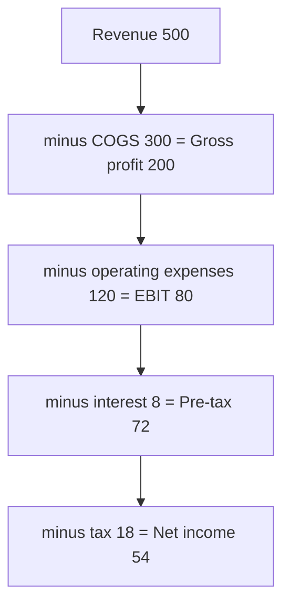

# The income statement

**Prerequisites:** [The balance sheet](04-the-balance-sheet.md).

*Jakob Fugger with his chief accountant Matthäus Schwarz, with the dossiers of his branch offices behind them (painting of 1517, Herzog Anton Ulrich Museum). Credit: 1517. License: Public domain. Source: [File:ContabilidadeFuggerkontor.jpg](https://commons.wikimedia.org/wiki/File:ContabilidadeFuggerkontor.jpg).*

If the balance sheet is a photograph, the **income statement** (profit and loss statement) is a film of one period. It reports revenue, costs and profit over a quarter or a year. For shareholders, the last line, **net income**, is what the company earned for them.

## The layout

An income statement starts at the top with sales and subtracts costs step by step, so you can see where profit is made or lost:

1. **Revenue** (sales): money earned from customers.
2. **Cost of goods sold** (COGS): direct costs of producing what was sold: materials, direct labour.
3. **Gross profit** = revenue − COGS.
4. **Operating expenses**: selling, administration, research, and **depreciation** (the allocation of the cost of equipment over its useful life).
5. **Operating income** (EBIT, earnings before interest and taxes) = gross profit − operating expenses.
6. **Interest expense** on borrowing.
7. **Pre-tax income** = EBIT − interest.
8. **Income tax.**
9. **Net income** = pre-tax income − tax. This is the profit that belongs to shareholders.

## A worked example

Maple Bakery Ltd. (the company from the [balance sheet](04-the-balance-sheet.md) lesson), in thousands:

| Line | Amount |
|---|---|
| Revenue | 500 |
| Cost of goods sold | (300) |
| **Gross profit** | **200** |
| Operating expenses (including depreciation of 20) | (120) |
| **Operating income (EBIT)** | **80** |
| Interest expense (10% on the 80 loan) | (8) |
| **Pre-tax income** | **72** |
| Income tax at 25% | (18) |
| **Net income** | **54** |

From this we can compute margins, which show how much of each dollar of sales is kept at each stage:

- Gross margin = 200 ÷ 500 = 40%
- Operating margin = 80 ÷ 500 = 16%
- Net margin = 54 ÷ 500 = 10.8%

If Maple has 10 thousand shares outstanding (a small private company, with all figures in thousands of dollars), its **earnings per share** is 54,000 ÷ 10,000 = 5.40 per share. The [earnings and EPS lesson](../03-securities/01-stocks/05-earnings-and-eps.md) pursues this.

## The accrual principle

Notice the income statement does not simply record cash in and cash out. Under **accrual accounting**, revenue is recognised when it is *earned*, and costs when they are *incurred*, whether or not cash has changed hands. If Maple delivers 20 of bread to a café on credit, the sale counts as revenue now, but the cash arrives later, as an account receivable. Similarly, buying a 100 oven does not hit the income statement all at once; its cost is spread over its life as depreciation. This matching of costs to the revenue they help produce gives a better picture of performance than raw cash, but it also allows judgment and manipulation. Profit is an opinion; cash is a fact, as the next lesson, [the cash flow statement](06-the-cash-flow-statement.md), will show. The Fugger merchant house of Augsburg, shown above with its chief accountant, kept detailed books of its far-flung branches in the early 16th century precisely to know where profit was being made.

## Interpreting an income statement

- **Growth:** compare revenue year over year. Rapid growth with falling margins may signal discounting to win sales.
- **Margins:** high gross margin businesses (software, branded goods) have more room for error than low-margin ones (grocery retail).
- **Operating leverage:** if most costs are fixed (a factory, a software team), a small change in revenue causes a large change in operating income.
- **Interest coverage** = EBIT ÷ interest. Maple's is 80 ÷ 8 = 10 times, comfortable. A ratio near 1 means almost all operating profit goes to lenders.
- **One-off items:** analysts often adjust for exceptional gains or charges to see underlying earnings, but the adjustments are themselves judgmental.

## How the two statements connect

Net income flows into the balance sheet: whatever is not paid out as dividends is added to **retained earnings**. If Maple pays dividends of 15 from net income of 54, retained earnings rise by 39. This link is why the three statements together describe the whole financial picture: the income statement explains how profit was earned, the balance sheet shows the resulting position, and the cash flow statement reconciles profit to the actual change in cash.

## Key ideas

- The income statement reports revenue, costs and profit over a period, ending in net income.
- Gross, operating and net margins show where in the cost structure profit is made or lost.
- Accrual accounting recognises revenue when earned and costs when incurred, which differs from cash flows.
- Net income less dividends adds to retained earnings on the balance sheet.

## Where this leads

- Next: [the cash flow statement](06-the-cash-flow-statement.md).
- Later: [earnings per share](../03-securities/01-stocks/05-earnings-and-eps.md), [the P/E ratio](../03-securities/01-stocks/06-the-price-to-earnings-ratio.md).
- Glossary: [income statement](../glossary/firms-and-accounting/income-statement.md), [revenue](../glossary/firms-and-accounting/revenue.md), [EBIT](../glossary/firms-and-accounting/ebit.md), [net income](../glossary/firms-and-accounting/net-income.md), [depreciation](../glossary/firms-and-accounting/depreciation.md), [accrual accounting](../glossary/firms-and-accounting/accrual-accounting.md).
