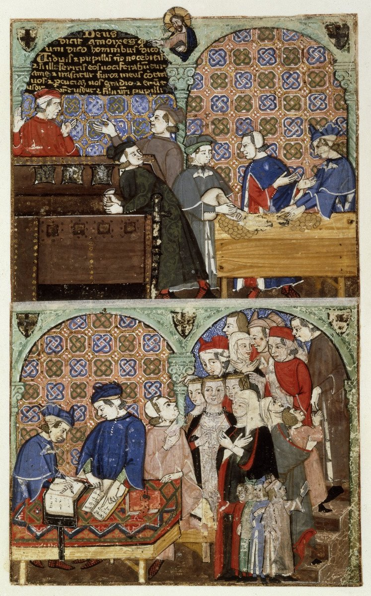
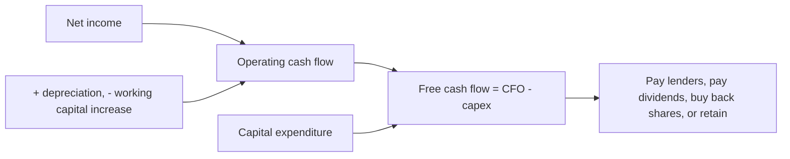

# The cash flow statement

**Prerequisites:** [The income statement](05-the-income-statement.md), [The balance sheet](04-the-balance-sheet.md).

*Counting-house scenes from a late 14th-century manuscript: cash is counted and recorded. Credit: Creator:Monk of Hyères Cibo. License: [CC0](http://creativecommons.org/publicdomain/zero/1.0/deed.en). Source: [File:Counting house scenes - Treatise on the Vices (late 14th C), f.8 - BL Add MS 27695.jpg](https://commons.wikimedia.org/wiki/File:Counting_house_scenes_-_Treatise_on_the_Vices_(late_14th_C),_f.8_-_BL_Add_MS_27695.jpg).*

A company can report a profit and still run out of money. Many businesses that failed were profitable on paper while customers paid late, inventory piled up and the bank account emptied. The **cash flow statement** reconciles accounting profit with the real change in cash, and it is the statement that valuation depends on most.

## Why cash is different from profit

Remember the accrual principle: profit counts revenue when earned and costs when incurred. Cash counts only money actually received or paid. They diverge for several reasons:

- **Non-cash expenses.** Depreciation reduces profit but no cash leaves the company that year.
- **Timing of receipts.** Sales on credit boost revenue now and cash later.
- **Timing of payments.** Inventory bought for cash is not an expense until sold.
- **Capital spending.** Buying equipment is a large cash outflow but only appears gradually as depreciation.
- **Financing.** Borrowing brings in cash without being revenue; repaying debt takes cash without being an expense.

## The three sections

The statement sorts cash movements into three groups:

1. **Operating activities (CFO):** cash generated by running the business. It starts from net income, adds back non-cash items such as depreciation, and adjusts for changes in working capital (receivables, inventory, payables).
2. **Investing activities (CFI):** purchases and sales of long-term assets: **capital expenditure** (capex), acquisitions, and investments.
3. **Financing activities (CFF):** transactions with the firm's capital providers: issuing or repaying debt, issuing or buying back shares, paying dividends.

The sum of the three is the change in cash over the period.

## A worked example

Maple Bakery Ltd., in thousands of dollars, with net income of 54 from the [income statement lesson](05-the-income-statement.md):

| Item | Amount |
|---|---|
| Net income | 54 |
| Add: depreciation (non-cash) | 20 |
| Less: increase in receivables and inventory | (10) |
| **Cash from operations** | **64** |
| Capital expenditure on new ovens | (30) |
| **Cash from investing** | **(30)** |
| Dividends paid | (15) |
| Repayment of bank loan | (5) |
| **Cash from financing** | **(20)** |
| **Net change in cash** | **+14** |

If the cash balance was 6 at the start of the year, it is 20 at the end, matching the 20 on the [balance sheet](04-the-balance-sheet.md). The three statements tie together. Notice that the company earned 54 but generated 64 in operating cash flow: depreciation of 20 was a non-cash charge, partly offset by cash tied up in working capital.

## Free cash flow

The key measure for valuation is **free cash flow** (FCF), the cash the business generates after maintaining and expanding its asset base. For Maple, a simple version is operating cash flow minus capital expenditure: 64 − 30 = 34. This 34 is what is available to pay lenders and shareholders, whether as interest, loan repayment, dividends or buybacks, or to build up cash. A common variant for valuing the whole firm, **free cash flow to the firm**, is calculated before interest: EBIT × (1 − tax rate) + depreciation − capex − increase in working capital. For Maple: 80 × 0.75 + 20 − 30 − 10 = 40.

Why does the market care so much? Because the discounted cash flow method, covered in [DCF valuation](../03-securities/01-stocks/09-discounted-cash-flow-valuation.md), says a business is worth the present value of the free cash it will generate. Earnings that never turn into cash have no value to an investor.

## Warning signs

Careful analysts compare profit and cash flow. Warning signs include:

- Net income far above operating cash flow for several years (profits "of low quality," perhaps reflecting aggressive revenue recognition).
- Receivables or inventory growing faster than sales.
- Dividends or buybacks financed by new debt rather than by free cash flow.
- A business that is perpetually negative in operating cash flow and survives by repeatedly raising money.

Growing young companies legitimately consume cash for years, so interpretation depends on the stage of the business. Still, the rule of thumb holds: in the long run, a business must produce cash.

## Key ideas

- Profit follows accrual accounting; cash flow records actual money movements.
- The statement has operating, investing and financing sections that sum to the change in cash.
- Free cash flow = operating cash flow − capital expenditure, roughly what is available to capital providers.
- Valuation is built on future free cash flow, not on reported profit.

## Where this leads

- Next: [what a security is](07-what-is-a-security.md).
- Later: [DCF valuation](../03-securities/01-stocks/09-discounted-cash-flow-valuation.md), [dividends](../03-securities/01-stocks/03-dividends.md).
- Glossary: [cash flow](../glossary/firms-and-accounting/cash-flow.md), [free cash flow](../glossary/firms-and-accounting/free-cash-flow.md), [capital expenditure](../glossary/firms-and-accounting/capital-expenditure.md), [working capital](../glossary/firms-and-accounting/working-capital.md).
