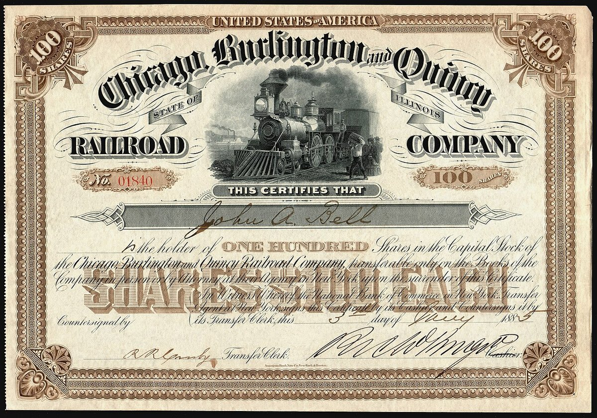
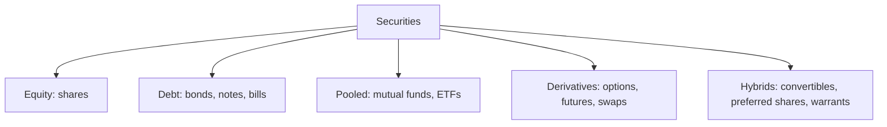

# What a security is

**Prerequisites:** [Equity and debt](equity-and-debt.md).

*A stock certificate of the Chicago, Burlington & Quincy Railroad: a security is a tradable piece of paper (now an electronic record) representing a financial claim. Credit: Issued by Chicago, Burlington and Quincy Railroad Company in 1885, reproduced from an original document by Palauenc05.. License: Public domain. Source: [File:Aktie Chicago Burlington.jpg](https://commons.wikimedia.org/wiki/File:Aktie_Chicago_Burlington.jpg).*

You are now equipped to answer the question that gives this branch its name. A **security** is a tradable financial asset: a standardised claim on cash flows or ownership that can be bought and sold. Shares, bonds, options and units of funds are all securities. The word has nothing to do with safety. It originally referred to the document serving as security (assurance) for a claim.

## From private claim to tradable instrument

A private loan from you to a neighbour is a financial claim, but it is not a security: it is specific to the two parties, difficult to value and almost impossible to sell. A security has the opposite properties. It is:

- **Standardised:** identical units, so one share of a company is the same as another.
- **Divisible:** issued in small pieces, so many investors can take part.
- **Transferable:** the claim can be sold to someone else without the issuer's involvement.
- **Documented:** its terms are written down, and the record of who owns it is reliable.
- **Priced by a market:** buyers and sellers continuously set a price.

Historically, a security was a paper certificate, such as the share certificates and bond coupons illustrated throughout this course. Today almost all securities exist as electronic entries in a ledger kept by a central depository and intermediaries, a topic in [clearing and settlement](../04-markets/07-clearing-and-settlement.md).

## The main families

- **Equity securities** represent ownership: [common and preferred shares](../03-securities/01-stocks/01-what-is-a-share.md).
- **Debt securities** represent loans: [bonds](../03-securities/02-bonds/01-what-is-a-bond.md), notes, bills.
- **Pooled securities** represent a share of a portfolio: [mutual funds and ETFs](../03-securities/03-funds/01-pooled-investing-and-mutual-funds.md).
- **Derivatives** derive their value from another asset, rate or index: [options, futures and swaps](../03-securities/04-derivatives/01-what-is-a-derivative.md).
- **Hybrids** mix features: convertible bonds, preferred shares, warrants.

Other claims, such as real estate, commodities and currencies, are not securities but can be accessed through them. For instance, you cannot hold a barrel of oil in a brokerage account, but you can hold units of a fund that does; see [alternatives](../03-securities/05-alternatives/01-real-estate-and-reits.md).

## Why securitisation matters

Making claims standardised and tradable has powerful effects:

- **Liquidity.** An investor who might need the money can sell, which makes long-term ventures easier to fund. A factory needs capital for decades, but individual investors may hold a share only for months.
- **Price discovery.** Constant trading aggregates the views of thousands of participants into a market price, which in turn guides where capital flows.
- **Risk sharing.** Risk is spread across many holders, each bearing a small part.
- **Access.** Small investors can own pieces of enterprises that would be out of reach individually.

The same process, applied to loans, produces **securitisation**: a bank bundles many mortgages, sells them to a special vehicle, and the vehicle issues securities backed by the stream of payments. This can spread risk and free up bank capital, and in 2007 and 2008 it showed how poorly understood and badly underwritten claims can transmit losses across the world; see [the 2008 crisis](../08-history/11-the-2008-financial-crisis.md).

## Securities law: a legal definition

Law has its own definition, because the question determines which investments must be registered and disclosed. In the United States, the Supreme Court's 1946 decision in *SEC v. W. J. Howey Co.* established the **Howey test**: an investment contract is a security if there is an investment of money in a common enterprise with an expectation of profits derived from the efforts of others. Canadian law has a similar approach in its *Pacific Coast Coin Exchange* decision (1978), which looked at a "common enterprise" and expectations of profit. Canadian provincial Securities Acts then define "security" broadly. The practical point is that calling an offering by a new name does not escape the rules if it economically functions as an investment contract. The regulation section covers how this plays out: [securities regulation in Canada](../05-regulation/03-securities-regulation-in-canada.md).

## Primary and secondary markets

When a company first sells a security to investors, raising new money, that is a **primary market** transaction, such as an initial public offering. When investors later trade among themselves, the transactions are in the **secondary market**, and the issuer receives nothing. Most stock-market activity is secondary, but it matters to the issuer because a liquid secondary market makes investors willing to buy in the first place. See [IPOs and the primary market](../04-markets/02-ipos-and-the-primary-market.md).

## Key ideas

- A security is a standardised, divisible, transferable and priced claim on cash flows or ownership.
- The main families are equity, debt, pooled, derivative and hybrid securities.
- Tradability creates liquidity, price discovery and risk sharing.
- The law defines "security" broadly, using tests such as Howey, to prevent evasion.

## Where this leads

- Next: [capital structure and cost of capital](capital-structure-and-cost-of-capital.md), then the [securities section](../03-securities/README.md).
- Glossary: [[g:security|security]], [[g:securitization|securitization]], [[g:liquidity|liquidity]], [[g:primary-market|primary market]], [[g:secondary-market|secondary market]].
