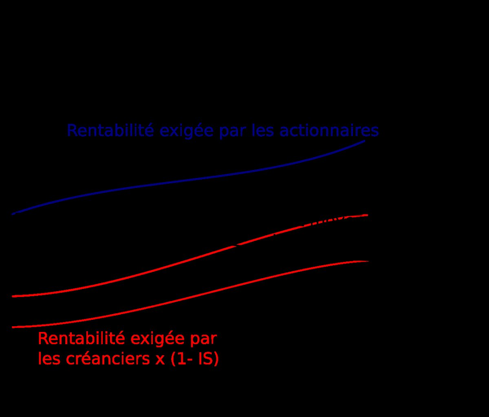
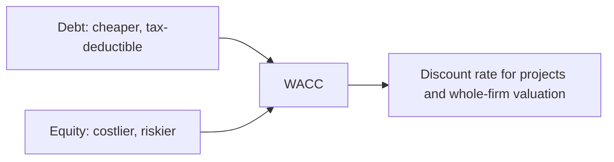

# Capital structure and cost of capital

**Prerequisites:** [Equity and debt](equity-and-debt.md), [The income statement](the-income-statement.md), [Risk and return](../01-foundations/10-risk-and-return.md).

*A diagram of the Modigliani–Miller theorem with taxes. Credit: Acrithène. License: [CC BY-SA 3.0](https://creativecommons.org/licenses/by-sa/3.0). Source: [File:Modigliani Miller 2.svg](https://commons.wikimedia.org/wiki/File:Modigliani_Miller_2.svg).*

A firm's **capital structure** is its mix of debt and equity. How much should it borrow? And what discount rate should it use when it evaluates projects or when investors value the whole firm? The answers lead to leverage, the Modigliani–Miller theorem and the weighted average cost of capital (WACC), which is the discount rate in most corporate valuations.

## Leverage: amplification in both directions

Using borrowed money to finance assets is called **leverage**. It magnifies returns on equity, up and down. Take a firm with assets of 1,000 earning an operating profit (EBIT) of 100 when things go well. Ignore taxes for simplicity.

**All-equity:** equity is 1,000, so return on equity (ROE) = 100 ÷ 1,000 = 10%.

**50% debt at 6% interest:** debt is 500, equity is 500, interest is 30. Profit to shareholders = 100 − 30 = 70, so ROE = 70 ÷ 500 = 14%.

Now suppose a bad year in which EBIT falls to 40 (a 4% return on assets):

- All-equity ROE = 40 ÷ 1,000 = 4%.
- Levered ROE = (40 − 30) ÷ 500 = 2%.

And if EBIT falls to 20, the unlevered firm earns 2% but the levered firm earns (20 − 30) ÷ 500 = −2%, and it still must find the interest payment. As long as the firm earns more on its assets than the cost of debt, leverage boosts the shareholders' return; when it earns less, leverage hurts disproportionately. Debt makes equity **riskier**, so shareholders demand a higher expected return on a levered firm. Leverage also creates the possibility of **financial distress**: if the firm cannot pay its interest, lenders can force it into bankruptcy.

## The Modigliani–Miller theorem

In 1958, Franco Modigliani and Merton Miller proved a surprising result. In a perfect world with no taxes, no bankruptcy costs and no information gaps, **the value of a firm does not depend on how it is financed**. The intuition: the value of a business comes from the cash flows its assets generate. Splitting those cash flows into a debt slice and an equity slice is like cutting a pizza into more or fewer pieces: the total pizza is unchanged. Cheaper debt financing is exactly offset by the higher required return on riskier equity, so the overall cost of capital is the same.

In the real world, the theorem fails in interesting ways, and the failures explain actual capital structures:

- **Taxes.** Interest is generally tax-deductible, so debt gives a "tax shield" that raises firm value. Modigliani and Miller's 1963 correction recognised this.
- **Costs of financial distress.** Bankruptcy is expensive: legal fees, lost customers and suppliers, forced sales.
- **Agency costs.** Debt disciplines managers (they must generate cash to pay interest), but a highly indebted firm may be tempted to take risks at lenders' expense.
- **Information.** Managers know more about the firm than outsiders, so the choice of financing can signal something.

The **trade-off theory** says firms balance the tax benefit of debt against the expected cost of distress, arriving at an optimal ratio. Firms with stable, tangible assets (utilities, real estate) usually carry more debt than firms with volatile profits and mostly intangible assets (early-stage technology).

## Cost of debt and cost of equity

- The **cost of debt** is the interest rate the firm pays on new borrowing. After tax it is lower: r_d × (1 − tax rate).
- The **cost of equity** is the return shareholders require. It cannot be read from a contract. It is estimated using models, most famously the Capital Asset Pricing Model; see [CAPM and beta](../06-portfolio-theory/03-capm-and-beta.md).

## Weighted average cost of capital

If a firm has both kinds of financing, its overall required return is a blend, weighted by the market values of each:

> WACC = (E ÷ V) × r_e + (D ÷ V) × r_d × (1 − T)

where E is the market value of equity, D the market value of debt, V = E + D, r_e the cost of equity, r_d the pre-tax cost of debt, and T the tax rate.

Example: equity of 600 with a required return of 10%, debt of 400 at 5% before tax, tax rate 25%. WACC = 0.6 × 10% + 0.4 × 5% × 0.75 = 6% + 1.5% = 7.5%. A project with a risk similar to the firm's should be accepted only if its expected return exceeds 7.5%, and the firm's projected free cash flows are discounted at 7.5% when valuing the whole business, as in [DCF valuation](../03-securities/01-stocks/09-discounted-cash-flow-valuation.md).

WACC is not a fixed fact. It depends on estimates of the cost of equity and the target mix, and small changes alter valuations noticeably. Divisions or projects with different risk should be discounted at rates that reflect their own risk, not the company average.

## Key ideas

- Leverage magnifies equity returns and risk; the amplification works in both directions.
- Modigliani–Miller: with perfect markets, financing mix does not change firm value; taxes, distress costs and agency problems make it matter in practice.
- Cost of equity exceeds cost of debt because equity is riskier.
- WACC blends the after-tax cost of debt and cost of equity by market-value weights and is the usual discount rate for firm valuation.

## Where this leads

- Next: the [securities section](../03-securities/README.md), starting with [what a share is](../03-securities/01-stocks/01-what-is-a-share.md).
- Later: [discounted cash flow valuation](../03-securities/01-stocks/09-discounted-cash-flow-valuation.md), [CAPM and beta](../06-portfolio-theory/03-capm-and-beta.md).
- Glossary: [[g:wacc|WACC]], [[g:cost-of-equity|cost of equity]], [[g:cost-of-debt|cost of debt]], [[g:modigliani-miller|Modigliani–Miller]], [[g:tax-shield|tax shield]].
