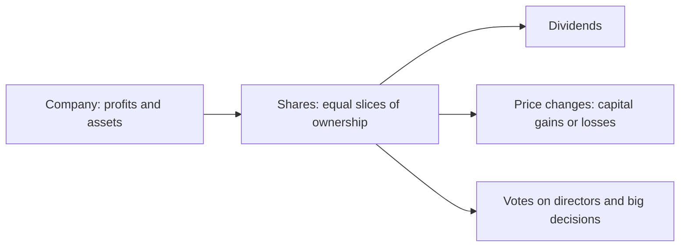

# What a share is

**Prerequisites:** [Equity and debt](../../02-firms-and-capital/03-equity-and-debt.md), [What a security is](../../02-firms-and-capital/07-what-is-a-security.md).

*The courtyard of the Old Exchange (Beurs) in Amsterdam after 1668, painted by Job Berckheyde, where shares of the Dutch East India Company were traded. Credit: Job Adriaenszoon Berckheyde. License: Public domain. Source: [File:Berckheyde, Job Adriaensz.—Binnenplaats van de Oude Beurs te Amsterdam na 1668—c.1670—Museum Boijmans Van Beuningen—1043 (OK)—WD item Q19924911.jpg](https://commons.wikimedia.org/wiki/File:Berckheyde,_Job_Adriaensz.—Binnenplaats_van_de_Oude_Beurs_te_Amsterdam_na_1668—c.1670—Museum_Boijmans_Van_Beuningen—1043_(OK)—WD_item_Q19924911.jpg).*

A **share** (also called a stock or an equity) is one of the equal units into which a corporation's ownership is divided. Owning a share makes you a part-owner of the company, with a claim on its profits and assets proportional to your stake. The collective term for all of a company's shares is its **equity** or **stock**; "shares" and "stocks" mean the same thing in everyday use.

## What a shareholder gets

Owning shares gives a bundle of rights, which vary with the class of share and the country, but typically include:

- **A residual claim on earnings.** The board may pay part of the profits as dividends; the rest is retained and, if invested well, raises the value of the company and so of each share.
- **A residual claim on assets.** If the company is wound up, shareholders receive what remains after all creditors are paid.
- **Voting rights.** Usually one vote per share on electing directors, approving mergers and other major decisions. Many companies also have a **dual-class** structure in which some shares carry more votes, which is common in Canada and the United States among founder-controlled firms.
- **Information rights.** A public company must send shareholders annual reports and notice of meetings.
- **Limited liability.** You cannot lose more than your investment.
- **The right to sell.** In a public company the shares can be sold on an exchange without the company's permission.

Notice what a shareholder does *not* own: the company's assets directly. The assets belong to the corporation, a legal person; the shareholder owns shares in the corporation. A shareholder cannot walk into the factory and take a machine, and the company is not obliged to pay a dividend.

## Counting the pieces

A company's **shares outstanding** are those held by investors. Authorised shares are the maximum the charter allows, and treasury shares are those the company has bought back. Multiplying the share price by shares outstanding gives the **market capitalisation**, the market's valuation of the equity.

Example: a company has 100 million shares outstanding, trading at 25 each. Its market capitalisation is 100 million × 25 = 2.5 billion. If you buy 1,000 shares for 25,000, you own 1,000 ÷ 100,000,000 = 0.001% of the company. Your stake is tiny, but the proportional claims are real: 0.001% of the profits, of any dividend, of the votes.

Size categories are common in practice. Market capitalisation is often used to label **large-cap**, **mid-cap** and **small-cap** stocks, with thresholds that vary by index provider and over time.

## Where shares came from

The VOC issued some of the best-known early shares, as in [the Dutch East India Company story](../../08-history/02-the-dutch-east-india-company-and-the-first-stock-exchange.md). Shares in 17th-century Amsterdam were traded in and around the Old Exchange (Beurs), which is depicted above. Many other early share markets grew up around chartered companies and then around railways and canals. Today most shares are recorded electronically, and investors hold them through a broker, with the broker's records and the central depository showing who owns what. Most Canadian equities are listed on the [Toronto Stock Exchange (TSX)](../../04-markets/01-what-an-exchange-does.md) or smaller exchanges, and US stocks on the New York Stock Exchange or Nasdaq.

## Why companies issue shares

- **To raise capital** without taking on debt or interest obligations. Equity is permanent, so there is no repayment date.
- **To provide liquidity** to founders and early investors, who can sell some holdings.
- **To pay for acquisitions** or compensate employees with shares or options.
- **To gain credibility and visibility** as a listed company.

The price of equity capital is high, though: shareholders expect a higher return than lenders because of the greater risk, and existing owners are **diluted** when new shares are issued. If you own 10% of a company and it issues new shares equal to the existing number, you now own 5% of the larger company, though the company also has more money.

## Why investors buy shares

Over long periods, stocks have historically been the asset class with the highest expected return among the major categories, with matching risk. The return comes from two sources: **dividends** and **capital gains** (price increase), together called **total return**. Over the very long run, dividends reinvested have provided a large fraction of the total, but the proportions vary by period and by market. The return is not guaranteed: share prices can fall sharply and for long periods, and a company can fail, leaving its shares worthless.

## Key ideas

- A share is a unit of ownership in a corporation: a residual claim on profits and assets, voting rights and limited liability.
- Market capitalisation = share price × shares outstanding.
- New issuance dilutes existing holders; buybacks do the reverse.
- Total return = dividends + price change; neither is guaranteed.

## Where this leads

- Next: [common and preferred shares](02-common-and-preferred-shares.md), then [dividends](03-dividends.md).
- Related: [the corporation](../../02-firms-and-capital/02-limited-liability-and-the-corporation.md), [IPOs](../../04-markets/02-ipos-and-the-primary-market.md).
- Glossary: [[g:share|share]], [[g:shares-outstanding|shares outstanding]], [[g:market-capitalization|market capitalization]], [[g:dilution|dilution]], [[g:total-return|total return]], [[g:dual-class-shares|dual-class shares]].
