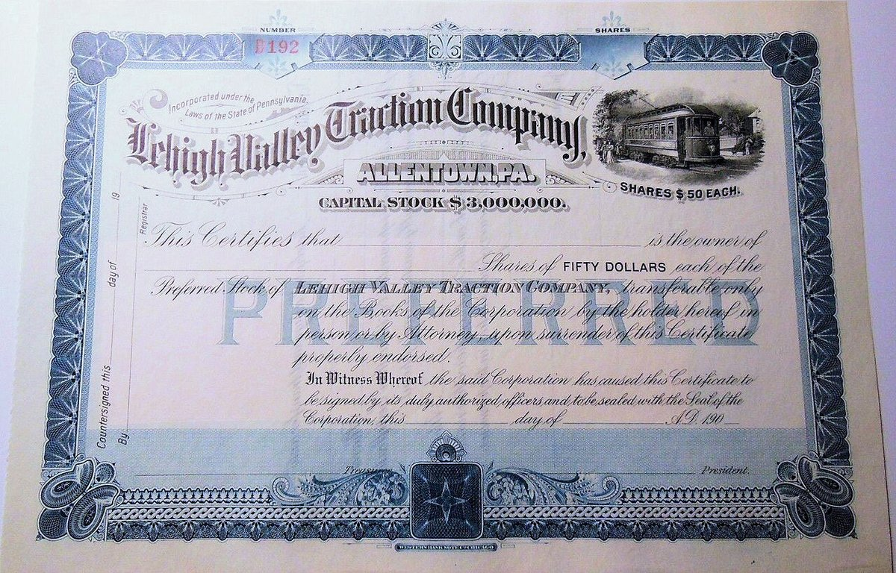
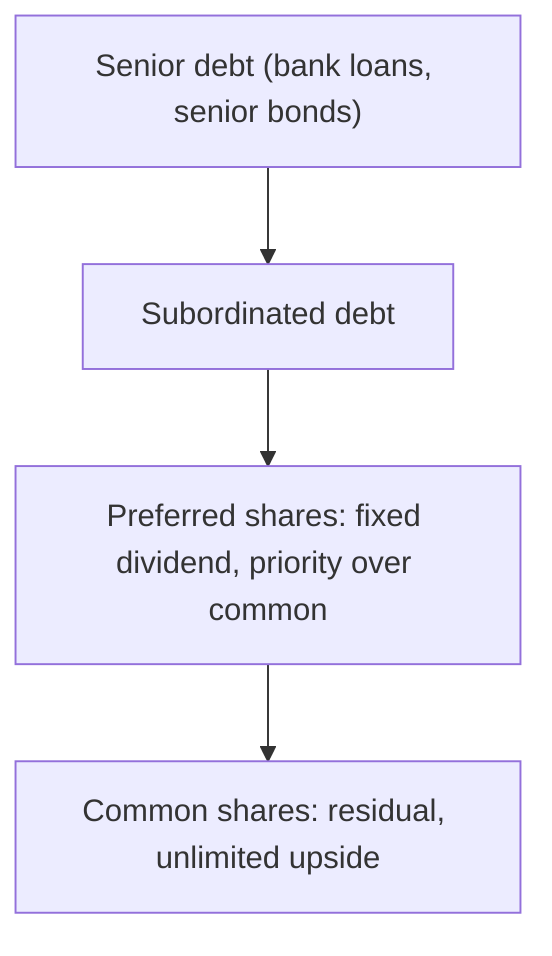

# Common and preferred shares

**Prerequisites:** [What a share is](01-what-is-a-share.md).

*A preferred stock certificate of the Lehigh Valley Traction Company, 1900. Credit: Unknown authorUnknown author. License: Public domain. Source: [File:1900 - Lehigh Valley Traction Company Preferred Stock Certificate Allentown PA.jpg](https://commons.wikimedia.org/wiki/File:1900_-_Lehigh_Valley_Traction_Company_Preferred_Stock_Certificate_Allentown_PA.jpg).*

Companies can issue more than one **class** of shares, with different rights. The two broad kinds are **common** and **preferred**. Most investors mean common shares when they say "stock", but preferred shares are an important hybrid that sits between debt and equity.

## Common shares

**Common shares** carry the standard residual claim. Their holders vote, receive dividends only if the board declares them, and share in whatever remains after all other claims have been met. The upside is unlimited, as with any equity, and the downside is the loss of the entire investment. Common shares are the most volatile claim on the firm and have the highest expected return.

## Preferred shares

**Preferred shares** ("prefs") have priority over common shares for dividends and in liquidation, in exchange for giving up some of the upside. Typical features:

- **Fixed dividend.** Often a stated percentage of a par (face) value, such as 5% of 25 = 1.25 per share per year.
- **Priority.** Preferred dividends must be paid before any common dividends. In liquidation, preferred holders rank above common but below creditors.
- **Limited or no voting rights**, unless the dividend is missed.
- **Cumulative** or **non-cumulative.** If a company skips a dividend on cumulative preferred, the unpaid amount accumulates and must be paid before common holders can get anything; non-cumulative preferreds do not.
- **Callable.** The issuer may be able to redeem the shares at a stated price after a certain date.
- **Convertible** into common shares at a set ratio, in some cases.
- **Rate-reset** features, common in Canadian preferred shares: after an initial period, the dividend resets to a spread over a government bond yield, which makes the price sensitive to interest-rate moves.

Because they pay a fixed amount with no maturity, plain preferred shares look like a perpetuity. A preferred paying 1.25 a year that investors price to yield 5.5% is worth 1.25 ÷ 0.055 = 22.73, using the [perpetuity formula](../../01-foundations/06-annuities-and-perpetuities.md). If market yields rise to 6.5%, the price falls to 1.25 ÷ 0.065 = 19.23, so preferred prices, like bond prices, move opposite to interest rates.

## Where preferred sits in the capital stack

Preferred shares are riskier than bonds, because dividends can legally be skipped without a default and they rank below debt, but less risky than common shares. Their price risk is mostly interest-rate and credit risk rather than business upside. In Canada, banks and insurers are major issuers because certain preferred shares count as regulatory capital. Dividends on Canadian preferred shares of Canadian corporations generally qualify for the dividend tax credit, which is attractive to some investors outside registered accounts; see [taxes on investments](../../09-personal-investing-canada/06-taxes-on-investments.md).

## Other classes and rights

- **Dual-class and multiple-voting shares.** A founder keeps control by holding shares with ten votes each while the public holds shares with one vote. Supporters say it allows long-term thinking; critics say it entrenches management and weakens accountability. Index providers and investors have debated how to treat such shares.
- **Restricted voting shares**, **non-voting shares** and **tracking stocks** appear in various jurisdictions.
- **Employee shares** and **stock options** align staff with owners but can dilute existing holders.

## Common versus preferred: who should hold what

A conservative investor seeking income may value the steady dividends of preferred shares, accepting limited upside. A growth investor wants the unlimited upside of common shares. The risks differ: preferred prices usually fall when interest rates rise or when the issuer's credit weakens, and common prices fall with business prospects and market sentiment. Both can lose value, and neither is guaranteed, which is why they must be compared by yield, risk and tax treatment.

## Key ideas

- Common shares: voting, residual claim, unlimited upside, highest risk.
- Preferred shares: priority dividends and liquidation claim, usually fixed, limited upside, hybrid of debt and equity.
- Preferred price ≈ dividend ÷ required yield, so it moves opposite to interest rates.
- Dual-class structures separate cash-flow rights from voting control.

## Where this leads

- Next: [dividends](03-dividends.md).
- Related: [equity and debt](../../02-firms-and-capital/03-equity-and-debt.md), [annuities and perpetuities](../../01-foundations/06-annuities-and-perpetuities.md).
- Glossary: [[g:common-share|common share]], [[g:preferred-share|preferred share]], [[g:cumulative-preferred|cumulative preferred]], [[g:par-value|par value]], [[g:callable|callable]], [[g:capital-stack|capital stack]].
