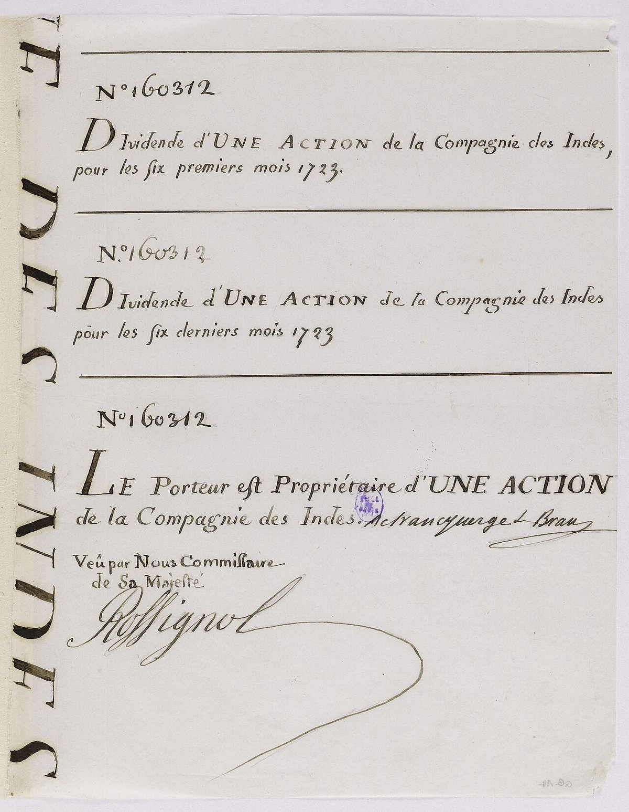
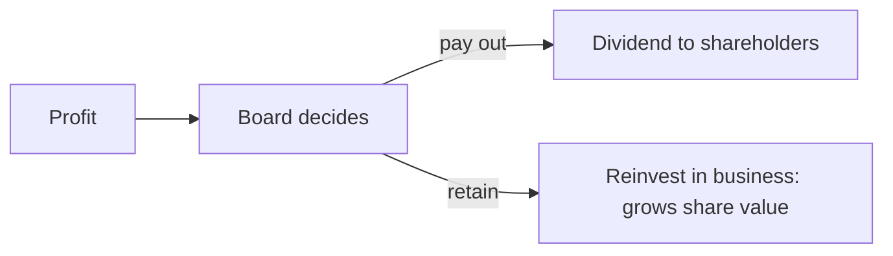

# Dividends

**Prerequisites:** [What a share is](01-what-is-a-share.md), [The cash flow statement](../../02-firms-and-capital/06-the-cash-flow-statement.md).

*Detachable dividend coupons of a share of the French Compagnie des Indes, 1723. Credit: Compagnie des Indes, autorité émettrice. License: [CC0](http://creativecommons.org/publicdomain/zero/1.0/deed.en). Source: [File:Coupons de dividendes d'une action (trois parties), Compagnie des Indes, n° 160312, 1723, GB14.jpg](https://commons.wikimedia.org/wiki/File:Coupons_de_dividendes_d'une_action_(trois_parties),_Compagnie_des_Indes,_n°_160312,_1723,_GB14.jpg).*

A **dividend** is a distribution of a company's profits to its shareholders. It is the original reason people bought shares: the VOC paid dividends, and early railway shares were prized for their yield. Dividends are how a company gives cash back to owners without requiring them to sell their holding.

## How a dividend works

A dividend is declared by the board of directors, usually as a fixed amount per share, and paid in cash, typically each quarter in North America. The sequence of dates matters for who gets paid:

1. **Declaration date:** the board announces the amount and dates.
2. **Ex-dividend date:** the first day on which a buyer of the share does *not* receive the upcoming dividend. In US and Canadian markets, which moved to T+1 settlement in May 2024, the ex-dividend date is generally the same as the record date.
3. **Record date:** shareholders on the company's books on this date are entitled to the dividend.
4. **Payment date:** the cash is paid.

On the ex-dividend date, the share price tends to fall by roughly the dividend amount, because the buyer is no longer entitled to it. This is not a loss: the shareholder has the cash in place of the extra share value. A share at 40 that pays 0.50 might open at about 39.50 on the ex-date, all else equal.

Other forms exist: **stock dividends** (extra shares instead of cash), **special dividends** (one-time, often large), and **dividend reinvestment plans** (DRIPs), which automatically use the cash to buy more shares, often without commission.

## Measuring dividends

- **Dividend per share (DPS):** total dividends ÷ shares outstanding.
- **Dividend yield:** annual dividend ÷ share price. A share at 40 with quarterly dividends of 0.50 pays 2.00 a year, a yield of 2.00 ÷ 40 = 5.0%.
- **Payout ratio:** dividends ÷ net income. If earnings per share are 3.20 and the dividend is 2.00, the payout ratio is 62.5%. A very high payout ratio may signal a dividend that is hard to sustain.

A high yield is not necessarily good. It can mean a depressed price because the market expects a cut. Yield rises when the price falls, so a collapsing share can look attractive on yield right until the dividend is cut.

## Why companies pay (or don't)

The Modigliani–Miller argument, applied to dividends in 1961 by Miller and Modigliani, says that in a perfect market, dividend policy is irrelevant to firm value: a dollar paid out is a dollar of value that has left the share price, and a shareholder wanting cash could sell a few shares instead. In practice, the choice reflects:

- **Maturity.** Mature, cash-rich businesses (utilities, banks, consumer staples) tend to pay steady dividends. Young growth firms keep profits to reinvest and often pay none.
- **Signalling.** Raising a dividend signals management confidence; cutting one signals trouble. Managers are reluctant to cut, so dividends are "sticky" and smoother than earnings.
- **Discipline.** Paying out cash restrains managers from wasting it on poor projects.
- **Taxes.** Dividends and capital gains are taxed differently, which may favour one or the other depending on the investor's situation.
- **Investor preference.** Some investors need income and prefer payments; a retiree may find dividends convenient, though selling shares can produce the same cash flow.

## Dividends and total return

Total return = dividend yield + price appreciation. A stock yielding 3% whose price grows 5% has a total return of about 8%. Reinvested dividends compound, which is why long-term returns of indices are often quoted as **total return** indices, with dividends reinvested, versus **price** indices that ignore them. In the [Dow Jones](../../04-markets/06-market-indices.md) and the S&P 500, the price index understates what an investor actually earned. A reinvestment example: 1,000 invested in a share yielding 3% with prices flat produces 30 of dividends the first year; reinvested, these buy more shares which pay further dividends, and after 20 years the 3% yield alone grows the holding to 1,000 × 1.03^20 = 1,806 even with no price growth.

## Canadian context

Canada has a long tradition of dividend-paying banks, utilities, pipelines and telecoms. For individuals, dividends from Canadian corporations get preferential tax treatment through the **gross-up and dividend tax credit** system, which differs for "eligible" and "non-eligible" dividends. The effect is that, in a non-registered account, Canadian dividends are usually taxed more lightly than interest income at the same level of income. Inside a TFSA, RRSP or FHSA the tax credit has no value, which matters for asset location; see [registered and non-registered accounts](../../09-personal-investing-canada/02-registered-and-non-registered-accounts.md). Dividends from foreign companies are generally taxed as ordinary income and may face withholding tax.

## Key ideas

- A dividend is a cash distribution of profits, declared by the board; there is no obligation to pay common dividends.
- The ex-dividend date determines who receives the dividend; the price drops by about the dividend on that date.
- Yield = dividend ÷ price; payout ratio = dividends ÷ earnings. High yield can signal risk.
- Dividend policy involves signalling, discipline, taxes and the stage of the business.

## Where this leads

- Next: [buybacks and stock splits](04-buybacks-and-stock-splits.md), the other way of returning cash and adjusting share counts.
- Related: [the dividend discount model](08-the-dividend-discount-model.md), [taxes on investments](../../09-personal-investing-canada/06-taxes-on-investments.md).
- Glossary: [[g:dividend|dividend]], [[g:dividend-yield|dividend yield]], [[g:payout-ratio|payout ratio]], [[g:ex-dividend-date|ex-dividend date]], [[g:drip|DRIP]], [[g:dividend-tax-credit|dividend tax credit]].
