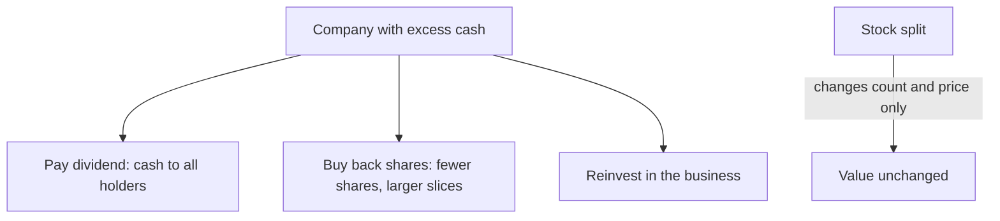

# Buybacks and stock splits

**Prerequisites:** [What a share is](01-what-is-a-share.md), [Dividends](03-dividends.md).

*A pizza: cutting it into more slices does not change how much pizza there is, which is the logic of a stock split. Credit: igorovsyannykov. License: [CC0](http://creativecommons.org/publicdomain/zero/1.0/deed.en). Source: [File:Pizza-3007395.jpg](https://commons.wikimedia.org/wiki/File:Pizza-3007395.jpg).*

Companies change their share counts for two quite different reasons. A **stock split** changes the number of shares without changing anything real. A **buyback** (share repurchase) spends cash to retire shares and is, economically, a second way of paying out profits.

## Stock splits

In a **stock split**, each existing share is exchanged for several new ones. In a 2-for-1 split, a holder of 100 shares worth 80 each (8,000 total) ends up with 200 shares worth 40 each (still 8,000). The company's value, the holder's wealth and the ownership percentage are all unchanged, as if a pizza were cut into 16 slices instead of 8. A **reverse split** goes the other way: 1-for-10 merges ten shares into one, raising the price per share, which is often done by troubled firms to avoid delisting minimum-price rules.

If nothing real changes, why bother?

- **Affordability and liquidity.** A very high price per share might be inconvenient for small orders (though fractional shares now blunt this), and many companies prefer a price in a familiar range.
- **Signalling.** A split often follows a long rise in the price and is read as management confidence.
- **Employee compensation.** A lower price makes option grants easier to size.
- **Tradition and index weights.** In price-weighted indices such as the Dow Jones Industrial Average, the share price itself matters; see [market indices](../../04-markets/06-market-indices.md).

Data providers adjust historical prices for splits so a chart does not show a false crash. The mechanics are cosmetic, but the **ex-split date** and the changed price are worth watching on your statements.

## Buybacks

In a **share buyback**, a company uses its cash to buy its own shares, usually on the open market, and typically retires them or holds them as treasury shares. The company's ownership is now divided among fewer shares, so each remaining share represents a larger slice.

An example: a company earns 500 million with 100 million shares, so earnings per share (EPS) are 5.00. The shares trade at 100, a P/E of 20. The company spends 1 billion to repurchase 10 million shares. If earnings are unchanged (ignoring the small interest the cash would have earned), EPS rises to 500 ÷ 90 = 5.56, an increase of 11%. If the market continues to value the firm at 20 times earnings, the share price should rise toward 111.

This arithmetic is why buybacks are popular, and also why they are controversial. The EPS increase is real for the remaining shareholders only if the price paid was fair. Buying back stock at 100 when it is worth 70 transfers value from remaining holders to those who sell. Buying when it is worth 150 does the opposite. Buybacks in boom times, at high prices, have often destroyed value, and some companies have borrowed to buy back shares just before a downturn.

## Buybacks versus dividends

Both distribute cash, but they differ:

| Feature | Dividend | Buyback |
|---|---|---|
| Who receives cash | All shareholders | Only those who sell |
| Tax | Taxed when received | Taxed only on capital gains when you sell |
| Flexibility | Cuts are punished by the market | Easy to pause |
| Signal | Steady, committed | Opportunistic, often considered less binding |
| Effect on share count | None | Reduced |

Buybacks became far more common in the United States after a 1982 SEC rule (Rule 10b-18) gave companies a safe harbour for repurchases. Canadian companies conduct **normal course issuer bids** (NCIBs) under exchange rules, which cap the number of shares that can be bought. In many tax systems, buybacks have a tax advantage: shareholders who do not sell defer tax, and those who do sell pay at capital-gains rates instead of dividend rates. Critics argue that buybacks can be used to inflate EPS-based executive pay and to prop up prices; defenders say that when a company cannot invest all its cash profitably, returning it to shareholders is efficient, since shareholders can reinvest it elsewhere. Both views can be right in different cases.

## Why the distinction matters when you analyse a stock

- When valuing a share, look at **total shareholder yield**: dividends plus net buybacks (buybacks minus new issuance) relative to market cap. Some companies issue as many new shares to employees as they repurchase, so the net share count never falls.
- Compare per-share measures (EPS, dividends per share) over time only after adjusting for splits and for changes in the share count.
- Treat "the stock fell 50%" with caution if a 2-for-1 split just occurred.

## Key ideas

- A stock split divides shares into more pieces without changing value; a reverse split does the reverse.
- A buyback reduces the share count and returns cash to those who sell; it raises EPS mechanically.
- Whether a buyback helps remaining holders depends on the price paid relative to value.
- Judge a company's payout by dividends plus net buybacks, and use split-adjusted data.

## Where this leads

- Next: [earnings and EPS](05-earnings-and-eps.md).
- Related: [dividends](03-dividends.md), [other valuation ratios](07-other-valuation-ratios.md).
- Glossary: [[g:stock-split|stock split]], [[g:reverse-split|reverse split]], [[g:share-buyback|share buyback]], [[g:treasury-stock|treasury stock]], [[g:normal-course-issuer-bid|normal course issuer bid]].
