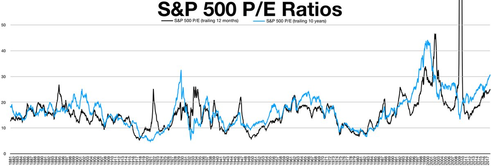
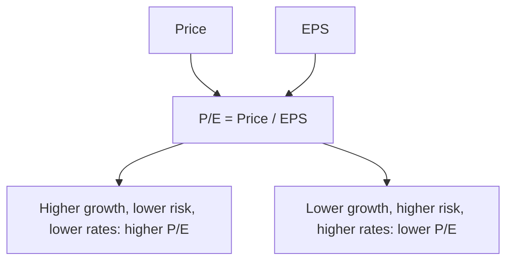

# The price-to-earnings ratio

**Prerequisites:** [Earnings and earnings per share](05-earnings-and-eps.md).

*The cyclically adjusted price-to-earnings (Shiller P/E) ratio of the S&P 500 over time. Credit: Wikideas1. License: [CC0](http://creativecommons.org/publicdomain/zero/1.0/deed.en). Source: [File:S&P 500 Shiller P-E Ratio.png](https://commons.wikimedia.org/wiki/File:S&P_500_Shiller_P-E_Ratio.png).*

The **price-to-earnings ratio**, or P/E, is the best-known shorthand for how expensive a share is. It answers a simple question: how many dollars are investors paying for each dollar of annual earnings?

> P/E = share price ÷ earnings per share

A share at 50 with EPS of 2.50 has a P/E of 20. Equivalently, the company's market capitalisation is 20 times its annual net income. Investors are paying 20 for each 1 of current profit.

## The earnings yield

Inverting the ratio gives the **earnings yield**: EPS ÷ price = 2.50 ÷ 50 = 5%. This puts stocks on the same footing as bonds. If a bond yields 4% and a share's earnings yield is 5%, the share offers a higher "yield" in the sense of earnings per dollar invested, but with risk that earnings may fall and the possibility that they may grow. A low P/E corresponds to a high earnings yield, and a high P/E to a low one. Comparing the earnings yield with bond yields is a popular way to judge whether stocks are cheap or dear relative to bonds.

## What a P/E means

A P/E is not a measure of "cheapness" in itself. It reflects the market's expectation of **growth**, **risk** and **interest rates**:

- A company expected to grow earnings quickly deserves a higher P/E, because today's earnings are a small base for future ones.
- A riskier company deserves a lower P/E, because its earnings are less certain and are discounted at a higher rate.
- When interest rates fall, discount rates fall and P/Es tend to rise, since future earnings are worth more today.

The [dividend discount model](08-the-dividend-discount-model.md) makes this precise. If a firm pays out a fraction of earnings and grows at a constant rate g, its justified P/E = payout ratio ÷ (r − g). With a 50% payout, r = 8% and g = 4%, the justified P/E is 0.5 ÷ 0.04 = 12.5; if growth is expected to be 5%, it rises to 16.7. A one-point change in growth alters the multiple by a third, which is why P/Es across companies and eras differ so much.

## Variants

- **Trailing P/E:** price ÷ last twelve months' EPS. Based on facts, but backward-looking.
- **Forward P/E:** price ÷ expected EPS for the next twelve months. Forward-looking, but depends on estimates which tend to be optimistic.
- **PEG ratio:** P/E ÷ expected annual EPS growth rate (in percent). A P/E of 20 and growth of 10% gives a PEG of 2. Popularised by Peter Lynch, it attempts to adjust for growth, but its inputs are shaky and it should be used as a rough screen.
- **CAPE (cyclically adjusted P/E, or Shiller P/E):** price ÷ average of the last ten years of inflation-adjusted earnings. Developed by John Campbell and Robert Shiller in work from the late 1980s and 1990s, it smooths out business-cycle swings in earnings. Shiller's book *Irrational Exuberance* appeared in March 2000, near the peak of the dot-com bubble, and the CAPE had then reached record levels. Shiller shared the 2013 Nobel Memorial Prize in Economic Sciences with Eugene Fama and Lars Peter Hansen. The chart above plots the CAPE of the S&P 500 over time. High CAPE has historically been followed, on average, by lower subsequent ten-year returns, but with weak precision for timing: markets can stay expensive for many years, and the relationship has been debated.

## Using P/E sensibly

- **Compare like with like.** Use the same industry or the same company over time. Banks, software firms and utilities have naturally different multiples.
- **Beware extremes.** A very low P/E can mean cheap, or it can mean earnings are about to collapse (a "value trap"). A very high P/E may reflect high growth or just bubble pricing. Negative or tiny earnings make the ratio meaningless.
- **Check the E.** One-time gains inflate earnings and make P/E look low; one-time charges do the opposite. Cyclical firms look cheapest at the peak of the cycle, when earnings are highest, and dearest at the trough.
- **Think in terms of what's priced in.** A high P/E asks "what has to go right?" and a low P/E asks "what has to go wrong?"
- **Don't forget the denominator in a bubble.** The P/E on the Nasdaq reached extreme levels in 2000 and many firms had no earnings at all, so investors turned to other metrics such as price-to-sales; see [the dot-com bubble](../../08-history/10-the-dot-com-bubble.md).

## Returns decomposed

A share's return over a period is approximately the sum of three pieces: the dividend yield, the growth in earnings per share, and the change in the P/E multiple. If a stock yields 2%, earnings grow 6% and the P/E stays unchanged, the return is about 8%. If the P/E falls from 20 to 16 (−20%) over five years, that drag takes roughly 4.4 percentage points a year off the return. Much of the short-term volatility of markets comes from changes in the multiple, not in earnings themselves.

## Key ideas

- P/E = price ÷ EPS; the earnings yield is the inverse and can be compared with bond yields.
- The multiple reflects growth, risk and interest rates, not simply cheapness.
- Variants include forward P/E, PEG and the cyclically adjusted CAPE.
- Return ≈ dividend yield + earnings growth + change in P/E.

## Where this leads

- Next: [other valuation ratios](07-other-valuation-ratios.md).
- Related: [dividend discount model](08-the-dividend-discount-model.md), [the dot-com bubble](../../08-history/10-the-dot-com-bubble.md).
- Glossary: [P/E ratio](../../glossary/stocks/price-to-earnings-ratio.md), [earnings yield](../../glossary/stocks/earnings-yield.md), [PEG ratio](../../glossary/stocks/peg-ratio.md), [CAPE](../../glossary/stocks/cape.md), [value trap](../../glossary/stocks/value-trap.md).
