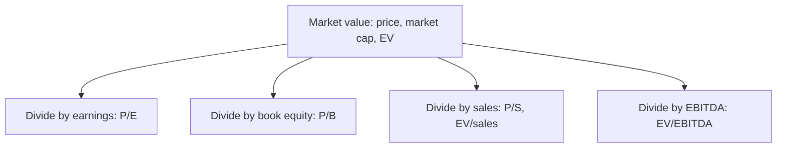

# Other valuation ratios

**Prerequisites:** [The price-to-earnings ratio](06-the-price-to-earnings-ratio.md), [The balance sheet](../../02-firms-and-capital/04-the-balance-sheet.md).

*A stock certificate of the Cumberland Telephone & Telegraph Company, early 1900s. Credit: Cumberland Telephone &amp; Telegraph Company. License: Public domain. Source: [File:Cumberland Telephone & Telegraph Company Stock Certificate early 1900s.png](https://commons.wikimedia.org/wiki/File:Cumberland_Telephone_&_Telegraph_Company_Stock_Certificate_early_1900s.png).*

P/E is only one lens. Earnings can be negative, volatile or distorted, so analysts use a family of ratios, each divides a measure of value by a measure of what the business produces or owns. This lesson covers the ones you will meet most often.

## A running example

Take a company with these figures (in millions): market capitalisation 2,000; net income 100; revenue 1,000; book equity 800; EBITDA (earnings before interest, taxes, depreciation and amortisation) 250; debt 600; cash 100.

## Price-to-book (P/B)

> P/B = market capitalisation ÷ book equity = 2,000 ÷ 800 = 2.5

The ratio compares the market's valuation with the accounting net worth. A P/B below 1 says the market values the equity below the accounting value of the assets, which can signal either a bargain or doubts about whether the assets are worth their recorded value or will earn adequate returns. Benjamin Graham and David Dodd, in their 1934 textbook *Security Analysis*, taught investors to look for such discounts to asset value, and Graham's later book *The Intelligent Investor* (1949) popularised the "margin of safety." P/B is most meaningful for asset-heavy businesses such as banks, insurers and property companies, and least for firms whose value is in intangible assets, which the balance sheet underrepresents.

## Price-to-sales (P/S)

> P/S = market capitalisation ÷ revenue = 2,000 ÷ 1,000 = 2.0

Sales cannot be negative, so P/S works for firms with no profit yet. Its weakness is that revenue says nothing about profitability: a business can have sales of 1,000 and lose money on every one. Compare P/S only across firms with similar margins.

## Enterprise value and EV/EBITDA

Equity multiples ignore how a company is financed. A firm with a lot of debt may look cheap on P/E and still be risky. **Enterprise value** (EV) values the whole business, to all capital providers:

> EV = market capitalisation + debt − cash = 2,000 + 600 − 100 = 2,500

> EV/EBITDA = 2,500 ÷ 250 = 10

EV/EBITDA is popular for comparing companies with different debt levels or tax rates, and for valuing acquisitions: a buyer takes on the debt and gets the cash. Its weakness is that EBITDA ignores the cost of replacing equipment, so for capital-intensive firms it flatters the business. Related ratios are EV/EBIT and EV/sales.

## Profitability ratios

Valuation ratios must be read alongside measures of how good the business is:

- **Return on equity (ROE)** = net income ÷ equity = 100 ÷ 800 = 12.5%. This tells how much profit management earns on owners' capital. It rises with leverage, so high ROE is only impressive if debt is modest.
- **Return on invested capital (ROIC)** = after-tax operating profit ÷ (debt + equity − cash). It measures returns to all capital and is preferred for comparing firms with different financing.
- **Net margin** = net income ÷ revenue = 100 ÷ 1,000 = 10%.
- **Dividend yield** and **payout ratio**: see [dividends](03-dividends.md).

The link to price is that, all else equal, firms that earn a higher ROE on retained earnings can grow faster. A firm that retains 60% of earnings and earns an ROE of 12.5% on them grows at about 0.6 × 12.5% = 7.5% a year, a result used in the [dividend discount model](08-the-dividend-discount-model.md).

## Safety ratios

- **Debt-to-equity** = 600 ÷ 800 = 0.75.
- **Net debt to EBITDA** = (600 − 100) ÷ 250 = 2.0 times. Credit analysts watch this: levels above roughly 4 or 5 times are generally considered heavy, though norms vary by industry.
- **Interest coverage** = EBIT ÷ interest expense.
- **Current ratio**, from the [balance sheet lesson](../../02-firms-and-capital/04-the-balance-sheet.md).

## Using ratios well

Ratios are comparisons, so they need comparators:

1. **Against the company's own history.** Is it cheap relative to its usual multiple?
2. **Against peers.** Grocery chains against grocery chains; ratios across industries mislead.
3. **Against the market.** Is the whole market expensive? The CAPE from the P/E lesson is one way.
4. **Against growth and quality.** A cheap multiple on a deteriorating business is a [value trap](../../03-securities/01-stocks/06-the-price-to-earnings-ratio.md); an expensive multiple on a high-growth, high-return business may be fair.

No ratio is a verdict. They flag where to look more closely, then you must understand the business. The two great schools are often called **value investing** (buy at a discount to estimated value, the Graham tradition) and **growth investing** (pay up for faster earnings growth); the ratios above tend to be used differently in each. See [factor investing](../../06-portfolio-theory/07-factor-investing.md) for the empirical record on value.

## Key ideas

- P/B compares price with accounting net worth; P/S with revenue; EV/EBITDA values the entire business independent of capital structure.
- Profitability (ROE, ROIC, margins) and safety (debt ratios, coverage) must be read with valuation.
- Compare ratios to history, peers and the market, and always adjust for growth and quality.
- Ratios flag questions; they do not answer them.

## Where this leads

- Next: [the dividend discount model](08-the-dividend-discount-model.md).
- Related: [factor investing](../../06-portfolio-theory/07-factor-investing.md), [credit risk](../02-bonds/06-credit-risk-and-ratings.md).
- Glossary: [[g:price-to-book|price-to-book]], [[g:price-to-sales|price-to-sales]], [[g:enterprise-value|enterprise value]], [[g:ebitda|EBITDA]], [[g:roe|ROE]], [[g:roic|ROIC]], [[g:value-investing|value investing]].
