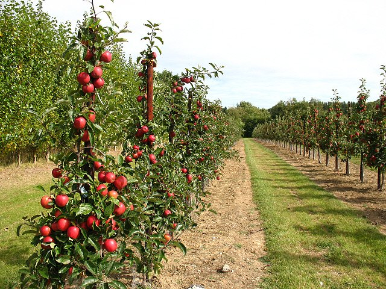
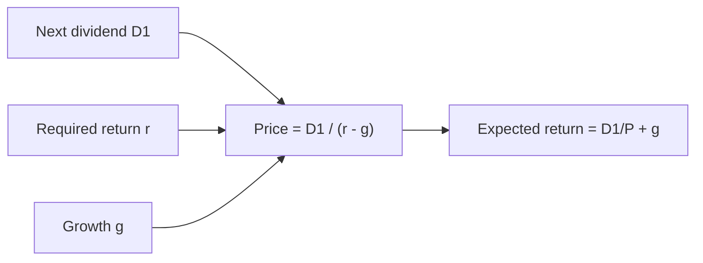

# The dividend discount model

**Prerequisites:** [Present value and discounting](../../01-foundations/05-present-value-and-discounting.md), [Annuities and perpetuities](../../01-foundations/06-annuities-and-perpetuities.md), [Dividends](03-dividends.md).

*Young apple trees bearing fruit: an orchard is worth the fruit it will yield, discounted back to today. Credit: Stephen Craven. License: [CC BY-SA 2.0](https://creativecommons.org/licenses/by-sa/2.0). Source: [File:Young apple trees bearing fruit - geograph.org.uk - 1476095.jpg](https://commons.wikimedia.org/wiki/File:Young_apple_trees_bearing_fruit_-_geograph.org.uk_-_1476095.jpg).*

What is a share worth? The most fundamental answer is the **dividend discount model** (DDM): a share is worth the present value of all the dividends it will ever pay. It looks odd, since many companies pay no dividends and shares are usually sold for a price, not held forever. But the logic is sound, and the model clarifies what the price of a share really depends on.

## The idea

An owner of a share receives dividends over time and finally sells. The selling price is itself the value of dividends to the next owner, and so on. Following the chain forever, today's price is the present value of the entire stream of future dividends:

> P₀ = D₁ ÷ (1+r) + D₂ ÷ (1+r)² + D₃ ÷ (1+r)³ + …

where D is the dividend in each year and r is the discount rate that reflects the share's risk (the **cost of equity**). The economist John Burr Williams set this out in his 1938 book *The Theory of Investment Value*, an early formal treatment of valuation by discounted cash flows.

## The Gordon growth model

If dividends grow at a constant rate g forever, the infinite sum becomes a [growing perpetuity](../../01-foundations/06-annuities-and-perpetuities.md), giving the **Gordon growth model**, after Myron Gordon:

> P₀ = D₁ ÷ (r − g), with r > g

Example: next year's dividend D₁ is 2.00, the required return r is 8%, and dividends are expected to grow at 3%. Then P₀ = 2.00 ÷ (0.08 − 0.03) = 40. If growth is 4% instead, P₀ = 2.00 ÷ 0.04 = 50. A single percentage point of expected growth changes the value by a quarter.

Rearranged, the model gives the expected return on a stock:

> r = D₁ ÷ P₀ + g = dividend yield + growth

For the share at 40: 5% + 3% = 8%. This decomposition, the dividend yield plus growth, is intuitive and appears in the return breakdown in [the P/E lesson](06-the-price-to-earnings-ratio.md).

## Where growth comes from

A company's sustainable dividend growth depends on how much it retains and what it earns on the retained money:

> g = retention ratio × return on equity

A firm that pays out 40% (retention 60%) and earns 12.5% on equity grows at 0.6 × 12.5% = 7.5% a year, in the long run, assuming a stable financing mix. But no business can grow faster than the economy forever, so the Gordon growth rate should be a modest figure, close to long-run economic growth or below it.

## Multi-stage models

Young or fast-growing companies cannot sensibly be modelled with one growth rate forever. A two-stage (or multi-stage) DDM uses a high growth rate for a defined period and then a steady rate. Example: the last dividend was 2.00, dividends grow 10% a year for three years, then 3% forever, and r = 9%.

- D₁ = 2.20, D₂ = 2.42, D₃ = 2.66.
- Present value of these three: 2.20 ÷ 1.09 + 2.42 ÷ 1.09² + 2.66 ÷ 1.09³ = 6.11.
- Dividend in year 4: D₄ = 2.662 × 1.03 = 2.742. The value at the end of year 3 (the **terminal value**) = 2.742 ÷ (0.09 − 0.03) = 45.70.
- Present value of the terminal value = 45.70 ÷ 1.09³ = 35.29.
- Total value = 6.11 + 35.29 = 41.40.

Note that about 85% of the value comes from the terminal value, far in the future. This is typical, and it means valuations are dominated by assumptions about distant years, with all the uncertainty that implies.

## Strengths and limits

**Strengths.** The DDM is conceptually clean: investors receive cash, so value should be the present value of cash received. It reveals the three drivers of value: the payout, the growth and the discount rate. It also exposes the sensitivity: small changes in r − g produce large changes in value.

**Limits.**

- Many valuable companies pay little or no dividends, so the model gives no direct guidance (though it can be applied to the dividends they *could* pay).
- Estimating long-run growth is uncertain, and small errors compound.
- As g approaches r, the value explodes; the model breaks if g ≥ r.
- It values what is distributed, ignoring that retained earnings may be invested well or badly.

These limits motivate the [discounted cash flow model](09-discounted-cash-flow-valuation.md), which values free cash flow rather than dividends and works for non-dividend payers. The DDM remains useful for stable payers such as utilities and banks, and as a thinking tool: it shows why higher interest rates (higher r) lower share prices, and why higher expected growth raises them.

## Key ideas

- A share's value is the present value of all its future dividends, discounted at the cost of equity.
- With constant growth, P₀ = D₁ ÷ (r − g); expected return = dividend yield + growth.
- Sustainable growth = retention ratio × ROE.
- Multi-stage models handle changing growth, but terminal value dominates and is highly assumption-dependent.

## Where this leads

- Next: [discounted cash flow valuation](09-discounted-cash-flow-valuation.md).
- Related: [CAPM and the cost of equity](../../06-portfolio-theory/03-capm-and-beta.md), [growth, value and factors](../../06-portfolio-theory/07-factor-investing.md).
- Glossary: [[g:dividend-discount-model|dividend discount model]], [[g:gordon-growth-model|Gordon growth model]], [[g:terminal-value|terminal value]], [[g:cost-of-equity|cost of equity]], [[g:retention-ratio|retention ratio]].
