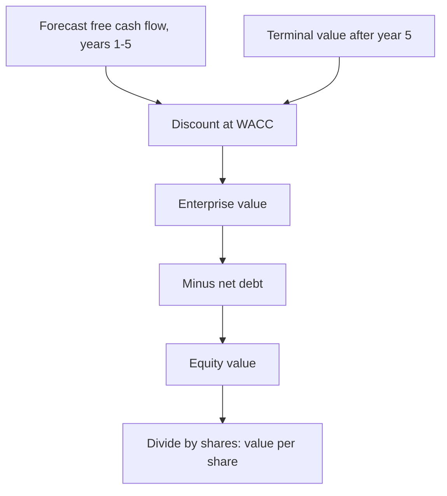

# Discounted cash flow valuation

**Prerequisites:** [Present value and discounting](../../01-foundations/05-present-value-and-discounting.md), [The cash flow statement](../../02-firms-and-capital/06-the-cash-flow-statement.md), [Capital structure and cost of capital](../../02-firms-and-capital/08-capital-structure-and-cost-of-capital.md), [The dividend discount model](08-the-dividend-discount-model.md).

*Irving Fisher of Yale, whose theory of interest framed value as discounted future income. Credit: George Grantham Bain Collection. License: Public domain. Source: [File:Prof. Irving Fisher of Yale - photo. by Bain News Service, New York. LCCN90711701.jpg](https://commons.wikimedia.org/wiki/File:Prof._Irving_Fisher_of_Yale_-_photo._by_Bain_News_Service,_New_York._LCCN90711701.jpg).*

The **discounted cash flow** (DCF) method is the workhorse of professional valuation. It generalises the dividend discount model: instead of discounting dividends, it discounts the **free cash flow** the business generates, whether or not that cash is paid out. The logic goes back to Irving Fisher's theory of interest and capital, and it rests on a principle you have seen several times already: an asset is worth the present value of the cash it will deliver.

## The steps

1. **Forecast free cash flow to the firm** (FCFF) for an explicit period, often five to ten years.
2. **Estimate a terminal value** for all the years after the forecast.
3. **Discount** everything at the **WACC**, the blended cost of debt and equity from the [capital structure lesson](../../02-firms-and-capital/08-capital-structure-and-cost-of-capital.md).
4. The sum is the **enterprise value** (EV), the value of the whole business.
5. **Subtract net debt** (debt minus cash) to get the value of the **equity**.
6. **Divide by shares outstanding** to get a value per share, and compare with the market price.

## A worked example

A company is expected to generate free cash flow of 110 next year, growing 10% a year for five years: 110, 121, 133.1, 146.4, 161.1 (millions). After year five, growth settles at 2.5% forever. WACC is 8%. Net debt is 300 and there are 100 million shares.

**Present value of the five forecast years** at 8%: 110 ÷ 1.08 + 121 ÷ 1.08² + 133.1 ÷ 1.08³ + 146.4 ÷ 1.08⁴ + 161.1 ÷ 1.08⁵ ≈ 528.

**Terminal value** at the end of year five using the [growing perpetuity formula](../../01-foundations/06-annuities-and-perpetuities.md): TV = 161.1 × 1.025 ÷ (0.08 − 0.025) ≈ 3,002. Its present value is 3,002 ÷ 1.08⁵ ≈ 2,043.

**Enterprise value** = 528 + 2,043 ≈ 2,571. **Equity value** = 2,571 − 300 = 2,271. **Per share** = 2,271 ÷ 100 ≈ 22.71.

If the stock trades at 30, the DCF says it is overvalued under these assumptions; if it trades at 18, undervalued. Note that the terminal value is 79% of the enterprise value (2,043 of 2,571), which is the central caveat of DCF.

## Sensitivity: the real lesson

Re-run the model with different WACC and terminal growth assumptions, keeping the other numbers. Enterprise value (in millions, rounded):

| WACC \ terminal growth | 1.5% | 2.5% | 3.5% |
|---|---|---|---|
| 7% | 2,663 | 3,159 | 3,939 |
| 8% | 2,240 | 2,571 | 3,049 |
| 9% | 1,930 | 2,165 | 2,484 |

Within what seems a reasonable range of assumptions, the value ranges from 1,930 to 3,939, a factor of two. Because net debt is a fixed 300, the effect on equity is even bigger: equity value runs from 1,630 to 3,639. A DCF is therefore not a point estimate but a framework for exploring what you must believe to justify a price. Professional analysts present ranges and scenarios, and a good habit is to run the valuation in reverse: from the market price, solve for the growth the market is implying (a "reverse DCF").

## What goes into the forecast

Garbage in, garbage out. A thoughtful forecast links cash flows to the business drivers:

- **Revenue growth**, from market size, share and pricing.
- **Operating margin**, from cost structure and competitive position.
- **Reinvestment**, since growth requires capital spending and working capital. A forecast that grows revenue 10% with no extra investment is fantasy.
- **Tax rate**, using what the firm will realistically pay.
- **Competitive fade.** High returns attract competition, so growth and returns on capital should drift toward normal levels over time. Aswath Damodaran, a professor known for teaching valuation, emphasises that growth rates should be consistent with reinvestment and returns.

## Terminal value choices

Two methods are common:

1. **Perpetuity growth** (used above). The growth rate should not exceed long-run nominal economic growth, and must be less than WACC.
2. **Exit multiple.** Apply a multiple such as EV/EBITDA to the final year. It is simpler, but it imports the market's current mood into the valuation and so partly makes the model circular.

## Equity DCF and relative valuation

The alternative is to value **equity directly** by discounting free cash flow to equity (after interest and debt repayments) at the cost of equity. It reaches the same answer if done consistently, but it is trickier when the debt level changes. DCF is often paired with **relative valuation**, comparing multiples like [P/E and EV/EBITDA](07-other-valuation-ratios.md) with similar companies, as a cross-check. Each method checks the other's blind spots: DCF tells you what a business is worth in principle, multiples tell you what the market pays in practice.

## Key ideas

- DCF values a business as the present value of its free cash flows, discounted at WACC; subtract net debt to get equity value.
- The terminal value usually makes up most of the total, so long-run growth and WACC drive the result.
- The output is highly sensitive to assumptions; use ranges, scenarios and reverse DCF.
- Forecasts must connect growth to reinvestment and competitive reality.

## Where this leads

- Next: the [bonds](../02-bonds/01-what-is-a-bond.md) branch of the securities section, where the cash flows are contractual and valuation is mechanical.
- Related: [capital structure and WACC](../../02-firms-and-capital/08-capital-structure-and-cost-of-capital.md), [efficient markets](../../06-portfolio-theory/04-the-efficient-market-hypothesis.md).
- Glossary: [DCF](../../glossary/stocks/dcf.md), [free cash flow](../../glossary/firms-and-accounting/free-cash-flow.md), [terminal value](../../glossary/stocks/terminal-value.md), [enterprise value](../../glossary/stocks/enterprise-value.md), [net debt](../../glossary/stocks/net-debt.md), [sensitivity analysis](../../glossary/stocks/sensitivity-analysis.md).
