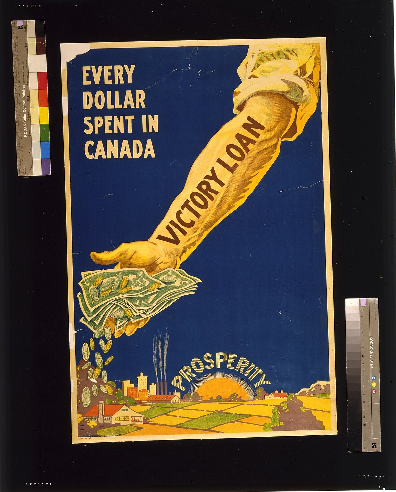
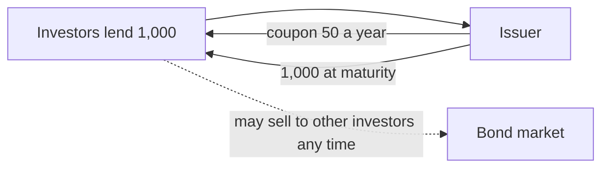

# What a bond is

**Prerequisites:** [Equity and debt](../../02-firms-and-capital/03-equity-and-debt.md), [Credit, debt and banking](../../01-foundations/02-credit-and-banking.md), [What a security is](../../02-firms-and-capital/07-what-is-a-security.md).

*A Canadian Victory Loan poster from the First World War, when ordinary citizens were urged to buy government bonds. Credit: Artist Posters. License: Public domain. Source: [File:Every dollar spent in Canada - Victory Loan - prosperity LCCN2004666240.jpg](https://commons.wikimedia.org/wiki/File:Every_dollar_spent_in_Canada_-_Victory_Loan_-_prosperity_LCCN2004666240.jpg).*

A **bond** is a tradable loan. Instead of borrowing a large sum from one bank, a government or company splits the loan into many identical pieces and sells them to investors. Each piece is a promise: pay the holder fixed interest at regular dates and return the face amount at the end. By most estimates the global bond market is larger than the global stock market by value outstanding, though it is less visible in daily news.

## The anatomy of a bond

Every bond is described by a handful of terms, fixed when it is issued:

- **Issuer:** the borrower (a government, province, municipality or corporation).
- **Face value** (also **par value** or **principal**): the amount repaid at maturity, commonly 1,000 per bond in Canada and the US.
- **Coupon rate:** the annual interest rate, applied to face value. A 5% coupon on a 1,000 bond pays 50 per year, typically in two semi-annual instalments of 25. The word *coupon* comes from the paper slips attached to old bearer bonds, which holders literally clipped and presented for payment, as shown above in [pricing a bond](02-pricing-a-bond.md).
- **Maturity date:** when the principal is repaid. Short-term is up to about a year, medium-term 1 to 10 years, long-term beyond 10, with some bonds issued for 30, 50 or even 100 years.
- **Currency** of payment.
- **Security and ranking:** whether the bond is **secured** by specific assets (a mortgage bond) or **unsecured** (a debenture), and where it ranks among the issuer's other debts.
- **Special features:** the issuer's right to repay early (**callable**), the holder's right to convert into shares (**convertible**), or inflation indexing.

The bond's **indenture** (or trust deed) is the legal contract that sets out these terms and any **covenants**, the promises the issuer makes, such as limits on additional borrowing. A **trustee** acts for the bondholders.

## An example

A company issues a 10-year bond, face value 1,000, 5% coupon. For ten years it pays 50 a year (as 25 each half year), and at the end of the tenth year it pays the final 1,000 as well. An investor who buys at issue for 1,000 and holds to maturity receives exactly that stream. If she wants her money earlier she can sell the bond to someone else in the market, at whatever price the market sets at that time. The market price is rarely exactly 1,000 after issue, because interest rates and the issuer's creditworthiness change, the central subject of the [next lessons](02-pricing-a-bond.md).

## Bonds versus shares

Bonds and shares differ in the contract, as discussed in [equity and debt](../../02-firms-and-capital/03-equity-and-debt.md):

- The bondholder has a **fixed, contractual claim** and no vote; the shareholder has a residual claim and a vote.
- Missing a bond payment is a **default** with legal consequences, while skipping a common dividend is not.
- Bonds have a **maturity** and a known final cash flow, so their value is pulled toward face value as maturity nears (a "pull to par"). Shares have no maturity.
- Bond returns have a narrower range: the best case is full repayment plus coupons, the worst is default and recovery of only a fraction. This is why bonds are often described as "fixed income," though the term is a little misleading because prices fluctuate and income can fail.

## Who issues bonds

- **Governments** issue to finance deficits, as in [government bonds](07-government-bonds.md).
- **Provinces and municipalities** fund infrastructure.
- **Corporations** fund expansion or refinance, as in [corporate bonds](08-corporate-bonds-and-high-yield.md).
- **Agencies and supranationals** such as the World Bank.
- **Banks and special vehicles** issue covered bonds and asset-backed securities.

## Why bonds exist

Issuers use bonds because they can borrow from a wide pool of investors at a lower cost than from a single bank, for longer terms, and with standardised terms. Investors use them for a predictable income stream, to match future liabilities (pension funds), to diversify away from equities, and to preserve capital. Throughout history the bond market has also been the mechanism by which governments finance wars: the Victory Bond campaigns of the First World War, with posters urging citizens to lend to the state, were among the largest public financial mobilisations of their time. Canada's Victory Loans, beginning in 1917, are generally described as the country's first large public bond issues sold to ordinary households at home.

## The bond market

Unlike stocks, most bonds do not trade on exchanges. They trade **over the counter** (OTC), through dealers who quote prices to institutional clients and, increasingly, through electronic platforms. A retail investor typically buys bonds through a broker or, more commonly today, through a [bond fund or ETF](../03-funds/01-pooled-investing-and-mutual-funds.md). Bond prices are quoted as a percentage of face value: a quote of 98.50 means 98.5% of par, or 985 per 1,000 bond. See [bond and OTC markets](../../04-markets/03-brokers-and-dealers.md).

## Key ideas

- A bond is a tradable loan with face value, coupon, maturity and issuer-specific terms.
- The holder receives fixed coupons and the face value at maturity unless the issuer defaults.
- Bonds rank ahead of shares in a failure but carry no ownership or vote.
- Most bonds trade over the counter and are quoted as a percentage of par.

## Where this leads

- Next: [pricing a bond](02-pricing-a-bond.md).
- Related: [government bonds](07-government-bonds.md), [credit risk](06-credit-risk-and-ratings.md).
- Glossary: [[g:bond|bond]], [[g:coupon|coupon]], [[g:face-value|face value]], [[g:indenture|indenture]], [[g:debenture|debenture]], [[g:covenant|covenant]].
