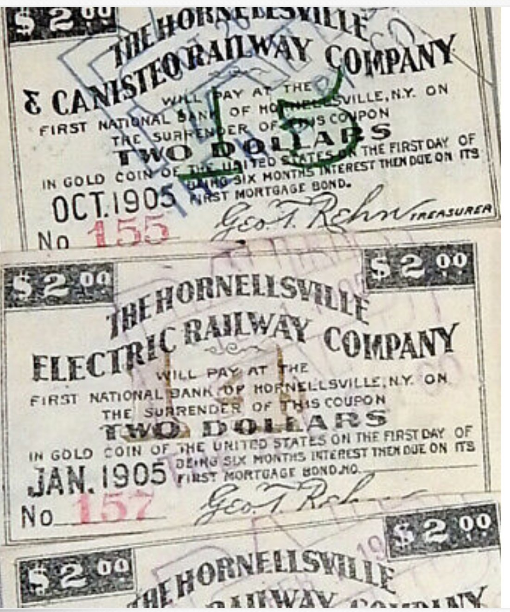
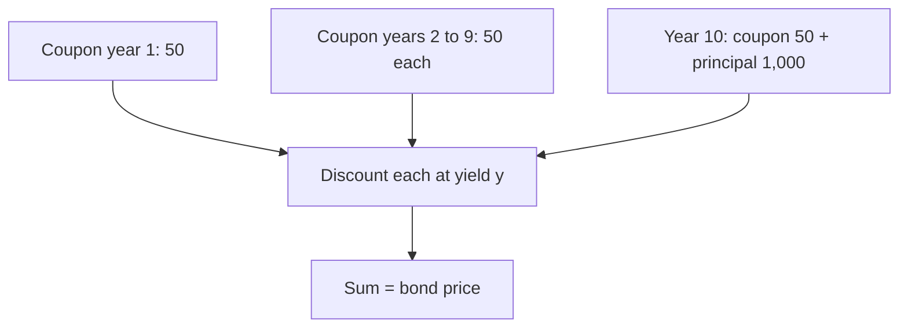

# Pricing a bond

**Prerequisites:** [What a bond is](01-what-is-a-bond.md), [Present value and discounting](../../01-foundations/05-present-value-and-discounting.md), [Annuities and perpetuities](../../01-foundations/06-annuities-and-perpetuities.md).

*Detachable coupons from a bond of the Hornell Traction Company: each coupon was clipped and redeemed for an interest payment. Credit: Unknown authorUnknown author. License: Public domain. Source: [File:Bond coupons for Hornell Traction Company.jpg](https://commons.wikimedia.org/wiki/File:Bond_coupons_for_Hornell_Traction_Company.jpg).*

A bond's cash flows are written in a contract, so its value is a clean application of present value: **the price of a bond is the present value of its future coupons and principal, discounted at the market's required yield**. Once you understand this, the behaviour of bond prices follows without any extra rules.

## The formula

For a bond with face value F, annual coupon C paid once a year, n years to maturity and market yield y:

> Price = C ÷ (1+y) + C ÷ (1+y)² + … + (C + F) ÷ (1+y)ⁿ = C × [1 − (1+y)^−n] ÷ y + F ÷ (1+y)ⁿ

The first term is an [annuity](../../01-foundations/06-annuities-and-perpetuities.md) (the coupons); the second is a single lump sum (the principal). Most bonds pay coupons twice a year, in which case you halve the coupon and the yield and double the number of periods; the effect on price is small.

## Worked example

A 10-year bond has a face value of 1,000 and pays a 5% annual coupon (50 a year). Prices at various market yields:

| Required yield | Price |
|---|---|
| 3% | 1,170.60 |
| 4% | 1,081.11 |
| 5% | 1,000.00 |
| 6% | 926.40 |
| 7% | 859.53 |

Check the 6% row: the coupons' present value is 50 × (1 − 1.06⁻¹⁰) ÷ 0.06 = 50 × 7.3601 = 368.00, and the principal's is 1,000 ÷ 1.06¹⁰ = 558.39, a total of 926.40.

The pattern is the whole story of the bond market: **when the required yield rises above the coupon rate, the price falls below face value; when it falls below, the price rises above face.** A bond paying 5% is attractive when new bonds yield only 3%, so buyers bid its price up; unattractive when new bonds yield 7%, so its price must drop for the buyer to earn the market yield. The relationship is studied in detail in [the price–yield relationship](04-the-price-yield-relationship.md).

## Par, premium and discount

- **At par:** coupon rate = yield, so price = face value (the 5% row).
- **At a premium:** coupon rate > yield, price above face (3%, 4% rows).
- **At a discount:** coupon rate < yield, price below face (6%, 7% rows).

As maturity approaches, all three converge to face value: the premium or discount decays to zero by maturity. This **pull to par** means a bond bought at a premium and held to maturity loses that premium gradually, which is already reflected in its yield.

## Accrued interest, clean and dirty prices

Coupons are paid on set dates, but bonds trade every day. A buyer who purchases a bond three months into a coupon period will receive the whole next coupon, though the seller owned the bond for the first part of that period. The convention is to compensate the seller with **accrued interest**, the share of the next coupon earned so far. The quoted price excludes it (the **clean price**); the amount the buyer actually pays includes it (the **dirty** or **full price**).

Example: a bond with a 6% annual coupon (paid semi-annually, 30 per period on 1,000) is bought 60 days into a 182-day coupon period. Accrued interest = 30 × 60/182 ≈ 9.89. If the clean price is 985, the buyer pays about 994.89. Without this convention, prices would jump by the coupon at every payment date.

## Reading a bond quote

Bond prices are quoted per 100 of face value: "98.50" means 985 on a 1,000 bond. The yield may be quoted next to it. Given the price you can compute the yield, and given the yield, the price. They carry the same information, but traders usually think in yield, because it allows comparison across bonds with different coupons and maturities. See [yield to maturity](03-yield-to-maturity.md).

## Zero-coupon bonds

A **zero-coupon bond** pays no coupons; it is sold at a discount and pays face value at maturity. Its price is just the PV of a single payment: a 10-year zero with face 1,000 at a yield of 4% costs 1,000 ÷ 1.04¹⁰ = 675.56. The investor's entire return is the difference between purchase price and face value. Zeros are the simplest bonds, and any coupon bond can be viewed as a bundle of zeros, one for each payment, which is exactly how government bond "strips" are made; see [inflation-linked, zero-coupon bonds and GICs](10-inflation-linked-zero-coupon-and-gics.md).

## Key ideas

- Bond price = present value of coupons and principal at the market yield.
- Price falls when yields rise and rises when yields fall; premium, par and discount depend on coupon versus yield.
- Prices pull to par as maturity nears.
- Quoted (clean) prices exclude accrued interest; buyers pay the dirty price.

## Where this leads

- Next: [yield to maturity](03-yield-to-maturity.md), the inverse problem, then [the price–yield relationship](04-the-price-yield-relationship.md).
- Glossary: [[g:bond-price|bond price]], [[g:par|par]], [[g:premium-bond|premium bond]], [[g:discount-bond|discount bond]], [[g:accrued-interest|accrued interest]], [[g:zero-coupon-bond|zero-coupon bond]].
