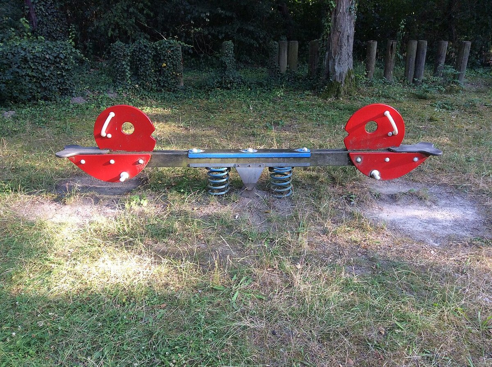
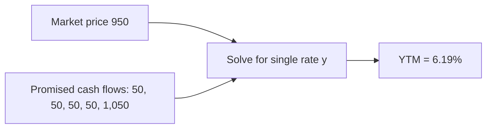

# Yield to maturity

**Prerequisites:** [Pricing a bond](02-pricing-a-bond.md), [Present value and discounting](../../01-foundations/05-present-value-and-discounting.md).

*A playground seesaw: when one end of the bond relationship goes up, the other goes down. Credit: Killarnee. License: [CC BY-SA 4.0](https://creativecommons.org/licenses/by-sa/4.0). Source: [File:Playground seesaw.jpg](https://commons.wikimedia.org/wiki/File:Playground_seesaw.jpg).*

If you know a bond's price, what return will you earn by buying it? The bond market's standard answer is the **yield to maturity** (YTM): the single annual discount rate that makes the present value of all the promised cash flows equal to today's price. It is the internal rate of return of the bond, and it is the number usually quoted when people talk about "the yield."

## The definition

YTM, y, solves

> Price = C ÷ (1+y) + C ÷ (1+y)² + … + (C + F) ÷ (1+y)ⁿ

There is no closed-form solution for y, so it is found by trial and error (calculators and spreadsheets do it for you). Example: a 5-year bond with a 5% annual coupon on a face value of 1,000 trades at 950. Try y = 6%: price = 957.88, too high. Try 6.2%: price ≈ 949.7, almost exactly 950. The YTM is about 6.19%.

Note that 6.19% is higher than the coupon rate of 5%, because the bond is bought at a discount: the investor earns the 5% coupon *plus* the gain of 50 as the price pulls up to 1,000 at maturity.

## Other yield measures

Several simpler numbers coexist with YTM, and it helps to separate them:

- **Coupon rate:** coupon ÷ face value = 5%. Fixed at issue, tells you nothing about today's return.
- **Current yield:** annual coupon ÷ current price = 50 ÷ 950 = 5.26%. Ignores the capital gain or loss to maturity.
- **Yield to maturity:** includes coupons *and* the gain from price to face value, 6.19%.
- **Yield to call:** for a callable bond, the yield assuming the issuer redeems at the earliest call date at the call price. Investors in callable bonds should look at the **yield to worst**, the lowest of the yields to maturity and to each call date.
- **Realised return:** what you actually earned, over the period you actually held.

## The assumptions behind YTM

YTM is a helpful summary but it rests on assumptions that are often not true:

1. **The bond is held until maturity.** If you sell earlier, your return depends on the price you receive, which depends on future yields.
2. **No default.** All promised payments are made in full and on time. For risky bonds, the promised yield overstates the *expected* yield. A bond yielding 9% with a 3% annual expected loss from default is not really a 9% investment.
3. **Coupons are reinvested at the YTM.** If rates fall, coupons reinvest at lower rates, and the realised return falls short of the promised yield. If rates rise, the reverse. This is **reinvestment risk**. For a 30-year bond bought at 5%, the reinvested coupons can account for a large fraction of the total return, so the 5% is only reached if reinvestment also earns 5%.

A zero-coupon bond has no reinvestment risk if held to maturity, because there are no coupons to reinvest; its YTM is guaranteed (subject to default risk).

## Why yield is the language of bonds

Prices are hard to compare across bonds with different coupons and maturities. Yields are comparable. A 2-year 4% bond and a 10-year 6% bond are directly comparable on yield, as price per 100 are not. Traders therefore quote yield, and speak of prices moving "20 basis points," where a **basis point** (bp) is one hundredth of one percentage point. A move from 4.00% to 4.20% is 20 bp. Yield differences between bonds, called **spreads**, show how much extra return the market demands for taking extra risk: a corporate bond with a yield 1.5 percentage points (150 bp) above a government bond of the same maturity has a **credit spread** of 150 bp; see [credit risk](06-credit-risk-and-ratings.md).

## Yield and expected return

Over a **long** holding period, the return on a bond portfolio tends to approach the yield at which it was bought, because coupons dominate and price changes reverse as bonds pull to par. Over a short period, price changes dominate and returns can differ widely from the initial yield. This is why bond funds have fallen sharply in years when interest rates rose (as in 2022), and why bond investors often think in terms of a **horizon**.

The bond's duration, studied in [duration and convexity](05-duration-and-convexity.md), is the time after which these price and reinvestment effects roughly offset.

## Key ideas

- YTM is the discount rate that equates the PV of promised cash flows to the price; it is the bond's IRR.
- Current yield ignores the pull to par; YTM includes it; yield to worst applies to callable bonds.
- YTM assumes holding to maturity, no default and reinvestment at the same rate.
- Yields are quoted in basis points and are the standard way to compare bonds.

## Where this leads

- Next: [the price–yield relationship](04-the-price-yield-relationship.md).
- Related: [credit risk and spreads](06-credit-risk-and-ratings.md), [the yield curve](09-the-yield-curve.md).
- Glossary: [[g:yield-to-maturity|yield to maturity]], [[g:current-yield|current yield]], [[g:basis-point|basis point]], [[g:yield-to-call|yield to call]], [[g:reinvestment-risk|reinvestment risk]], [[g:credit-spread|credit spread]].
