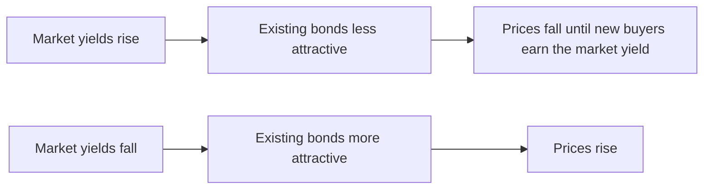

# The price–yield relationship

**Prerequisites:** [Pricing a bond](02-pricing-a-bond.md), [Yield to maturity](03-yield-to-maturity.md).

*Girls playing on a seesaw in the snow, Xavier Leprince, 1822. Credit: Auguste-Xavier Leprince. License: Public domain. Source: [File:Xavier Leprince, girls playing seesaw in the snow, 1822.jpg](https://commons.wikimedia.org/wiki/File:Xavier_Leprince,_girls_playing_seesaw_in_the_snow,_1822.jpg).*

The most important fact about bonds is also the one beginners find most counter-intuitive: **bond prices move opposite to interest rates**. When market yields rise, existing bonds fall in value; when yields fall, they rise. A seesaw is the right image. This lesson explains why, and how big the moves are.

## Why prices fall when rates rise

Suppose you own a bond paying a 5% coupon. Then the market changes, and new bonds of similar quality are issued with a 6% coupon. Nobody will pay full price for your 5% bond when a 6% one is available. To sell, you must cut the price until a buyer, receiving your 5% coupon *plus* a capital gain as the price rises to par, earns the market's 6% in total. That is the discounting formula at work: a higher discount rate means a lower present value for the same cash flows.

If instead new bonds yield 4%, your 5% bond is attractive, and its price rises until the buyer's total return is down to 4%.

Notice that nothing about the issuer has changed. The change in price is entirely due to the market's required yield. A bondholder who plans to hold to maturity and the issuer does not default still receives every promised payment, so a temporary paper loss does not change the final result. But those who must sell before maturity, or who need to mark the value of a portfolio, feel the change at once. This is **interest rate risk**.

## How big are the moves?

For the 10-year 5% bond from [pricing a bond](02-pricing-a-bond.md):

| Yield | Price | Change from par |
|---|---|---|
| 4% | 1,081.11 | +8.1% |
| 5% | 1,000.00 | 0 |
| 6% | 926.40 | −7.4% |

A one-point rise in yield cuts the price by 7.4%; a one-point fall adds 8.1%. Three features follow.

**1. The relationship is convex.** The price curve bends: the gain from a yield fall is larger than the loss from an equal yield rise. This asymmetry is desirable for the bondholder and is measured by **convexity**; see [duration and convexity](05-duration-and-convexity.md).

**2. Longer maturity means greater sensitivity.** For a 5-year bond with the same 5% coupon, a one-point rise to 6% cuts the price by 4.2% (from 1,000 to 957.88), compared with 7.4% for the 10-year bond. The longer the bond, the more of its value is in distant cash flows, which are the most affected by the discount rate, as shown in [present value](../../01-foundations/05-present-value-and-discounting.md).

**3. Lower coupon means greater sensitivity.** A bond that pays little coupon has more of its value in the final principal, which is far away. A 10-year zero-coupon bond bought at a 4% yield falls from 675.56 to 613.91 (a fall of 9.1%) when yields rise to 5%, more than the coupon bond's 7.4% for a one-point move, though the zero here has the same maturity.

## What moves yields

Bond yields change because of:

- **Expected inflation.** Higher expected inflation raises nominal yields, because investors demand compensation; see [inflation](../../01-foundations/07-inflation-and-real-returns.md).
- **Central bank policy.** Short-term yields follow the policy rate closely; see [central banks](../../05-regulation/06-central-banks-and-monetary-policy.md).
- **Economic growth expectations.** Strong growth tends to raise real yields; recessions lower them as investors seek safety.
- **Credit conditions.** Fear of defaults widens spreads on risky bonds.
- **Supply and demand,** including government borrowing and central bank purchases.

## Real-world example: 2022

In 2022, central banks raised policy rates sharply to fight inflation. Government bond yields rose substantially across the world, and broad bond indexes suffered their steepest annual declines in decades, hitting investors who regarded bonds as a safe store of value. Bonds that mature and return par were not "unsafe" in the sense of default, but their market values fell because the discount rate had risen. It is a clear demonstration that **risk-free in credit terms is not risk-free in price terms**. Many bonds bought in 2020 and 2021 at yields near record lows lost more in 2022 than their annual coupons would earn in several years, because the coupons were so small. After yields rose, new bonds offered much higher income, which is the flip side of interest rate risk: higher yields reduce today's price but raise future returns.

## What it means for investors

- A bond investor is exposed to interest rate changes in proportion to the bond's maturity and coupon, which duration summarises.
- Holding to maturity eliminates price risk from rate changes, but not the opportunity cost of being locked into a lower rate.
- Bond fund investors, who never reach "maturity", should compare a fund's duration with their own time horizon.
- Rising rates hurt existing bondholders in the short run but raise the returns on reinvested coupons; falling rates do the reverse.

## Key ideas

- Bond prices and yields move in opposite directions because price is a present value.
- The price–yield curve is convex: equal yield moves produce bigger gains than losses.
- Longer maturity and lower coupon mean larger price sensitivity.
- A bond can be free of default risk and still lose market value when rates rise.

## Where this leads

- Next: [duration and convexity](05-duration-and-convexity.md), the measures of rate sensitivity.
- Related: [the yield curve](09-the-yield-curve.md), [central banks](../../05-regulation/06-central-banks-and-monetary-policy.md), [2022 and the rate shock](../../08-history/12-covid-crash-and-the-rate-shock.md).
- Glossary: [[g:interest-rate-risk|interest rate risk]], [[g:convexity|convexity]], [[g:price-yield-relationship|price–yield relationship]], [[g:pull-to-par|pull to par]].
