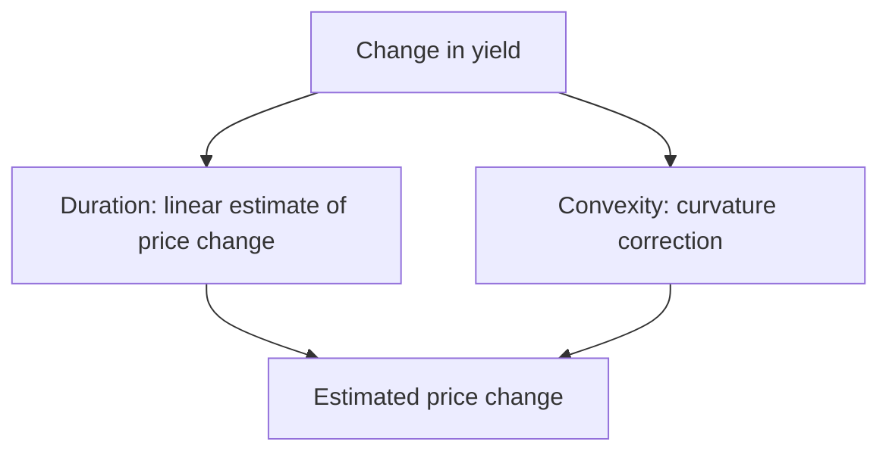

# Duration and convexity

**Prerequisites:** [The price–yield relationship](04-the-price-yield-relationship.md).

*An old illustration of Archimedes using a lever to move a ship: duration works like a lever arm on a bond's price. Credit: Hermann Göll. License: Public domain. Source: [File:Archimedes uses a lever to move a ship.jpg](https://commons.wikimedia.org/wiki/File:Archimedes_uses_a_lever_to_move_a_ship.jpg).*

How sensitive is a particular bond to a change in yields? "Longer maturity means more sensitive" is a start, but we want a number. **Duration** provides it, summarising a bond's price risk in a single figure; **convexity** corrects for the curve's bend.

## Macaulay duration

In 1938 the economist Frederick Macaulay proposed measuring a bond's effective life by the **weighted average time to receive its cash flows**, where the weights are the present values of each payment:

> Macaulay duration = Σ [t × PV(CFₜ)] ÷ Price

Consider the 5-year, 5% bond priced at par (yield 5%). The payments are 50 each year for four years and 1,050 in year five. Their present values at 5% are 47.62, 45.35, 43.19, 41.14 and 822.70, summing to 1,000. Weighting each year by its PV gives a Macaulay duration of 4.55 years. This is less than the 5-year maturity because the coupons arrive earlier. A zero-coupon bond has a duration equal to its maturity, because there is only one payment. The higher the coupon and the higher the yield, the shorter the duration for a given maturity.

## Modified duration

What matters for risk is how much the price changes per unit change in yield. **Modified duration** converts Macaulay duration:

> Modified duration = Macaulay duration ÷ (1 + y) = 4.55 ÷ 1.05 = 4.33

The interpretation is a rule of thumb: **for a 1 percentage point change in yield, the price changes by about the modified duration in percent, in the opposite direction.** For this bond, a rise of 1% in yield is expected to cut the price by about 4.33%. The actual price at 6% is 957.88, a fall of 4.21%. The estimate is close but a little too pessimistic, and that gap is the convexity.

For the 10-year 5% bond at a 5% yield, Macaulay duration is 8.11, modified duration is 7.72. The estimate says a one-point rise cuts the price by 7.7%; the actual price at 6% is 926.40, a fall of 7.4%. Again, the estimate overstates the loss, and conversely understates the gain: at 4% the price rose 8.1% while the estimate was +7.7%.

## Why convexity matters

Duration is the slope of the price–yield curve at the current point. But the curve is bent (convex), so a straight line understates gains and overstates losses. **Convexity** measures the curvature. A common approximation for the price change uses both:

> %ΔPrice ≈ −Modified duration × Δy + ½ × Convexity × (Δy)²

For the 5-year bond, convexity is about 24 (in the same units), so for Δy = +0.01, the correction is ½ × 24 × 0.0001 = +0.12% (as a fraction, +0.0012). Duration alone predicts −4.33%; adding convexity gives −4.33% + 0.12% = −4.21%, matching the exact result. For small yield changes duration is enough; for large changes convexity matters. Investors like convexity (it helps in both directions), so bonds with high convexity trade at a slight premium. Callable bonds and mortgage-backed securities have **negative convexity** in some ranges: when rates fall, the issuer or homeowner is likely to refinance, capping the price gain.

## Duration as a tool

**Portfolio duration.** The duration of a portfolio is the weighted average of its holdings' durations, so it is easy to compute and manage. A fund with a duration of 7 will fall about 7% if yields rise one point.

**Choosing risk.** An investor expecting rates to rise might shorten duration; someone who needs cash in 5 years might choose a duration near 5 to balance price and reinvestment effects.

**Immunisation.** In 1952 the British actuary Frank Redington described how an institution with a known future liability, such as a pension fund or insurer, can **immunise** itself against interest rate moves by matching the duration of its assets to that of its liabilities. When yields change, the asset value and the present value of the liability change by about the same amount, so the funding status is protected. Pension funds and insurers still use the idea, extended with convexity and cash-flow matching.

**Hedging.** Traders use futures or swaps to adjust duration without selling bonds.

## Limits

Duration assumes small, **parallel shifts** of the whole yield curve; in reality short and long yields move by different amounts, so analysts also use **key-rate durations** at specific maturities. It assumes cash flows do not change when yields change, which is false for callable and mortgage bonds. It cannot capture credit risk: a bond's price can fall because its issuer is in trouble, with yields otherwise unchanged. As a first-order measure of interest rate risk it is indispensable, but it is not the whole story.

## Key ideas

- Macaulay duration is the PV-weighted average time to a bond's cash flows; a zero-coupon bond's duration equals its maturity.
- Modified duration ≈ percentage price change per 1 percentage point change in yield.
- Convexity corrects the duration estimate, benefiting the holder in both directions.
- Duration drives immunisation and portfolio risk management, but assumes parallel yield moves and unchanged cash flows.

## Where this leads

- Next: [credit risk and ratings](06-credit-risk-and-ratings.md).
- Related: [the yield curve](09-the-yield-curve.md), [swaps](../04-derivatives/06-swaps-and-credit-derivatives.md).
- Glossary: [[g:duration|duration]], [[g:macaulay-duration|Macaulay duration]], [[g:modified-duration|modified duration]], [[g:convexity|convexity]], [[g:immunization|immunization]], [[g:negative-convexity|negative convexity]].
