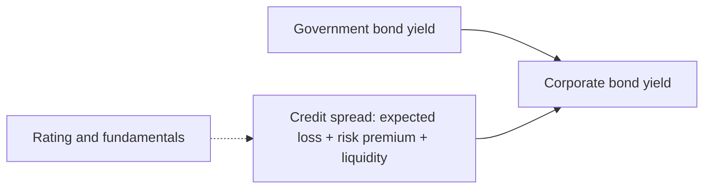

# Credit risk and ratings

**Prerequisites:** [What a bond is](01-what-is-a-bond.md), [Yield to maturity](03-yield-to-maturity.md), [Risk and return](../../01-foundations/10-risk-and-return.md).

*A page from Poor's Manual (1891) on the Lehigh Valley Railroad; Henry Varnum Poor's manuals were the forerunner of modern credit-rating publications. Credit: Unknown authorUnknown author. License: Public domain. Source: [File:1891 Poor's Lehigh Valley Railroad.jpg](https://commons.wikimedia.org/wiki/File:1891_Poor's_Lehigh_Valley_Railroad.jpg).*

A government bond and a bond from a struggling company can have the same coupon and maturity, yet they are very different investments. The difference is the chance of not being paid. **Credit risk** is the risk that the issuer fails to make a promised payment. It is why risky bonds yield more, and why a whole industry exists to measure it.

## Components of credit risk

- **Default risk:** the probability that the issuer misses a payment or restructures.
- **Recovery rate:** the fraction of the face value recovered after default, which depends on the bond's seniority and the issuer's assets. Senior secured bondholders typically recover more than subordinated ones.
- **Loss given default** = 1 − recovery rate.
- **Expected loss** ≈ probability of default × loss given default.
- **Downgrade risk:** the chance that the issuer's credit quality deteriorates, lowering the bond's price even if no default occurs.
- **Spread risk:** the chance that the extra yield demanded for credit risk widens, for example in a crisis.

Example: a bond yields 6.5% while a government bond of the same maturity yields 4%, a **credit spread** of 2.5 percentage points (250 bp). If the bond has a 2% annual chance of default and recovers 40% on default, its expected annual loss is 2% × 60% = 1.2%. The remaining 1.3 points is compensation for bearing the uncertainty, plus lower liquidity. Spreads are higher than expected losses on average, which is why holding corporate bonds has historically earned a premium over government bonds, though with risk of heavy losses in downturns.

## Credit ratings

Most investors cannot analyse every issuer, so they rely on **credit rating agencies**. The practice goes back to the 19th century. Henry Varnum Poor published manuals on railroads from the 1860s, and John Moody began publishing bond ratings for railroads in 1909. Moody's, Standard & Poor's (S&P) and Fitch dominate globally, with DBRS Morningstar prominent in Canada. They assign letter grades:

| S&P / Fitch | Moody's | Meaning |
|---|---|---|
| AAA | Aaa | Highest quality |
| AA+ to AA− | Aa1 to Aa3 | Very high quality |
| A+ to A− | A1 to A3 | Upper-medium grade |
| BBB+ to BBB− | Baa1 to Baa3 | Lowest **investment grade** |
| BB+ and below | Ba1 and below | **Speculative grade** ("high yield" or "junk") |
| CCC and below | Caa and below | Very high risk or near default |
| D | C | In default |

The line between BBB− and BB+ is important. Many pension funds, insurers and regulations restrict holdings to **investment grade**, so a downgrade to speculative grade (becoming a "fallen angel") can force selling and a sharp price drop. Ratings come with an **outlook** (positive, stable, negative) and can be placed on **watch**.

## How ratings are made and their limits

Analysts look at the issuer's profitability, leverage, cash flow coverage, business position, management, industry outlook and, for countries, economic strength and political stability. The agencies are generally paid by the issuers, which creates a conflict of interest, and ratings have not been infallible. The most notable failure came in 2007 and 2008, when agencies gave top ratings to complex mortgage-backed securities that later suffered heavy losses; see [the 2008 crisis](../../08-history/11-the-2008-financial-crisis.md). Regulators in the US and elsewhere responded with more oversight, including the US Dodd–Frank Act of 2010. Ratings are also **lagging**: markets often move before agencies do, so prices and spreads frequently signal trouble earlier. Treat a rating as one input, not a guarantee.

## Credit spreads in practice

Credit spreads widen in recessions and crises, when defaults are expected to rise, and narrow in good times. This makes corporate bonds behave partly like stocks: when the economy deteriorates, they lose value alongside shares, even if the underlying government bonds rally. Investors should therefore not expect high-yield bonds to provide the same diversification against equity declines as government bonds do. See [corporate bonds and high yield](08-corporate-bonds-and-high-yield.md).

## Managing credit risk

- **Diversify** across many issuers, since default is mostly company-specific. A single high-yield bond can fail, a basket of 100 rarely all will.
- **Prefer higher rank**: senior secured bonds have higher recovery.
- **Look beyond the rating**: compare spreads with fundamentals.
- **Use covenants**: protections in the indenture limit what issuers can do with your money.
- **Hold investment-grade** if the goal is capital preservation.

## Key ideas

- Credit risk is the risk of default, downgrade or spread widening; expected loss = default probability × loss given default.
- The credit spread is the extra yield over a comparable government bond.
- Ratings from agencies such as Moody's, S&P, Fitch and DBRS Morningstar divide bonds into investment grade (BBB−/Baa3 and above) and speculative grade.
- Ratings are useful but fallible, lagging and subject to conflicts of interest.

## Where this leads

- Next: [government bonds](07-government-bonds.md), the benchmark of low credit risk, then [corporate bonds](08-corporate-bonds-and-high-yield.md).
- Related: [credit default swaps](../04-derivatives/06-swaps-and-credit-derivatives.md), [the 2008 crisis](../../08-history/11-the-2008-financial-crisis.md).
- Glossary: [credit risk](../../glossary/bonds/credit-risk.md), [credit rating](../../glossary/bonds/credit-rating.md), [investment grade](../../glossary/bonds/investment-grade.md), [high-yield bond](../../glossary/bonds/high-yield-bond.md), [recovery rate](../../glossary/bonds/recovery-rate.md), [fallen angel](../../glossary/bonds/fallen-angel.md).
