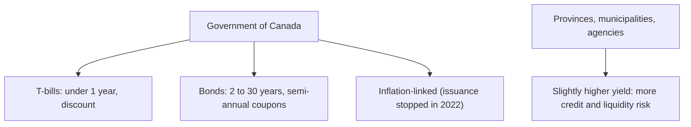

# Government bonds

**Prerequisites:** [What a bond is](01-what-is-a-bond.md), [Credit risk and ratings](06-credit-risk-and-ratings.md).

*A colour poster from the Victory Bond Committee in Ottawa urging Canadians to buy Victory Bonds. Credit: Unknown authorUnknown author or not provided. License: Public domain. Source: [File:Buy Your Victory Bonds. Color poster. Issued by Victory Bond Committee, Ottawa, Canada., ca. 1917 - NARA - 516338.jpg](https://commons.wikimedia.org/wiki/File:Buy_Your_Victory_Bonds._Color_poster._Issued_by_Victory_Bond_Committee,_Ottawa,_Canada.,_ca._1917_-_NARA_-_516338.jpg).*

Governments are the largest borrowers in the world, and their bonds are the foundation of the fixed-income market. Government yields serve as the benchmark for pricing nearly everything else: mortgage rates, corporate bonds, and the discount rates used in valuation all start from a government yield.

## Why governments borrow

A government spends on services and infrastructure and collects taxes. When spending exceeds revenue, the gap is a **deficit**, financed by issuing bonds. The cumulative stock of past borrowing is the **national debt**. Governments have also used bonds to finance wars: the Victory Bond campaigns in the First World War (Canada's first in 1917) and the war bonds of the Second World War sold debt to ordinary people on a very large scale. Unlike a company, a government can raise taxes, and a government that borrows in its own currency can, in principle, create money to repay; this is why such debt is often treated as free of default risk in the currency, though not of inflation or interest rate risk.

## Main instruments

Terms are similar across countries, and Canada's names are typical:

- **Treasury bills (T-bills):** short-term (typically up to one year), sold at a discount to face value with no coupons. The return is the difference between purchase price and 1,000 at maturity. Example: a 6-month bill purchased at 980 pays 1,000, a return of 20 ÷ 980 ≈ 2.04% over half a year, or about 4.1% annualised.
- **Notes and bonds:** longer-term, with semi-annual coupons. Government of Canada bonds are issued at maturities such as 2, 3, 5, 10 and 30 years. In the US, the Treasury issues notes (2 to 10 years) and bonds (20 and 30 years).
- **Inflation-linked bonds:** principal or coupons adjust with inflation, covered in [inflation-linked bonds](10-inflation-linked-zero-coupon-and-gics.md).
- **Savings bonds:** non-tradable bonds sold to individuals. The Canada Savings Bond programme ended with the last sales in 2017.

Sub-sovereign borrowers issue similar instruments: **provinces** (Ontario, Quebec and others), **municipalities**, and Crown corporations. **Canada Mortgage Bonds** are issued through the Canada Housing Trust and carry a federal guarantee of timely payment. Provincial bonds usually yield a bit more than federal bonds, because of the slightly greater credit risk and lower liquidity.

## The "risk-free" rate

A government bond issued in its own currency is generally used as the **risk-free rate** in finance: the return on a no-default-risk asset. Several caveats are worth knowing:

- No sovereign is *literally* risk-free. Countries have defaulted or restructured throughout history, notably those borrowing in foreign currencies. Greece restructured its debt in 2012.
- In August 2011, S&P lowered the US credit rating from AAA to AA+ after a political standoff over the debt ceiling, and Moody's moved the US from Aaa to Aa1 in May 2025. Yet US Treasuries remain the world's most widely used safe-haven asset, because of their liquidity and the size of the market.
- Even a default-free bond carries **interest-rate risk** and **inflation risk**: its market price fluctuates, and its real value can be eroded.
- Canada has historically held top-tier ratings from the major agencies; check the current assessments, because ratings change.

## How governments sell bonds

Primary dealers (large banks) bid at **auctions** run by the Bank of Canada on behalf of the government, or by the US Treasury. The bonds are then traded in the secondary market, one of the deepest and most liquid in the world. The size, auctions and tradability of government bonds make them the market's safe place; in a panic, investors often sell risky assets and buy government bonds, a **flight to quality**, pushing yields down.

## Central banks and government bonds

Central banks both set short-term interest rates and, since the 2008 crisis, have bought large amounts of government bonds through **quantitative easing** (QE) to push down long-term yields, later reversing with **quantitative tightening** (QT). Government bond yields therefore reflect market expectations about central bank policy; see [central banks](../../05-regulation/06-central-banks-and-monetary-policy.md).

## Role in portfolios

Government bonds provide: a safe, liquid reserve; income; and, historically, diversification against equities, since they have often held value or risen in value when stocks fell sharply in a recession, because yields fall. That negative relation is not a law: in 2022, rising inflation caused bonds and stocks to fall together. Investors who hold bonds as a stabiliser should be clear about what kind of risk they are guarding against.

## Key ideas

- Government bonds finance deficits and set the benchmark risk-free yield.
- Bills are discount instruments of up to a year; notes and bonds pay coupons.
- "Risk-free" means no default in domestic currency, not no price risk.
- Government bonds historically diversified equity risk, but not when inflation and rising rates hit both.

## Where this leads

- Next: [corporate bonds and high yield](08-corporate-bonds-and-high-yield.md), then [the yield curve](09-the-yield-curve.md).
- Related: [central banks](../../05-regulation/06-central-banks-and-monetary-policy.md), [Bretton Woods and the postwar order](../../08-history/08-bretton-woods-and-the-postwar-order.md).
- Glossary: [[g:treasury-bill|Treasury bill]], [[g:government-bond|government bond]], [[g:sovereign-debt|sovereign debt]], [[g:flight-to-quality|flight to quality]], [[g:quantitative-easing|quantitative easing]], [[g:canada-mortgage-bond|Canada Mortgage Bond]].
