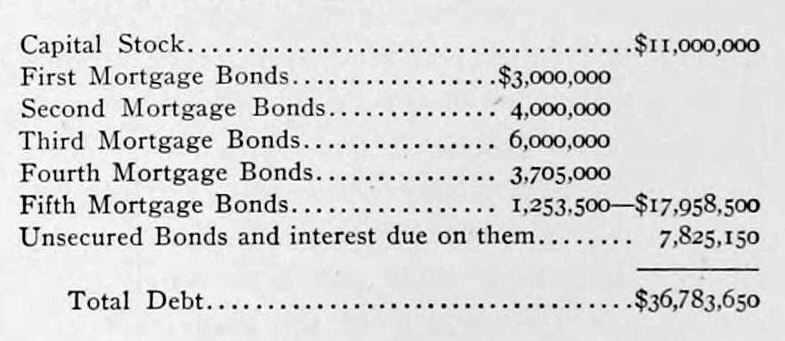

# Corporate bonds and high yield

**Prerequisites:** [Credit risk and ratings](06-credit-risk-and-ratings.md), [Government bonds](07-government-bonds.md).

*Erie Railroad bond and capital stock listing, 1859: railroads were the first big issuers of corporate bonds. Credit: Edward Harold Mott. License: Public domain. Source: [File:Erie Railroad, bond dept and capital stock, 1859.jpg](https://commons.wikimedia.org/wiki/File:Erie_Railroad,_bond_dept_and_capital_stock,_1859.jpg).*

Companies borrow in the bond market when they need large sums for long periods. **Corporate bonds** pay more than government bonds of the same maturity, because the issuer might fail. The market splits into **investment grade** and **high yield**, with different behaviour and different investors.

## Why companies issue bonds

- **Cheaper than equity:** lenders accept lower returns than shareholders, and interest is typically tax-deductible, as discussed in [equity and debt](../../02-firms-and-capital/03-equity-and-debt.md).
- **No dilution:** owners keep control and the upside.
- **Large and long-term:** the bond market can supply amounts and maturities that a single bank may not.
- **Flexibility:** bonds can be tailored with callable, convertible or floating-rate features.

Railroads were the first large issuers: in the 19th century, bonds financed the networks that crossed North America. The Erie Railroad and the Canadian Pacific Railway were among those that raised money from investors in London, New York and Montreal. Issuers have included utilities, banks, manufacturers and, more recently, technology companies.

## Types of corporate bonds

- **Secured bonds** (mortgage bonds, equipment trust certificates) are backed by specific collateral.
- **Debentures** are unsecured, relying only on the issuer's general credit.
- **Subordinated bonds** rank below senior debt in bankruptcy and pay more to compensate.
- **Convertible bonds** can be exchanged for shares at a set price; the investor accepts a lower coupon in return for equity upside. They blend features of [debt and equity](../../02-firms-and-capital/03-equity-and-debt.md).
- **Floating-rate notes** have coupons that reset with a reference rate, which reduces interest rate risk.
- **Callable bonds** let the issuer repay early, usually when rates fall; investors demand extra yield for this.
- **Green bonds and sustainability-linked bonds** direct proceeds toward environmental projects, or tie terms to targets.

## Investment grade and high yield

**Investment-grade** bonds (BBB−/Baa3 or higher) have lower default risk and trade at modest spreads over governments. They are held by pension funds, insurers and banks, and behave a lot like government bonds, with an added credit component.

**High-yield bonds**, also called **speculative-grade** or **junk bonds**, are rated BB+/Ba1 or lower. They pay higher coupons to compensate for greater default risk. They behave more like stocks: their prices fall in recessions when defaults rise and spreads widen.

## The junk bond story

Before the 1970s, most high-yield bonds were "fallen angels," bonds that had been investment grade and had been downgraded. Michael Milken, working at the investment bank Drexel Burnham Lambert in the 1970s and 1980s, argued that a diversified portfolio of originally speculative-grade bonds paid more than their risk justified and that smaller or newer companies could be financed through the bond market. Drexel built a large market in newly issued high-yield bonds, which financed growth companies and also **leveraged buyouts**, in which investors buy companies using mostly borrowed money. The boom ended with a wave of defaults and the 1990 collapse of Drexel; Milken pleaded guilty in 1990 to securities law violations and was sentenced to prison. High-yield bonds survived as a mainstream asset class, and they are today a large and liquid market, though they still show episodes of stress, as in 2008 and early 2020.

## Valuation and risks

A corporate bond's yield breaks down as

> Yield = government yield for the same maturity + credit spread

and its price risk comes from both parts: rising government yields and widening spreads each push the price down. In a recession, both can move against the holder (spreads widen), although government yields often fall, partially offsetting.

The main risks are:

1. **Default and recovery:** after default, recovery depends on seniority and assets; senior secured bondholders often recover considerably more than unsecured ones.
2. **Downgrade:** a drop in rating widens the spread and lowers the price.
3. **Call risk:** bonds are called when rates fall, forcing reinvestment at lower yields.
4. **Liquidity risk:** many corporate bonds trade rarely. In stress, dealers may be unwilling to buy, so prices fall more than fundamentals justify.
5. **Event risk:** a leveraged buyout, merger or big dividend can change a company's credit quality overnight, to the bondholders' disadvantage; covenants try to protect against it.

## Investing in corporate bonds

Individuals can buy individual bonds, but minimum sizes, markups and information disadvantages make that tough for small investors. Most use **bond funds** or **ETFs**, which provide diversification across hundreds of issuers; see [pooled investing and mutual funds](../03-funds/01-pooled-investing-and-mutual-funds.md) and [ETFs](../03-funds/02-exchange-traded-funds.md). Remember that a bond fund has no maturity: its price fluctuates with rates and credit spreads, and it never "matures" as a single bond does. Interest from bonds in a non-registered account is taxed as ordinary income in Canada, the least tax-favoured form of investment income, which is one reason fixed income is often held within registered accounts; see [taxes on investments](../../09-personal-investing-canada/06-taxes-on-investments.md).

## Key ideas

- Corporate bonds yield government yield plus a credit spread that compensates for default, downgrade and liquidity risk.
- Investment-grade bonds behave like safer, higher-yielding government bonds; high-yield bonds behave more like stocks.
- Michael Milken and Drexel built the modern high-yield market in the 1970s and 1980s.
- Most individuals access corporate bonds through diversified funds, and interest is fully taxable in non-registered accounts.

## Where this leads

- Next: [the yield curve](09-the-yield-curve.md).
- Related: [credit default swaps](../04-derivatives/06-swaps-and-credit-derivatives.md), [private equity and leveraged buyouts](../03-funds/05-hedge-funds-private-equity-and-closed-end-funds.md).
- Glossary: [[g:corporate-bond|corporate bond]], [[g:junk-bond|junk bond]], [[g:leveraged-buyout|leveraged buyout]], [[g:subordinated-debt|subordinated debt]], [[g:floating-rate-note|floating-rate note]], [[g:call-risk|call risk]].
