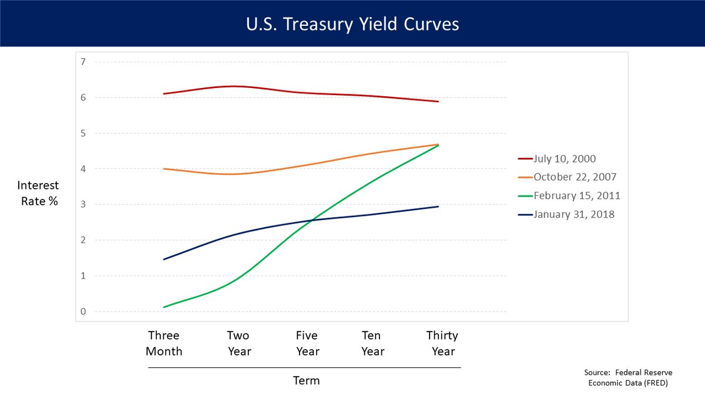
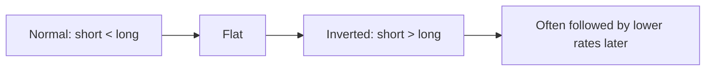

# The yield curve

**Prerequisites:** [Yield to maturity](03-yield-to-maturity.md), [Government bonds](07-government-bonds.md).

*US Treasury yield curves at several dates, plotting yield against time to maturity. Credit: Farcaster. License: [CC BY-SA 4.0](https://creativecommons.org/licenses/by-sa/4.0). Source: [File:U.S. Treasury Yield Curves - v1.png](https://commons.wikimedia.org/wiki/File:U.S._Treasury_Yield_Curves_-_v1.png).*

A government borrows for 3 months, 2 years, 10 years and 30 years, and each maturity has its own yield. Plot those yields against maturity and you have the **yield curve**, one of the most-watched pictures in finance. Its level reflects interest rates, and its shape carries information about what the market expects.

## The shapes

- **Normal (upward-sloping):** long-term yields exceed short-term yields. This is the usual shape. Lenders typically want more for tying up money longer.
- **Flat:** short and long yields are about equal, often a sign of transition.
- **Inverted:** short-term yields exceed long-term yields. Rare, and often discussed as a warning sign.
- **Humped:** medium-term yields exceed both ends.

For example, a normal curve might show a 3-month yield of 3.0%, a 2-year of 3.4%, a 10-year of 4.0% and a 30-year of 4.3%. An inverted curve might show a 3-month yield of 5.0%, a 2-year of 4.5% and a 10-year of 4.0%. The images above show the US Treasury yield curve at several dates, with the shape changing over time.

## Why it slopes

Three main theories, which are not mutually exclusive:

1. **Expectations theory.** A long-term rate is an average of expected future short-term rates. If you expect short rates to rise, the long rate is higher than today's short rate (upward slope); if you expect cuts, it is lower (downward slope or inversion). A simple example: if the 1-year yield is 3% and the market expects the 1-year yield next year to be 5%, then a 2-year bond should yield about the average, around 4%, since (1.03 × 1.05)^0.5 − 1 ≈ 4.0%. The implied forward rate is built from today's curve.
2. **Liquidity premium (term premium).** Longer bonds are more exposed to interest-rate and inflation risk, so investors demand extra yield to hold them. This explains why the curve typically slopes up even if no rate rise is expected.
3. **Market segmentation / preferred habitat.** Different investors prefer different maturities (pension funds like long bonds, banks like short ones), so supply and demand at each maturity matter.

## Reading the curve

- **Level:** an overall rise in yields is a rise in the cost of borrowing and often reflects higher expected inflation or policy rates.
- **Slope:** the gap between long and short yields, often measured as the 10-year minus 2-year yield. A steep curve means the market expects growth or inflation to pick up (or higher future rates); a flat or inverted curve says the market expects rates to fall, often because it expects the economy to weaken.
- **Curvature:** the middle of the curve relative to the ends.

Short-term yields are mainly anchored by the central bank's policy rate; long-term yields are set by the market's view of growth, inflation and risk. When a central bank raises short rates sharply to fight inflation while investors expect inflation to fall back, the front end rises more than the back end, and the curve inverts. Inverted curves have preceded many past recessions in the United States, which has made inversion a widely watched indicator. But the record is limited in the number of cases and the lead time varies widely, and the long inversion that began in 2022 was not followed by an immediate downturn. Treat the curve as one signal among many.

## Spot rates, par yields and the zero curve

Different types of yield curves exist:

- The **par yield curve** plots the yields of bonds priced at par, and is what is usually shown in the news.
- The **spot rate (zero) curve** plots the yield of zero-coupon bonds at each maturity. Because each cash flow of a coupon bond is a mini zero-coupon bond, bond prices are more exactly computed by discounting each cash flow at its own spot rate than by one yield: Price = Σ CFₜ ÷ (1 + sₜ)ᵗ. That is why the term structure matters for valuation.
- **Forward rates** derived from the spot curve tell you the interest rate for a future period implied by today's prices.

## The yield curve and everything else

The government curve is the foundation for the pricing of other instruments. A corporate bond's yield is a spread over the government curve at the same maturity. Mortgage rates, bank loan rates and swap rates follow the curve at relevant maturities. A fixed-rate five-year mortgage in Canada is priced off the five-year government bond yield, with a spread. For banks, which borrow short and lend long, a steep curve widens profits and an inverted one squeezes them. For an investor, the curve shows the reward for taking duration risk: whether longer bonds pay enough extra yield compared with short ones.

## Key ideas

- The yield curve plots yield against maturity for similar-quality bonds, usually government bonds.
- Normal curves slope upward; inversions mean short rates exceed long rates, often tied to expectations of rate cuts or weakness.
- Slope is explained by expected future rates, a term premium and segmented demand.
- The curve underlies pricing of mortgages, corporate bonds and much else; spot rates are the exact discount rates for each cash flow.

## Where this leads

- Next: [inflation-linked bonds, zero-coupon bonds and GICs](10-inflation-linked-zero-coupon-and-gics.md).
- Related: [central banks and monetary policy](../../05-regulation/06-central-banks-and-monetary-policy.md), [swaps](../04-derivatives/06-swaps-and-credit-derivatives.md).
- Glossary: [[g:yield-curve|yield curve]], [[g:inverted-yield-curve|inverted yield curve]], [[g:term-premium|term premium]], [[g:spot-rate|spot rate]], [[g:forward-rate|forward rate]], [[g:term-structure|term structure]].
