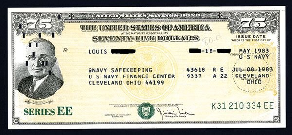
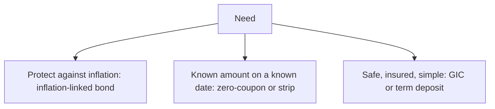

# Inflation-linked bonds, zero-coupon bonds and GICs

**Prerequisites:** [Pricing a bond](02-pricing-a-bond.md), [Inflation and real returns](../../01-foundations/07-inflation-and-real-returns.md), [Government bonds](07-government-bonds.md).

*A US Series EE savings bond: bought at a discount to face value, it works much like a zero-coupon bond. Credit: U.S. Department of the Treasury. License: Public domain. Source: [File:US Savings Bond EE $75.png](https://commons.wikimedia.org/wiki/File:US_Savings_Bond_EE_$75.png).*

The bond family has several specialised members that answer particular needs: protection against inflation, a guaranteed lump sum at a known date, or a simple, insured term deposit. This lesson covers the ones a Canadian investor is likely to meet.

## Inflation-linked bonds

A regular bond pays fixed dollar amounts, so inflation erodes their real value. An **inflation-linked bond** adjusts so that the buyer's purchasing power is preserved. In the common design, the principal is multiplied by an inflation index (in Canada the CPI), and coupons are paid on the adjusted principal.

Example: a bond has face value 1,000 and a **real coupon** of 1.5%. Over a year, CPI rises 3%. The principal is adjusted to 1,030, and the coupon is 1.5% × 1,030 = 15.45, which is higher than last year's. At maturity the holder receives the inflation-adjusted principal. The **real yield** is therefore what the bond promises *above* inflation.

The US Treasury introduced Treasury Inflation-Protected Securities (TIPS) in 1997, and the United Kingdom, Canada and other countries have had similar bonds. Canada issued **Real Return Bonds** from 1991, but on 3 November 2022 the federal government announced it would stop issuing them, citing low demand; the existing bonds continue to trade until they mature. Investors in Canada can still hold inflation-linked bonds through funds or foreign inflation-linked bonds.

An important derived measure is the **breakeven inflation rate**: the difference between the yield on a regular bond and the real yield on an inflation-linked bond of the same maturity. It is the market's implied expectation of inflation (plus a risk premium). If the regular 10-year yield is 4.0% and the real yield is 1.5%, the breakeven is about 2.5%: inflation-linked bonds beat regular bonds if inflation averages above 2.5%. Inflation-linked bonds are still exposed to **real interest rate risk**: when real yields rise, their prices fall, which happened sharply in 2022.

## Zero-coupon bonds and strips

As shown in [pricing a bond](02-pricing-a-bond.md), a **zero-coupon bond** pays only a single amount at maturity, and is sold at a discount. Its yield is the whole return, compounded. Two ways to get them:

- **Issued zeros** from governments and corporations.
- **Strips** (Separate Trading of Registered Interest and Principal of Securities): a dealer takes a government bond and separates each coupon and the principal into individual zero-coupon securities. A 10-year bond with semi-annual coupons becomes 20 coupon strips and one principal strip.

Features:

- **Price sensitivity** is the highest of any bond with the same maturity, since duration equals maturity. A 30-year zero at 4% costs 1,000 ÷ 1.04³⁰ = 308.32, and if the yield rises to 6% it costs 174.11, a fall of 44%.
- **No reinvestment risk:** the return is known at purchase if held to maturity and no default occurs.
- **Taxation:** in a non-registered account, many tax systems tax the **imputed (accrued) interest** each year even though no cash is received, a phantom income problem. Zeros are therefore often held in registered accounts such as an RRSP or TFSA.
- **Use cases:** matching a known future liability, such as a tuition payment or a retirement date, or very long duration exposure.

US Series EE savings bonds (the image above) were sold at a discount in some periods and work much like zeros.

## GICs and term deposits

A **Guaranteed Investment Certificate (GIC)** is a deposit with a bank, trust company or credit union that pays a stated interest for a fixed term, from a few months to five years or more. It is the Canadian everyday cousin of the bond:

- **Non-redeemable GICs** pay a higher rate but lock the money in until maturity. **Cashable** GICs allow early withdrawal, usually with a lower rate.
- **Interest** can be paid regularly or compounded to maturity.
- **Safety:** GICs are deposits, not securities, and are generally insured by the Canada Deposit Insurance Corporation (CDIC) up to $100,000 per category per member institution, including principal and interest (check cdic.ca for current rules); credit unions have provincial insurers. Marketable GICs held at an investment dealer are covered, if at all, by different rules: the Canadian Investor Protection Fund covers the *property* held at a member dealer, not its value.
- **Return:** fixed, so there is no market price risk if you hold to maturity, but also no inflation protection and no upside.
- **GIC ladder:** an investor buys GICs of different maturities (one, two, three, four, five years) and, as each matures, rolls it into a new five-year GIC. This gives regular liquidity and reduces the risk of locking everything in at a low rate.

GICs, like bonds, are priced by the yield curve and by the issuer's credit, and they are taxed as interest income in non-registered accounts. They suit money needed on a known date, such as a down-payment fund in three years; see [the FHSA](../../09-personal-investing-canada/05-the-fhsa.md) and [the TFSA](../../09-personal-investing-canada/03-the-tfsa.md) for accounts that can hold them.

## Putting them in context

| Instrument | What it protects | Main drawback |
|---|---|---|
| Inflation-linked bond | Purchasing power | Real-rate risk; low yield |
| Zero-coupon bond / strip | Known future lump sum | Price volatility; phantom income |
| GIC | Principal (insured), known rate | No liquidity, no inflation protection |

## Key ideas

- Inflation-linked bonds adjust principal to the CPI; the real yield is the return above inflation, and breakeven inflation compares them with regular bonds.
- Zero-coupon bonds and strips pay one amount at maturity; they have maximum duration for their maturity and may create taxable phantom income.
- GICs are insured deposits with fixed terms; ladders manage liquidity and rate risk.
- Canada stopped issuing Real Return Bonds in 2022.

## Where this leads

- Next section: [funds](../03-funds/01-pooled-investing-and-mutual-funds.md), which package bonds and stocks together.
- Related: [inflation](../../01-foundations/07-inflation-and-real-returns.md), [taxes on investments](../../09-personal-investing-canada/06-taxes-on-investments.md), [CIRO and investor protection](../../05-regulation/04-ciro-and-investor-protection.md).
- Glossary: [[g:inflation-linked-bond|inflation-linked bond]], [[g:real-return-bond|Real Return Bond]], [[g:breakeven-inflation|breakeven inflation]], [[g:strip-bond|strip bond]], [[g:gic|GIC]], [[g:gic-ladder|GIC ladder]].
