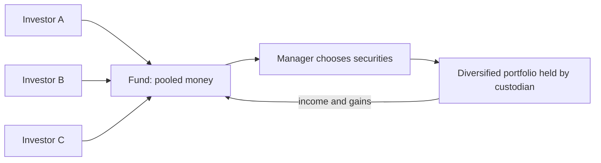

# Pooled investing and mutual funds

**Prerequisites:** [Correlation and diversification](../../01-foundations/11-correlation-and-diversification.md), [What a security is](../../02-firms-and-capital/07-what-is-a-security.md).

*John Neff, long-time manager of the Vanguard Windsor mutual fund. Credit: BillCramer. License: [CC BY-SA 4.0](https://creativecommons.org/licenses/by-sa/4.0). Source: [File:John neff mutual fund manager.jpg](https://commons.wikimedia.org/wiki/File:John_neff_mutual_fund_manager.jpg).*

Diversifying properly takes dozens of holdings, which is expensive and laborious for a small investor. The solution, as old as the 18th century, is **pooling**: many investors put money into one vehicle, which a professional manager invests in a diversified portfolio. Each investor owns a proportional slice. The most common form is the **mutual fund**.

## A short history

In 1774 an Amsterdam broker, Abraham van Ketwich, offered a trust called *Eendragt Maakt Magt* ("Unity Creates Strength"), often cited as the first investment fund; it pooled money in a diversified set of bonds. Investment trusts then appeared in Britain and Scotland in the 1860s. In the United States, the Massachusetts Investors Trust (1924) is generally regarded as the first open-end mutual fund. After the crash of 1929 exposed abuses, the **Investment Company Act of 1940** set the US regulatory framework; Canada developed provincial securities regulation of funds, and mutual funds grew rapidly there from the 1960s onward, especially after the 1990s, when bank-owned fund families spread them through branch networks.

## How a mutual fund works

An **open-end mutual fund** issues new units to investors who put in money and redeems units of those who withdraw, so the fund's size changes daily. Each unit's value is the **net asset value per unit (NAV)**:

> NAV = (value of assets − liabilities) ÷ units outstanding

Example: a fund holds securities worth 250 million, owes 10 million in fees and other liabilities, and has 12 million units outstanding. NAV = (250 − 10) ÷ 12 = 20.00. If you invest 5,000 you receive 250 units. The fund is priced once a day, after markets close, and all purchases and redemptions that day take place at that NAV, so there is no premium or discount to value, and no intraday trading. This differs from an [ETF](02-exchange-traded-funds.md).

The key players: the **investors** (unit holders); the **manager**, who chooses investments for a fee; the **custodian**, which holds the assets separately from the manager; and the **regulator**, such as the provincial securities commissions under National Instrument 81-102 in Canada, which sets rules on what funds can hold and how they are sold.

## Types of mutual funds

- **Money market funds:** very short-term, high-quality debt; stable value, low return.
- **Bond (fixed-income) funds:** portfolios of bonds; see [duration](../02-bonds/05-duration-and-convexity.md) for their rate sensitivity.
- **Equity funds:** by region (Canadian, US, global), size (small-cap), style (growth, value) or sector.
- **Balanced and asset allocation funds:** a fixed or managed mix of stocks and bonds in one product.
- **Target-date funds:** shift gradually toward bonds as a target year (such as a retirement date) approaches.
- **Index funds:** track a market index with minimal management; see [index funds](03-index-funds.md).
- **Segregated funds:** insurance-company versions with guarantees on part of the principal, with higher fees.

## Advantages

- **Diversification** from a small amount of money.
- **Professional management** and administration.
- **Convenience:** automatic reinvestment of distributions, regular contribution plans.
- **Regulation and custody protections:** assets are held separately from the manager.
- **Access** to markets that are hard for small investors to reach.

## Costs and cautions

Funds are not free. Costs include the **management expense ratio** (MER), sales charges or trailing commissions paid to advisers in some fund series, and trading costs inside the fund; see [fees and the cost of investing](04-fees-and-the-cost-of-investing.md). Other issues:

- **Tax distributions:** a fund must distribute realised gains and income to unit holders, who owe tax in a non-registered account even if they reinvested, which can trigger a tax bill in a year when the fund's own price fell.
- **Underperformance:** most actively managed funds have trailed their benchmarks after fees over long periods, a finding documented by studies including the SPIVA scorecards; see [active versus passive](../../06-portfolio-theory/05-active-versus-passive-investing.md).
- **Past performance:** it is a poor predictor of future results, which regulators require funds to say.
- **Fund-specific risks:** concentration, style drift or closing to new investors.

## Key ideas

- A mutual fund pools money into a diversified portfolio run by a manager; each investor owns units valued at NAV.
- Open-end funds create and redeem units at the end-of-day NAV.
- Fund types range from money market to equity, balanced, target-date and index funds.
- Fees, tax distributions and long-run underperformance of active funds are the main cautions.

## Where this leads

- Next: [exchange-traded funds](02-exchange-traded-funds.md), then [index funds](03-index-funds.md).
- Related: [portfolio theory](../../06-portfolio-theory/README.md), [costs and choosing a platform](../../09-personal-investing-canada/08-costs-brokers-and-choosing-a-platform.md).
- Glossary: [[g:mutual-fund|mutual fund]], [[g:net-asset-value|net asset value]], [[g:open-end-fund|open-end fund]], [[g:target-date-fund|target-date fund]], [[g:segregated-fund|segregated fund]], [[g:custodian|custodian]].
