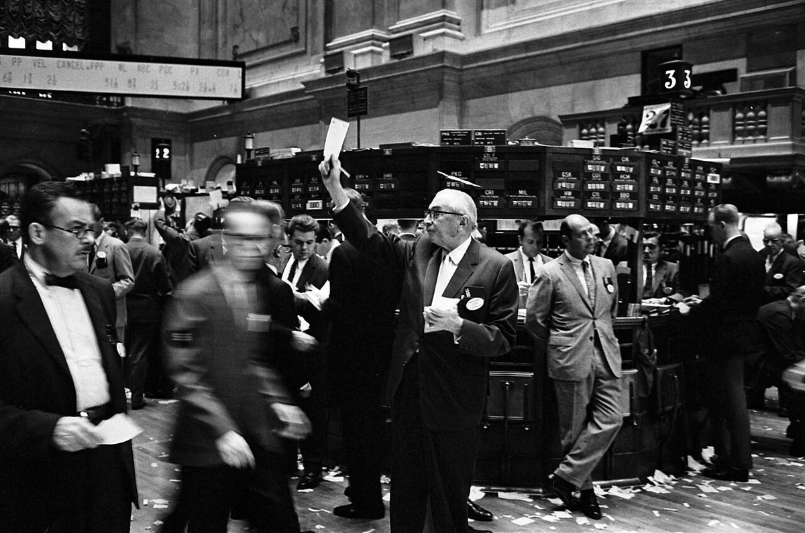
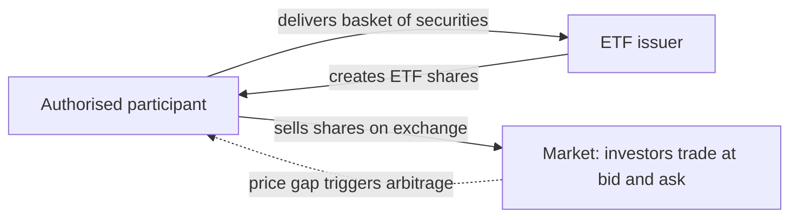

# Exchange-traded funds

**Prerequisites:** [Pooled investing and mutual funds](01-pooled-investing-and-mutual-funds.md), [What an exchange does](../../04-markets/01-what-an-exchange-does.md).

*The trading floor of the New York Stock Exchange: ETF shares trade on exchanges just like stocks. Credit: Thomas J. O'Halloran. License: Public domain. Source: [File:NY stock exchange traders floor LC-U9-10548-6.jpg](https://commons.wikimedia.org/wiki/File:NY_stock_exchange_traders_floor_LC-U9-10548-6.jpg).*

An **exchange-traded fund** (ETF) is a pooled fund whose units trade on a stock exchange all day, like a share. It combines the diversification of a fund with the convenience and typically low cost of listed trading. ETFs have become one of the most important innovations in retail investing.

## Origins

The first product of this type, Toronto Stock Exchange's Toronto 35 Index Participation Units (TIPs), launched in Canada in 1990 and tracked the TSE 35 index. In the United States, the SPDR S&P 500 ETF (ticker SPY) launched in January 1993 and remains one of the largest. The iShares family, launched under that name in 2000, grew into one of the major providers, and ETFs now cover thousands of indexes, including bonds, commodities, currencies and themes. In Canada, several providers, such as BMO, iShares, Vanguard, Horizons and others, compete; in 2018 and after, "all-in-one" asset allocation ETFs became popular, covered in [building a simple portfolio](../../09-personal-investing-canada/07-building-a-simple-portfolio.md).

## How an ETF works

Shares of the ETF trade on an exchange between investors, at a market price that moves minute by minute. A buyer pays the **ask** and a seller receives the **bid**, just as with any stock; see [bid, ask and market makers](../../04-markets/05-bid-ask-and-market-makers.md).

The mechanism that keeps the market price close to the fund's underlying value is **creation and redemption**. Large institutions called **authorised participants** (APs) can deliver the basket of underlying securities to the fund in exchange for newly created ETF shares (creation), or hand in ETF shares to receive the basket (redemption). If the ETF's price drifts above the value of its holdings, APs can buy the cheaper holdings, create ETF shares and sell them at the higher price, profiting and pushing the ETF price back down. If it falls below, they do the reverse. The ETF therefore tracks its **net asset value** (NAV) closely, usually within a small fraction of a percent for liquid underlying assets. Because it is usually done "in kind" (securities for shares), the process also makes ETFs tax-efficient in some jurisdictions: the fund avoids selling holdings to meet redemptions.

## ETFs and mutual funds compared

| Feature | ETF | Mutual fund |
|---|---|---|
| Trading | All day on an exchange | Once a day at NAV |
| Pricing | Market price (may differ slightly from NAV) | NAV |
| Costs | MER plus trading spread and brokerage commission | MER; sometimes sales charges |
| Minimums | One share (or a fraction) | Often a minimum purchase |
| Automatic plans | Limited unless the broker offers them | Common |
| Tax | Often efficient (fewer distributions) | May distribute gains |
| Management | Mostly index-tracking | Active or indexed |

## Types of ETFs

- **Broad market and sector index ETFs:** the most common.
- **Bond ETFs:** hold baskets of bonds; the ETF trades continuously even though its holdings trade over the counter, which can create gaps in stressed markets.
- **Commodity and currency ETFs:** physical holdings or futures.
- **Leveraged and inverse ETFs:** aim for a multiple (or the opposite) of an index's *daily* return. Because of daily resetting, over longer periods their results can diverge considerably from the multiple of the index's long-term return; they are trading tools, not buy-and-hold investments.
- **Active ETFs:** managers select holdings within the ETF wrapper.
- **Smart-beta or factor ETFs:** follow rules-based strategies on value, momentum and others; see [factor investing](../../06-portfolio-theory/07-factor-investing.md).
- **Synthetic ETFs:** use derivatives (swaps) to replicate an index, adding counterparty risk.

## What to check before buying

1. **MER and tracking error:** the fee and how closely the ETF follows its index.
2. **Liquidity:** trading volume and the **bid-ask spread**; use limit orders, see [order types](../../04-markets/04-order-types.md).
3. **Underlying holdings:** some ETFs are narrow or concentrated despite their names.
4. **Structure:** physical or synthetic; domicile (US-listed ETFs held by Canadians face foreign withholding tax issues, especially inside a TFSA).
5. **Currency:** whether the fund hedges foreign currency exposure.

Trading at the open or close on volatile days can produce unexpected prices. The 24 August 2015 US market dislocation and the May 2010 flash crash saw some ETFs trade far below the value of their holdings for brief periods. Using limit orders avoids bad fills.

## Key ideas

- An ETF is a pooled fund that trades on an exchange throughout the day.
- Creation and redemption by authorised participants keep the price close to NAV.
- Compared with mutual funds, ETFs offer intraday trading, usually low fees and tax efficiency, but add bid-ask spreads and commissions.
- Check fees, liquidity, structure and currency; treat leveraged and inverse ETFs as short-term tools.

## Where this leads

- Next: [index funds](03-index-funds.md).
- Related: [fees and the cost of investing](04-fees-and-the-cost-of-investing.md), [building a simple portfolio](../../09-personal-investing-canada/07-building-a-simple-portfolio.md).
- Glossary: [ETF](../../glossary/funds/etf.md), [authorized participant](../../glossary/funds/authorized-participant.md), [tracking error](../../glossary/funds/tracking-error.md), [leveraged ETF](../../glossary/funds/leveraged-etf.md), [bid-ask spread](../../glossary/markets/bid-ask-spread.md), [synthetic ETF](../../glossary/funds/synthetic-etf.md).
