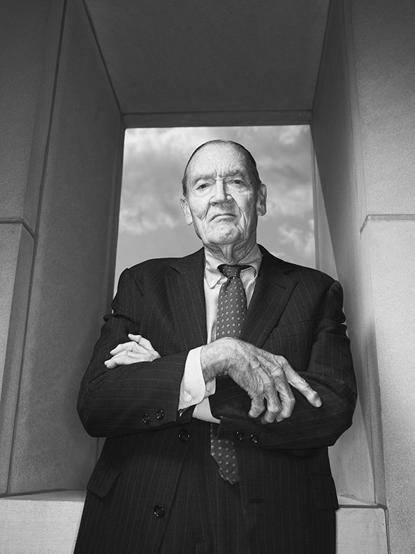
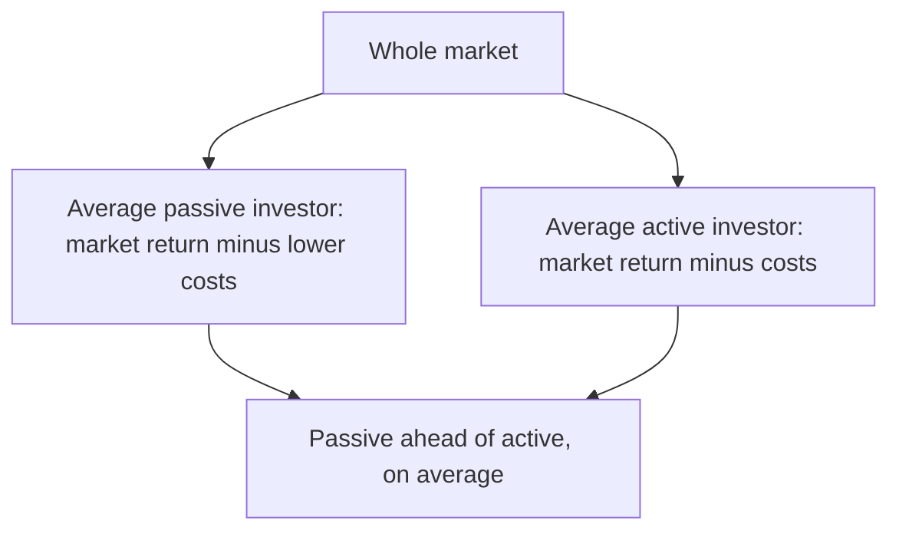

# Index funds

**Prerequisites:** [Pooled investing and mutual funds](01-pooled-investing-and-mutual-funds.md), [Market indices](../../04-markets/06-market-indices.md).

*John C. Bogle, founder of Vanguard and of the first index mutual fund for individual investors. Credit: BillCramer. License: [CC BY-SA 4.0](https://creativecommons.org/licenses/by-sa/4.0). Source: [File:Photo of a John C. Bogle By Bill Cramer.jpg](https://commons.wikimedia.org/wiki/File:Photo_of_a_John_C._Bogle_By_Bill_Cramer.jpg).*

An **index fund** does not try to beat the market. It tries to *be* the market, by holding the securities in an index in the same proportions, at the lowest possible cost. This humble idea has reshaped investing and is the foundation of what most advice for non-professionals recommends.

## The idea

A **market index** such as the S&P 500 or the S&P/TSX Composite measures the performance of a basket of securities. An index fund buys that basket (or a representative sample) and holds it. When the index changes, the fund adjusts. Because no analysts or stock pickers are needed, costs are minimal: management fees on broad index funds can be a small fraction of the fees on actively managed ones, and trading is rare, so transaction costs and taxable distributions are low as well.

Most major indexes are **market-capitalisation weighted**: each company's weight equals its market value divided by the total, so large companies count for more. This means an index fund holds more of the biggest firms, and it **rebalances automatically** as prices change, since each share's weight rises with its price. An investor in a total-market fund owns a slice of nearly every listed company, about as diversified as an equity investor can get.

## The case for indexing

The argument rests on arithmetic, set out by William Sharpe in a 1991 essay, "The Arithmetic of Active Management":

1. Before costs, the average return of all investors in a market equals the market's return, because together they own the market.
2. Active investors as a group therefore earn the market return before costs, and passive investors earn it too.
3. Active management costs more (research, trading, fees), so after costs the average active dollar must earn less than the average passive dollar.

It is a statement about averages: some active managers beat the market, but identifying them in advance is difficult, and persistent outperformance is rare. Empirical studies, such as the S&P SPIVA reports, generally find that over ten years or more, a majority of actively managed funds underperform their benchmark index after fees in most categories. Compound the lower fees: see [fees and the cost of investing](04-fees-and-the-cost-of-investing.md). Related to this is the [efficient market hypothesis](../../06-portfolio-theory/04-the-efficient-market-hypothesis.md), which argues that prices already reflect available information.

## John Bogle and Vanguard

John C. Bogle founded the Vanguard Group in 1975, and in 1976 launched the first index mutual fund available to individual investors, originally called the First Index Investment Trust and later the Vanguard 500 Index Fund. It was mocked at first as "Bogle's Folly," and attracted little money initially. Over the decades, its low-cost model grew massively, helped by Vanguard's structure, in which the funds own the management company, so profits return to investors as lower costs. Bogle's book *The Little Book of Common Sense Investing* (2007) is the popular statement of the case. He credited the economist Paul Samuelson, who had urged the creation of such a fund in a 1974 essay, and Burton Malkiel, whose book *A Random Walk Down Wall Street* (first published 1973) had made the argument for the public. Today index funds and ETFs hold a very large share of market assets, which has raised new questions about corporate governance and market concentration.

## Types and tracking

- **Broad equity:** total market, large-cap, small-cap, international, emerging markets.
- **Bond indexes:** broad bond market, government, corporate.
- **Style and sector:** growth, value, dividend, technology.
- **Equal-weighted and factor indexes** use other weighting schemes and are sometimes called "smart beta".

**Tracking error** is how much the fund's return deviates from the index. A well-run fund trails its index by about its fees plus small friction costs. A fund with a 0.10% fee should track within about that amount; a larger gap suggests sampling error, cash drag or hedging costs.

## Limits and criticisms

- **No downside protection:** you receive the market's return, including its crashes. An index fund fell with the market in 2008 and 2020.
- **Concentration:** cap-weighted indexes can become dominated by a few large firms; in recent years a handful of technology stocks have made up a large share of US indexes. That means your "diversified" fund is more concentrated than the number of holdings suggests.
- **Momentum feedback:** index funds buy more of whatever rises in price, which critics say can amplify bubbles; research is mixed on the size of the effect.
- **Free-riding on price discovery:** if everyone indexed, nobody would research stocks and prices would lose accuracy, though active investors currently set prices. The system needs active traders, but individuals do not have to be among them.

## Key ideas

- An index fund holds the securities of an index in index weights, at minimal cost.
- The case for indexing is arithmetic: after costs, the average active investor must trail the average passive one.
- John Bogle launched the first retail index fund in 1976; Vanguard's low-cost model transformed the industry.
- Index funds give market returns, with market risk and growing concentration in the largest firms.

## Where this leads

- Next: [fees and the cost of investing](04-fees-and-the-cost-of-investing.md).
- Related: [active versus passive investing](../../06-portfolio-theory/05-active-versus-passive-investing.md), [market indices](../../04-markets/06-market-indices.md).
- Glossary: [[g:index-fund|index fund]], [[g:market-index|market index]], [[g:cap-weighted|cap-weighted]], [[g:passive-investing|passive investing]], [[g:spiva|SPIVA]].
