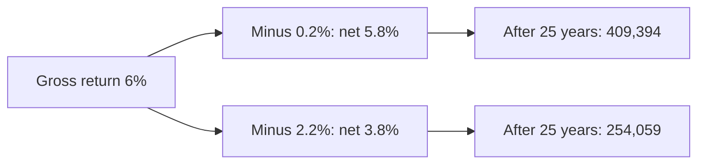

# Fees and the cost of investing

**Prerequisites:** [Simple and compound interest](../../01-foundations/03-simple-and-compound-interest.md), [Index funds](03-index-funds.md).

*Toll booths at Queensway, Birkenhead: a small charge taken on every passage adds up, like an annual fund fee. Credit: Rodhullandemu. License: [CC BY-SA 4.0](https://creativecommons.org/licenses/by-sa/4.0). Source: [File:Toll booths at Queensway, Birkenhead.jpg](https://commons.wikimedia.org/wiki/File:Toll_booths_at_Queensway,_Birkenhead.jpg).*

Investors cannot control markets, but they can control costs. A fee that looks small is deducted every year from a balance that would otherwise compound, so its effect over decades is large. Understanding fees is among the highest-value things an investor can do.

## Kinds of costs

- **Management expense ratio (MER):** in Canada, the annual cost of running a fund as a percentage of its assets, including the management fee, administration and taxes (GST/HST). It is deducted from the fund's returns automatically, so you never see an invoice. In an ETF or fund, the return you see is already **net** of the MER.
- **Trading expense ratio (TER):** the fund's own trading costs, reported separately in Canada. MER + TER is the better measure of total cost.
- **Sales charges:** front-end or deferred loads on some mutual funds. Deferred sales charge schedules have been banned in Canadian provinces since 1 June 2022.
- **Trailing commissions:** ongoing payments from the fund company to the adviser or dealer, embedded in the MER of some fund series. The Canadian Securities Administrators banned trailing commissions on funds sold through discount brokerages (order-execution-only accounts) as of 1 June 2022, partly because no advice is given there.
- **Advisory or management fees:** a percentage of assets charged by an adviser or robo-advisor, separate from fund MERs in fee-based accounts.
- **Trading commissions and spreads:** what you pay to buy and sell. Many Canadian brokers now charge no commission on ETF purchases, but the bid–ask spread remains.
- **Foreign exchange conversion:** converting between currencies at a broker can cost around 1% to 2% or more each way, so Norbert's Gambit and similar techniques exist to reduce it.
- **Taxes** are not fees, but they are a real cost, covered in [taxes on investments](../../09-personal-investing-canada/06-taxes-on-investments.md).

## The arithmetic of drag

Take 100,000 invested for 25 years in a portfolio that earns 6% a year before costs, with annual costs of different sizes:

| Annual cost | Value after 25 years | Reduction vs no costs |
|---|---|---|
| 0% | 429,187 | n/a |
| 0.2% (index ETF-like) | 409,394 | −4.6% |
| 1.0% | 338,635 | −21.1% |
| 2.2% (typical high-fee mutual fund) | 254,059 | −40.8% |

The difference between 0.2% and 2.2% is 155,336 on a 100,000 investment, enough to buy the original sum more than once over. A 2-point fee out of a 6% return takes a third of the gross return every year. The fee is certain; the return is not. As John Bogle emphasised, you "get what you don't pay for."

The compounding effect works against you in two ways: the fee reduces the amount invested each year, and the lost amount would also have earned returns. This is the [time value of money](../../01-foundations/04-time-value-of-money.md) applied to costs.

## Do higher fees buy better performance?

Studies of fund performance across many countries and years consistently find little or no link between higher fees and higher net returns; if anything, low-cost funds tend to do better because the fees are a known, certain handicap that a manager must overcome before adding any value. Morningstar's research has repeatedly found that expense ratio is one of the better predictors of future fund performance. This is not a statement about advice: a good financial planner may be worth the fee for planning, behaviour coaching, tax and estate expertise. But what you pay for *fund selection* tends not to be rewarded.

## How to find the real cost

1. In Canada, look at the fund's **Fund Facts** or **ETF Facts** document, a two-page summary that must be provided, showing the MER, the trailing commission, and past performance.
2. Add MER and TER for funds; add advisory fees if you pay them.
3. Check for hidden costs: bid–ask spreads on thinly traded ETFs, currency conversion and cash drag.
4. Express the total as a percentage of assets and think in decades.

Rule of thumb for orientation (not advice): broad index ETFs often cost well under 0.25% a year, while many actively managed mutual funds sold through branches charge MERs of 2% or more. Check current figures, because they change.

## Costs and behaviour

The cheapest fund can still cost you dearly if you buy and sell at the wrong times. Studies of "investor returns" versus "fund returns", such as Morningstar's research on dollar-weighted returns, find that investors as a group often earn less than the funds they hold, because they pile in after strong performance and leave after weak performance. The behavioural cost of poor timing can exceed the fee; see [overconfidence and other biases](../../07-behavioural-finance/03-overconfidence-and-other-biases.md).

## Key ideas

- Fees compound against you: a 2% annual cost can consume over a third of a 6% gross return and about 40% of final wealth after 25 years.
- Count MER, TER, advisory fees, spreads, currency conversion and taxes.
- Higher fees do not reliably buy better net performance.
- Use Fund Facts / ETF Facts and think in decades.

## Where this leads

- Next: [hedge funds, private equity and closed-end funds](05-hedge-funds-private-equity-and-closed-end-funds.md), the high-fee end of the spectrum.
- Related: [costs, brokers and platforms](../../09-personal-investing-canada/08-costs-brokers-and-choosing-a-platform.md), [active versus passive](../../06-portfolio-theory/05-active-versus-passive-investing.md).
- Glossary: [MER](../../glossary/funds/mer.md), [trading expense ratio](../../glossary/funds/trading-expense-ratio.md), [trailing commission](../../glossary/funds/trailing-commission.md), [load](../../glossary/funds/load.md), [Fund Facts](../../glossary/funds/fund-facts.md), [Norbert's Gambit](../../glossary/personal-investing-canada/norberts-gambit.md).
