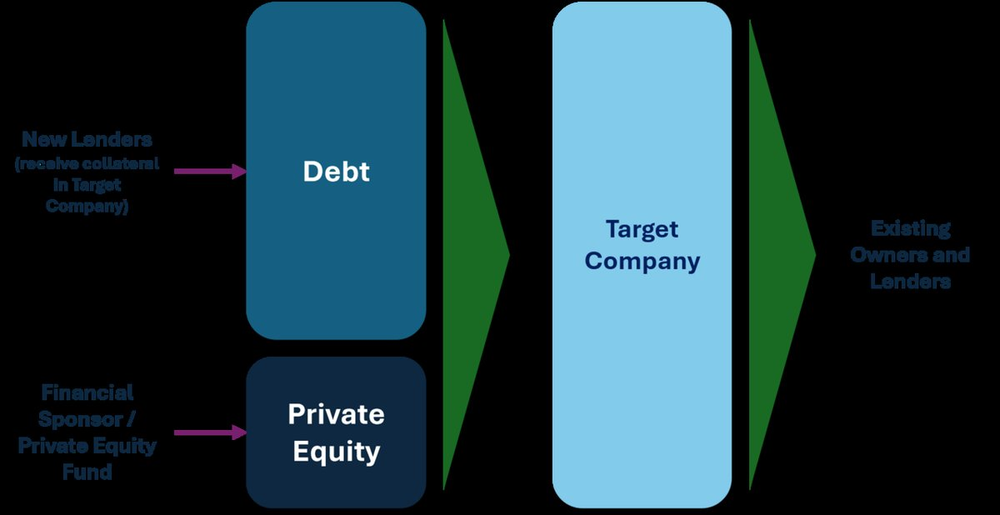
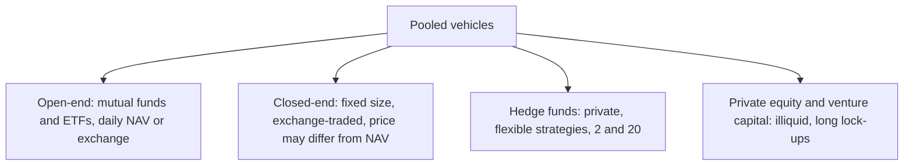

# Hedge funds, private equity and closed-end funds

**Prerequisites:** [Pooled investing and mutual funds](01-pooled-investing-and-mutual-funds.md), [Fees and the cost of investing](04-fees-and-the-cost-of-investing.md).

*A diagram of the structure of a leveraged buyout, the typical private-equity transaction. Credit: I w. Isuzu I’lljjnxbxnxnxn Mn777-4.:4?Urbanrenewal. License: [CC BY 3.0](https://creativecommons.org/licenses/by/3.0). Source: [File:Leveraged Buyout Diagram.png](https://commons.wikimedia.org/wiki/File:Leveraged_Buyout_Diagram.png).*

Not all pooled vehicles are open to everyone or priced daily. This lesson covers three variants: closed-end funds (publicly traded but fixed in size), and hedge funds and private equity (private partnerships mostly for large investors).

## Closed-end funds

A **closed-end fund** raises money once in an IPO, invests it, and then its shares trade on an exchange. Unlike an open-end fund it does not issue or redeem units on demand, so its size is fixed (except for further offerings). Because the market price is set by buyers and sellers, it can differ from the **NAV**: a **discount** (price below NAV) or a **premium**. Example: a fund with a NAV of 20.00 trading at 18.00 is at a 10% discount; buying at that price gives you 20 of assets for 18. Discounts are common and can persist, a long-standing puzzle in finance because there is no creation-redemption mechanism to close the gap, unlike [ETFs](02-exchange-traded-funds.md). Closed-end funds suit illiquid assets (since the manager never faces redemptions) and can use leverage. Scottish and English investment trusts of the 19th century were the earliest examples. Many Canadian closed-end structures also exist, such as split-share corporations and listed investment companies.

## Hedge funds

A **hedge fund** is a privately offered investment partnership that can use strategies mutual funds usually cannot: short selling, leverage, derivatives and concentrated positions. The name comes from the first of them. Alfred Winslow Jones, a sociologist turned journalist and fund manager, created a partnership in 1949 that bought stocks he liked and sold short others, in an attempt to **hedge** away market risk and profit from stock selection.

Common styles include:

- **Long/short equity:** buy undervalued, short overvalued stocks.
- **Global macro:** bet on currencies, rates and commodities based on economic views.
- **Event-driven:** merger arbitrage, distressed debt.
- **Relative value / arbitrage:** exploit small price differences between related securities, usually with leverage.
- **Managed futures** (trend following).

The standard fee structure is "**two and twenty**": a 2% annual management fee plus 20% of profits (the **performance fee**), often with a **high-water mark**, meaning a manager earns the fee only on gains above the fund's previous peak. Example: a 100 million fund earns 15% gross (15 million). The management fee is 2 million. Performance fee is 20% of the remaining profit, 0.2 × (15 − 2) = 2.6 million. Investors net 15 − 2 − 2.6 = 10.4 million, 10.4%, so about 31% of the gross gain went in fees.

Features: limited liquidity (lock-ups and redemption notice periods), minimum investments, limited disclosure, and in many jurisdictions access restricted to **accredited investors**: those meeting income or wealth thresholds set by regulators. In Canada, the accredited-investor definition is in National Instrument 45-106. Hedge funds are lightly regulated compared with mutual funds, and their record is mixed: a few famous winners, and many that failed to cover their fees. Long-Term Capital Management, a highly leveraged fund, required a Federal Reserve-organised rescue in 1998; see [1987, LTCM and the 1990s crises](../../08-history/09-1987-ltcm-and-the-1990s-crises.md). Studies of hedge fund performance generally find that the average fund does not beat simple benchmarks after fees, though results depend on the period and the style, and survivorship bias in databases flatters the figures.

## Private equity

**Private equity (PE)** funds raise money from institutions and wealthy investors to buy companies outright or take large stakes in private firms, then improve and sell them, typically after four to seven years. The classic strategy is the **leveraged buyout** (LBO): buy a company using a large amount of borrowed money, secured against the company's own assets and cash flows. Because of leverage, a modest improvement in the company's value can produce a large return on the PE firm's equity, but losses can be equally large. The 1980s buyout wave, including the 1988 purchase of RJR Nabisco, popularised the model; see [corporate bonds and high yield](../02-bonds/08-corporate-bonds-and-high-yield.md). **Venture capital** is a related strategy, investing in young start-ups, accepting that most will fail and a few will be extremely successful.

Features: **committed capital** called gradually, lock-ups of ten years or so, fees of about 2% plus **carried interest** (typically 20% of profits above a hurdle), and low transparency. Returns are reported as IRRs, which can flatter, since valuations of unsold holdings are estimates ("smoothed"), making private assets look less volatile than they are.

## Who should care

For most individuals, these vehicles are not available directly and often not appropriate: high fees, limited liquidity and complexity are costly, and the record of average performance is uninspiring. They matter for three other reasons. They are a large part of institutional portfolios, such as pension funds. They shape corporate behaviour, as buyers of companies. And products that bring private-market exposure to retail investors, such as interval funds and listed alternatives, are growing, so understanding the trade-offs is useful. The usual questions apply: what is the real cost, what are you being paid for taking illiquidity, and how would you get out?

## Key ideas

- Closed-end funds have a fixed number of shares that trade at a premium or discount to NAV.
- Hedge funds are private partnerships using short selling, leverage and derivatives, usually with 2 and 20 fees.
- Private equity buys companies, often with debt, and holds them for years; fees and illiquidity are significant.
- Costs, illiquidity and opaque reporting make these vehicles hard to judge; most individuals need not use them.

## Where this leads

- Next: [derivatives](../04-derivatives/01-what-is-a-derivative.md), the instruments hedge funds use heavily.
- Related: [accredited investors and regulation in Canada](../../05-regulation/03-securities-regulation-in-canada.md), [active versus passive investing](../../06-portfolio-theory/05-active-versus-passive-investing.md).
- Glossary: [[g:closed-end-fund|closed-end fund]], [[g:hedge-fund|hedge fund]], [[g:private-equity|private equity]], [[g:venture-capital|venture capital]], [[g:accredited-investor|accredited investor]], [[g:carried-interest|carried interest]].
