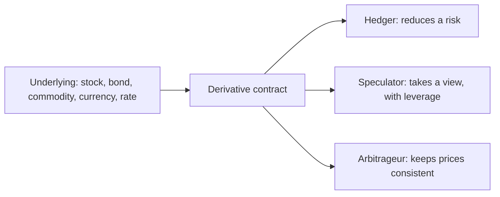

# What is a derivative?

**Prerequisites:** [What a security is](../../02-firms-and-capital/07-what-is-a-security.md), [Risk and return](../../01-foundations/10-risk-and-return.md).

*Thales of Miletus, whom Aristotle's Politics credits with an early option-like contract on olive presses. Credit: Blanchard. License: [CC BY 4.0](https://creativecommons.org/licenses/by/4.0). Source: [File:Thales of Miletus. Line engraving by Blanchard. Wellcome V0005771.jpg](https://commons.wikimedia.org/wiki/File:Thales_of_Miletus._Line_engraving_by_Blanchard._Wellcome_V0005771.jpg).*

A **derivative** is a contract whose value *derives* from something else: the price of a stock, bond, commodity, currency, interest rate, an index, or even the weather. The thing it derives from is the **underlying**. Derivatives are tools for transferring risk, and like any powerful tool they can protect or injure depending on how they are used.

## Old ideas

Derivatives are far older than modern markets. Aristotle's *Politics* tells a story about the philosopher Thales, who, forecasting a large olive harvest, paid deposits for the right to use olive presses and then profited when demand arrived; whether or not the tale is true, it describes an option. In 17th-century Japan, rice merchants in Osaka traded contracts for future delivery of rice at the Dojima market; and in the 17th-century Dutch Republic, forward and option contracts on shares were traded in Amsterdam. In 1848 the Chicago Board of Trade opened to let farmers and grain dealers agree on future prices, and in 1865 it standardised grain contracts, creating futures as we know them. The Chicago Board Options Exchange (CBOE) opened in April 1973 and listed standardised stock options for the first time; the Black–Scholes formula was published that same year.

## Why they exist

Derivatives serve three purposes:

1. **Hedging:** reduce an existing risk. A farmer sells wheat futures to lock in a price; an airline buys oil futures to fix fuel costs; an exporter hedges a currency exposure.
2. **Speculation:** take a view on a price with less money up front, a form of **leverage**.
3. **Arbitrage and price discovery:** exploit mispricings between related assets, which keeps prices consistent; futures prices also reveal market expectations.

For every hedger who wants to shed a risk, someone else must take it, often a speculator paid for bearing it. Without speculators, hedgers could not find a counterparty.

## The main families

| Type | What it does |
|---|---|
| Forward | Private agreement to buy or sell an asset at a set price on a future date |
| Future | A standardised, exchange-traded forward, settled daily |
| Option | The *right*, not the obligation, to buy (call) or sell (put) at a set price |
| Swap | Agreement to exchange streams of cash flows, such as fixed for floating interest |
| Credit derivative | Transfers credit risk, for instance a credit default swap |

The first lessons here describe each: [forwards and futures](02-forwards-and-futures.md), [options](03-options-calls-and-puts.md) and [swaps](06-swaps-and-credit-derivatives.md).

## Where they trade

- **Exchange-traded derivatives:** standardised contracts traded on exchanges with a **clearing house** as counterparty to every trade, which removes **counterparty risk**. In Canada, the Montreal Exchange, part of TMX Group, is the derivatives exchange.
- **Over-the-counter (OTC) derivatives:** customised bilateral contracts, mostly between banks and large institutions. The notional value outstanding is in the hundreds of trillions of dollars, though that figure overstates actual risk: notional is the size of the underlying exposure, not the money at stake. After the 2008 crisis, reforms required many standardised OTC derivatives, such as interest-rate swaps, to be cleared through central counterparties and reported to trade repositories.

## Leverage, an example

A call option giving the right to buy 100 shares at 50 might cost 3 per share, or 300. If the stock rises from 50 to 60, the option is worth at least 10 per share, so 1,000: a 233% gain on 300 while the stock gained 20%. If the stock stays at 50 or falls, the option expires worthless, a 100% loss. Leverage magnifies gains and losses both. Buying the 100 shares directly would cost 5,000.

## The dangers

- **Leverage and losses beyond the stake:** a futures position or a sold (written) option can lose far more than the margin put up.
- **Complexity and misuse:** in 1995, Nick Leeson's unauthorised derivatives trading brought down Barings Bank, then Britain's oldest merchant bank. In 1994, Orange County, California, lost around 1.5 billion dollars in leveraged interest-rate positions and entered bankruptcy.
- **Concentrated, opaque risk:** AIG's insurance of mortgage-related securities through credit default swaps was a key part of the 2008 crisis; see [the 2008 financial crisis](../../08-history/11-the-2008-financial-crisis.md).
- Warren Buffett wrote in his 2002 shareholder letter that derivatives were "financial weapons of mass destruction". He has also used them himself. The lesson is that they are neither good nor bad; but they reward understanding and punish ignorance.

## Pricing in one idea

Many derivatives are priced by **no-arbitrage replication**: if you can build the same payoff from other assets (a stock and a loan, say), the derivative's price must equal the cost of that replication, or someone could earn a risk-free profit. The same present-value logic from [the foundations section](../../01-foundations/README.md) applies, as seen in [option pricing](05-option-pricing.md).

## Key ideas

- A derivative's value derives from an underlying asset, rate or index.
- Uses: hedging, speculation and arbitrage.
- Main types are forwards, futures, options, swaps and credit derivatives, traded on exchanges or over the counter.
- Leverage magnifies both gains and losses; misuse has caused spectacular failures.

## Where this leads

- Next: [forwards and futures](02-forwards-and-futures.md).
- Related: [clearing and settlement](../../04-markets/07-clearing-and-settlement.md), [short selling and margin](../../04-markets/08-short-selling-and-margin.md).
- Glossary: [[g:derivative|derivative]], [[g:underlying|underlying]], [[g:hedging|hedging]], [[g:speculation|speculation]], [[g:leverage|leverage]], [[g:counterparty-risk|counterparty risk]], [[g:notional-amount|notional amount]], [[g:arbitrage|arbitrage]].
