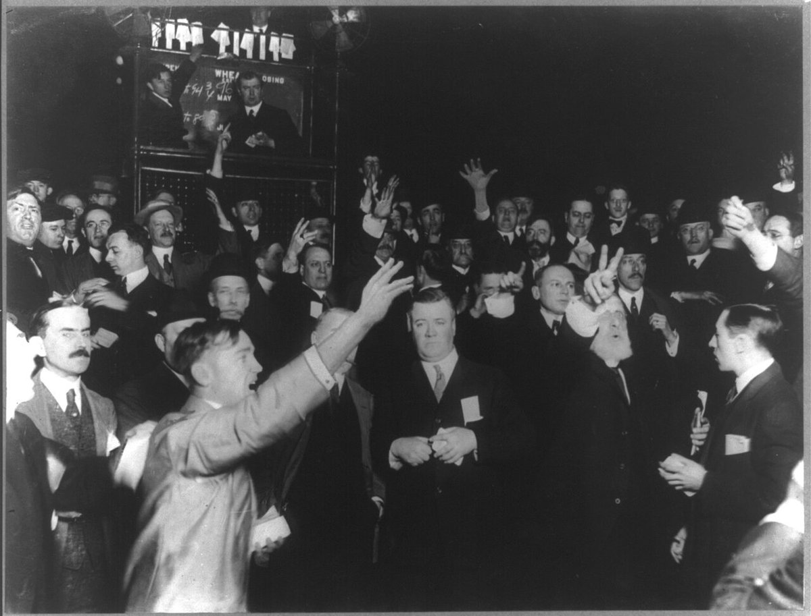
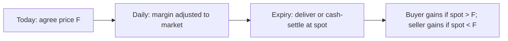

# Forwards and futures

**Prerequisites:** [What is a derivative?](01-what-is-a-derivative.md), [Time value of money](../../01-foundations/04-time-value-of-money.md).

*The wheat pit of the Chicago Board of Trade, a centre of futures trading from the 19th century. Credit: Miscellaneous Items in High Demand, PPOC, Library of Congress. License: Public domain. Source: [File:In the wheat pit of the Board of Trade of the city of Chicago LCCN2013646364.jpg](https://commons.wikimedia.org/wiki/File:In_the_wheat_pit_of_the_Board_of_Trade_of_the_city_of_Chicago_LCCN2013646364.jpg).*

A **forward contract** is an agreement today to buy or sell an asset at a fixed price (the **delivery price**) on a set future date. Nothing is paid up front; the price is simply fixed. A **futures contract** is the same idea, standardised and traded on an exchange, with gains and losses settled every day.

## Forward pricing: cost of carry

What should the forward price be? Take a stock worth 100 that pays no dividend, a forward expiring in 6 months, and a risk-free rate of 4% per year. Anyone can do the following: borrow 100, buy the stock, and deliver it at expiry. The cost at that time is the loan repaid with interest, 100 × 1.04^0.5 = 101.98. Any forward price above that lets an arbitrageur sell forward, buy the stock and pocket the difference; any price below lets one short the stock, lend the proceeds and buy forward. So the forward price must be:

> F = S × (1 + r)^T (continuously compounded: F = S e^(rT), which gives 102.02)

The forward price is **not** a forecast of the future spot price. It is today's spot price plus the **cost of carry**: interest, storage and insurance, minus any income from the asset (dividends, or a "convenience yield" for physical commodities). For a dividend-paying stock, subtract the present value of the dividends. This is the same present-value reasoning used in [discounting](../../01-foundations/05-present-value-and-discounting.md).

## Futures

Futures differ from forwards in four ways:

1. **Standardisation:** fixed contract size, quality and delivery dates.
2. **Exchange trading and clearing:** a clearing house stands between buyer and seller, removing counterparty risk.
3. **Margin:** each side posts an **initial margin**, a good-faith deposit, typically a small percent of the contract value.
4. **Mark-to-market:** gains and losses are credited or debited daily. If the margin account falls below the **maintenance margin**, the holder gets a **margin call** and must top up or be closed out.

Example: a wheat futures contract covers 5,000 bushels. At 6.00 per bushel the contract is worth 30,000. Suppose initial margin is 5%, or 1,500. If wheat falls by 0.30 per bushel, that is 5,000 × 0.30 = 1,500, a loss equal to the entire margin in a day. Leverage here is 20 to 1: the 1,500 posted controls 30,000 of wheat.

Most futures are closed out before expiry by taking an opposite position, so only a small share leads to physical delivery. Some contracts, such as stock index futures, are **cash-settled** since delivering 500 stocks would be absurd.

## Who uses them

- **Hedgers:** a farmer *sells* wheat futures to lock in a price (a **short hedge**); a bakery *buys* them to fix its input cost (a **long hedge**).
- **Speculators:** take positions, providing liquidity and absorbing risk.
- **Arbitrageurs:** keep futures aligned with the underlying through cost-of-carry relations.

**Basis** is the spot price minus the futures price. It converges to zero at expiry; imperfect convergence, or hedging with a similar but not identical asset, creates **basis risk**.

## What underlies futures

- **Commodities:** crude oil, natural gas, metals, grain, livestock.
- **Financial futures:** stock index futures (like the S&P 500 e-mini), interest-rate futures, currency futures and government bond futures.

Futures on the Treasury market and short-term rates are central to how institutions manage interest-rate risk. In Canada, the Montreal Exchange lists futures on Government of Canada bonds and on short-term interest rates.

## Contango and backwardation

When futures prices exceed the spot price and rise with maturity, the market is in **contango**, consistent with positive carrying costs. When futures are below spot, it is in **backwardation**, which often appears when immediate supply is scarce and holding the physical commodity yields benefits. This matters for funds that hold futures: rolling from one contract to the next in contango costs money, so a futures-based commodity ETF can lag the spot price.

## Hedging example

An airline will buy 1 million gallons of jet fuel in three months and fears a price rise. It buys futures on a related fuel contract. If prices rise 0.20 per gallon, the physical purchase costs 200,000 more but the futures gain roughly offsets that. If prices fall, the airline overpays on the physical but loses on the futures and ends up near the locked-in price. Hedging does not make money; it trades an uncertain cost for a nearly known one, which can matter for planning. Fine detail: the hedge isn't perfect, thanks to basis risk.

## Key ideas

- A forward fixes a price today for a future trade; a future is a standardised, exchange-traded, daily-settled version.
- The forward price is spot plus the cost of carry, enforced by arbitrage, not a forecast.
- Futures use margin and daily mark-to-market, giving large leverage and the risk of margin calls.
- Contango and backwardation describe the shape of the futures curve and affect roll returns.

## Where this leads

- Next: [options](03-options-calls-and-puts.md).
- Related: [commodities and gold](../05-alternatives/02-commodities-and-gold.md), [clearing and settlement](../../04-markets/07-clearing-and-settlement.md).
- Glossary: [[g:forward-contract|forward contract]], [[g:futures-contract|futures contract]], [[g:margin|margin]], [[g:mark-to-market|mark-to-market]], [[g:cost-of-carry|cost of carry]], [[g:contango|contango]], [[g:backwardation|backwardation]], [[g:basis-risk|basis risk]], [[g:clearing-house|clearing house]].
