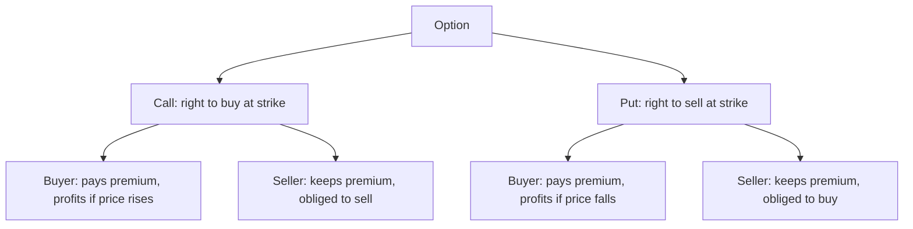

# Options: calls and puts

**Prerequisites:** [What is a derivative?](01-what-is-a-derivative.md).

*The Old Amsterdam Exchange (Beurs), Jan van der Heyden, 1667, rear view of the building where option contracts were traded in the 17th century. Credit: Jan van der Heyden. License: Public domain. Source: [File:The Old Amsterdam Exchange (Beurs) - Jan van der Heyden (1667) Staatsgalerie Stuttgart.jpg](https://commons.wikimedia.org/wiki/File:The_Old_Amsterdam_Exchange_(Beurs)_-_Jan_van_der_Heyden_(1667)_Staatsgalerie_Stuttgart.jpg).*

An **option** gives its owner the *right*, but not the obligation, to buy or sell an asset at a fixed price on or before a date. That one-sided choice is what makes options different from forwards and futures, where both sides are obligated.

## The vocabulary

- A **call** gives the right to **buy** the underlying.
- A **put** gives the right to **sell** it.
- The **strike price** (exercise price) is the fixed price.
- The **expiry** is the last date the right exists.
- The **premium** is the price paid for the option.
- The **buyer** (holder, "long") pays the premium and has the right. The **seller** (writer, "short") receives the premium and takes the obligation if the buyer exercises.
- **European** options may be exercised only at expiry; **American** options at any time up to expiry. (The names have nothing to do with geography.)
- In listed equity options, one contract usually covers 100 shares.

## Payoffs at expiry

For a call with strike K and stock price S at expiry, the holder's payoff is max(S − K, 0). For a put it is max(K − S, 0). Subtract the premium for profit.

Example: a call with strike 50 bought for premium 3.

| Stock at expiry | Call payoff | Profit (payoff − 3) |
|---|---|---|
| 40 | 0 | −3 |
| 50 | 0 | −3 |
| 53 | 3 | 0 (breakeven) |
| 60 | 10 | +7 |

The most the buyer can lose is the premium; the potential gain is unlimited. For the seller, it's the mirror image: keep the premium of 3 at best, and face unlimited loss as the stock rises.

A put with strike 50 bought for premium 2 pays 10 if the stock falls to 40, a profit of 8; if the stock ends at 50 or higher, it expires worthless and the loss is 2. The put holder profits when the stock *falls*.

## Moneyness

A call is **in the money** (ITM) if the stock price is above the strike, **at the money** (ATM) if equal, and **out of the money** (OTM) if below. For puts it is the reverse. The option's **intrinsic value** is its payoff if exercised now; the rest of its price is **time value**, reflecting the chance of becoming more valuable before expiry. Time value declines as expiry approaches, a decay called **theta**.

## What affects an option's price

| Factor | Call price | Put price |
|---|---|---|
| Stock price up | Up | Down |
| Strike up | Down | Up |
| Time to expiry longer | Up | Up (usually) |
| Volatility higher | Up | Up |
| Interest rates higher | Up | Down |
| Dividends higher | Down | Up |

Volatility is the key variable: since the buyer's loss is capped but gain is not, more uncertainty about the underlying always adds value. See [option pricing](05-option-pricing.md) for the model, and [variance and standard deviation](../../01-foundations/09-variance-and-standard-deviation.md).

## Put-call parity

For European options on a non-dividend stock, a call and a put with the same strike and expiry are tied together by:

> C − P = S − K e^(−rT)

If this failed, an arbitrage would exist. With S = 100, K = 100, r = 4%, T = 1 year, a call minus a put should equal 100 − 100e^(−0.04) = 3.92.

## Why people use options

1. **Insurance:** buy a put on a stock you own, protecting against a fall below the strike while keeping the upside. The premium is like an insurance premium.
2. **Income:** sell a call against shares you own (a "covered call"), collecting premium in return for giving up gains above the strike.
3. **Leveraged speculation:** a small premium gives exposure to a large move, with a capped loss.
4. **Hidden options elsewhere:** callable bonds, convertible bonds, mortgage prepayment rights and stock options paid to employees contain option features; see [corporate bonds](../02-bonds/08-corporate-bonds-and-high-yield.md). Equity itself is a call option on a levered firm's assets, as Merton showed in 1974.

## Risks

Buying options can lose 100% of the premium, and the majority of short-dated out-of-the-money options expire worthless. Selling "naked" options can lose without limit. Options are wasting assets; being right about direction is not enough: the move must be big enough and soon enough to pay for the premium.

## Key ideas

- A call is the right to buy; a put is the right to sell; the buyer pays a premium for the right.
- Payoffs are asymmetric: limited loss for the buyer, large potential gain; the seller faces the opposite.
- Price = intrinsic value + time value; volatility and time increase the price.
- Put-call parity ties calls, puts, stock and cash together.

## Where this leads

- Next: [option payoffs and strategies](04-option-payoffs-and-strategies.md).
- Related: [what is a derivative?](01-what-is-a-derivative.md).
- Glossary: [[g:option|option]], [[g:call-option|call option]], [[g:put-option|put option]], [[g:strike-price|strike price]], [[g:premium|premium]], [[g:intrinsic-value|intrinsic value]], [[g:time-value-of-an-option|time value of an option]], [[g:put-call-parity|put-call parity]], [[g:moneyness|moneyness]].
