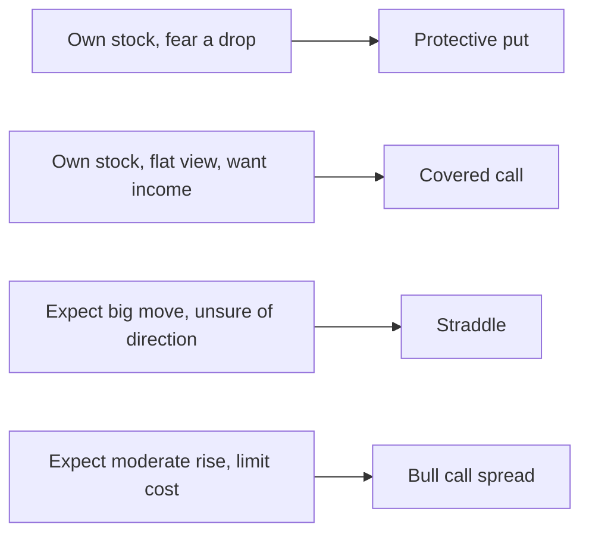

# Option payoffs and strategies

**Prerequisites:** [Options: calls and puts](03-options-calls-and-puts.md).

*The payoff of a long call option at expiry as a function of the underlying price. Credit: Credit as given on Wikimedia Commons. License: [CC BY-SA 3.0](http://creativecommons.org/licenses/by-sa/3.0/). Source: [File:Payoff call option.svg](https://commons.wikimedia.org/wiki/File:Payoff_call_option.svg).*

Options can be combined with each other and with the underlying to build almost any payoff shape. Each strategy below shows what you want to be true, what you give up and what the worst case is. All numbers are per share and ignore commissions, taxes and early exercise. The examples assume the stock trades at 50.

## Protective put (insurance)

You own the stock bought at 50 and buy a put with strike 45 for a premium of 1.50.

- If the stock falls to 30, the put pays 15, so the stock loss of 20 is cut to 5 plus the premium 1.50: total loss 6.50.
- If the stock rises to 60, you gain 10 and lose the premium: net +8.50.
- Worst case: 6.50 (the 5 below the strike plus the premium). Breakeven: 51.50.

This is a floor under your position, bought for a known price: portfolio insurance. The deductible is the 5 between 50 and 45.

## Covered call (income)

You own the stock at 50 and sell a call with strike 55 for 2.

- If the stock ends at or below 55, the call expires; you keep the premium of 2 on top of any stock gain or loss.
- If the stock ends above 55, your stock is called away at 55: gain capped at 5 + 2 = 7.
- Breakeven: 48 (the premium cushions a 2-point fall). Downside is nearly all of the stock's risk minus 2.

It exchanges upside above 55 for income now. It does well in flat or mildly rising markets, and badly if the stock soars (you miss the gain) or crashes (you keep most of the loss).

## Straddle (a bet on movement)

Buy a call and a put with the same strike, 50, paying 3 and 2: total cost 5.

- If the stock ends at 50, both expire worthless; loss 5 (the maximum).
- Breakevens: 55 and 45. Beyond those the position profits, so at 65 the payoff is 15 − 5 = +10.
- The buyer needs volatility *bigger than the market expected* when pricing the options; direction does not matter. The seller of a straddle collects 5 and loses if the stock moves strongly in either direction.

## Bull call spread (cheaper bullish bet)

Buy a call with strike 50 for 3 and sell a call with strike 60 for 1: net cost 2.

- Maximum loss: 2 (stock at or below 50).
- Maximum profit: 10 − 2 = 8 (stock at or above 60).
- Breakeven: 52.

The sold call finances part of the purchase, but caps the gain. A **bear put spread** is the mirror image for a falling market.

## Summary table

| Strategy | View | Max loss | Max gain |
|---|---|---|---|
| Long call | Strongly up | Premium | Unlimited |
| Long put | Strongly down | Premium | Large (to zero price) |
| Protective put | Own stock, want a floor | Limited | Unlimited |
| Covered call | Flat or mildly up | Stock falls to zero minus premium | Capped |
| Straddle (long) | Big move, either way | Both premiums | Unlimited |
| Bull call spread | Moderately up | Net premium | Capped |

## Choosing and judging

Every strategy has a price, and options are fairly priced on average relative to what traders expect: you cannot get something for nothing. A covered call "yields income" only by selling away upside; a protective put costs the premium every period you hold it. Thinking in payoff diagrams rather than in probabilities of "winning" helps prevent self-deception, such as selling cheap out-of-the-money options that profit often and then lose a lot rarely (a pattern sometimes called "picking up pennies in front of a steamroller").

## Greeks (a first look)

The sensitivities of an option's price to its inputs are named after Greek letters:

- **Delta:** change in option price per 1 change in the stock price. A call's delta is between 0 and 1; a put's between −1 and 0. It also approximates the probability-like chance the option ends in the money.
- **Gamma:** how fast delta changes as the stock moves.
- **Theta:** time decay.
- **Vega:** sensitivity to volatility.
- **Rho:** sensitivity to interest rates.

Option sellers and market makers use the Greeks to hedge; see [option pricing](05-option-pricing.md).

## Key ideas

- Combining options with each other or with stock produces custom payoffs: floors, caps, ranges and bets on volatility.
- Protective puts are insurance; covered calls trade upside for income; straddles bet on movement; spreads cap both cost and profit.
- No free lunch: every extra payoff feature is paid for through a premium or a given-up gain.
- Greeks measure an option's sensitivities and guide hedging.

## Where this leads

- Next: [option pricing](05-option-pricing.md).
- Related: [portfolio insurance and risk](../../06-portfolio-theory/01-portfolio-return-and-risk.md), [1987 crash](../../08-history/09-1987-ltcm-and-the-1990s-crises.md).
- Glossary: [protective put](../../glossary/derivatives/protective-put.md), [covered call](../../glossary/derivatives/covered-call.md), [straddle](../../glossary/derivatives/straddle.md), [spread](../../glossary/derivatives/spread-strategy.md), [delta](../../glossary/derivatives/delta.md), [gamma](../../glossary/derivatives/gamma.md), [theta](../../glossary/derivatives/theta.md), [vega](../../glossary/derivatives/vega.md).
