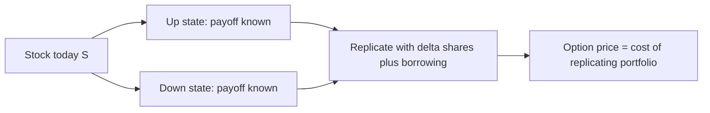

# Option pricing

**Prerequisites:** [Options: calls and puts](03-options-calls-and-puts.md), [Present value and discounting](../../01-foundations/05-present-value-and-discounting.md), [Probability and expected value](../../01-foundations/08-probability-and-expected-value.md).

*Fischer Black, co-author of the 1973 Black–Scholes option pricing formula. Credit: Dalmatine at English Wikipedia. License: Public domain. Source: [File:Fischer Black.JPG](https://commons.wikimedia.org/wiki/File:Fischer_Black.JPG).*

What should an option cost? For centuries, traders guessed. The breakthrough, in the early 1970s, was to see that an option can be **replicated** by trading the underlying and borrowing, so its price must equal the cost of that replication, without needing to know how likely the stock is to rise.

## One-step binomial model

Suppose a stock is worth 100 today. In a year it will be either 120 or 90. A call with strike 100 pays 20 if the stock rises and 0 if it falls. The risk-free rate is 5%.

Build a portfolio that copies the call: buy Δ shares and borrow B so that the outcomes match.

- If the stock rises: Δ × 120 − 1.05 B = 20.
- If the stock falls: Δ × 90 − 1.05 B = 0.

Subtracting: 30 Δ = 20, so Δ = 2/3 share. Then 60 = 1.05 B, so B = 57.14. The portfolio costs (2/3) × 100 − 57.14 = **9.52**. That must be the call's price; otherwise an arbitrage exists. Notice that nothing about the *probability* of rising entered the calculation.

Equivalent shortcut: **risk-neutral valuation**. Define q so that the stock's expected growth at q equals the risk-free rate: q × 120 + (1 − q) × 90 = 105, so q = 0.5. The call's price is the expected payoff under q, discounted: 0.5 × 20 ÷ 1.05 = 9.52. The q are **risk-neutral probabilities**: they are not real-world forecasts but a device which works because the replication is risk-free. Chaining many short steps produces the **Cox–Ross–Rubinstein** binomial model (1979), widely used for American options.

## The Black–Scholes–Merton model

Fischer Black and Myron Scholes published their option-pricing formula in 1973; Robert Merton extended and justified it by continuous replication and called it the "Black–Scholes" approach. Scholes and Merton received the 1997 Nobel Memorial Prize in Economics (Black had died in 1995). For a European call on a non-dividend stock:

> C = S·N(d₁) − K·e^(−rT)·N(d₂), with d₁ = [ln(S/K) + (r + σ²/2)T] ÷ (σ√T), d₂ = d₁ − σ√T

where N is the standard normal cumulative distribution, σ is volatility, and the other symbols are as before. The put follows from [put-call parity](03-options-calls-and-puts.md).

Example: S = 100, K = 100, r = 4%, T = 1 year, σ = 20%. Then d₁ = 0.30, d₂ = 0.10, N(d₁) = 0.618 and N(d₂) = 0.540. The call is worth about **9.93**, and the put about **6.00**. Raise volatility to 30% and the call goes to **13.75**: more uncertainty, more value. For a higher strike of 105 and 20% volatility, the call is about **7.57**.

**N(d₁)** is the option's delta, here 0.618: hold 0.618 shares per call to hedge it. The idea of continuously adjusting this hedge, **dynamic hedging**, is how market makers manage the risk of options they sell.

## Assumptions and limits

The model assumes continuous trading, constant volatility and interest rates, no transaction costs and log-normally distributed returns. Real markets have **fat tails**, jumps and changing volatility; see [variance and standard deviation](../../01-foundations/09-variance-and-standard-deviation.md). Consequently:

- **Implied volatility:** the volatility you must plug into the formula to reproduce the market price. It is the market's consensus on future volatility, a "price" quoted in volatility terms. The CBOE's **VIX** index summarises the implied volatility of S&P 500 options, often called the "fear gauge".
- **Volatility smile or skew:** implied volatility differs across strikes. After the October 1987 crash, out-of-the-money puts became more expensive relative to the model, reflecting fear of crashes.
- The model remains the common language of options markets even though people know its limits.

## Beyond: employee options and real options

The same logic values employee stock options, convertible bonds and **real options**, such as the flexibility to expand, delay or abandon a project, which a plain DCF ignores; see [DCF valuation](../01-stocks/09-discounted-cash-flow-valuation.md). In 1974 Merton also noted that a firm's equity is like a call option on its assets, with debt as the strike, which links options to [credit risk](../02-bonds/06-credit-risk-and-ratings.md) and the [capital structure](../../02-firms-and-capital/08-capital-structure-and-cost-of-capital.md).

## Key ideas

- An option's price equals the cost of a replicating portfolio of the underlying and borrowing; real-world probabilities are not needed.
- The binomial example gives a call price of 9.52 by replication or risk-neutral expectation.
- Black–Scholes–Merton gives a formula; with S = K = 100, r = 4%, T = 1, σ = 20% the call is about 9.93.
- Volatility is the key input; implied volatility reverses the formula, and the VIX tracks it for the S&P 500.

## Where this leads

- Next: [swaps and credit derivatives](06-swaps-and-credit-derivatives.md).
- Related: [capital structure and cost of capital](../../02-firms-and-capital/08-capital-structure-and-cost-of-capital.md), [CAPM and beta](../../06-portfolio-theory/03-capm-and-beta.md).
- Glossary: [Black–Scholes](../../glossary/derivatives/black-scholes.md), [implied volatility](../../glossary/derivatives/implied-volatility.md), [VIX](../../glossary/portfolio-theory/vix.md), [risk-neutral valuation](../../glossary/derivatives/risk-neutral-valuation.md), [replication](../../glossary/derivatives/replication.md), [volatility smile](../../glossary/derivatives/volatility-smile.md), [real option](../../glossary/derivatives/real-option.md).
