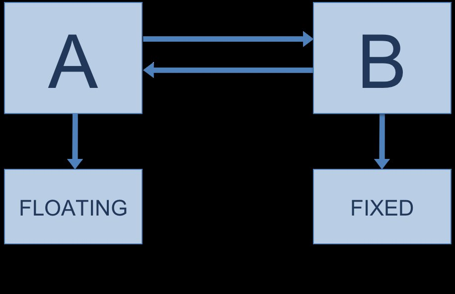
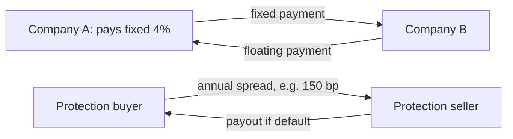

# Swaps and credit derivatives

**Prerequisites:** [What is a derivative?](01-what-is-a-derivative.md), [Credit risk and ratings](../02-bonds/06-credit-risk-and-ratings.md).

*A diagram of a plain-vanilla interest rate swap, fixed payments exchanged for floating ones. Credit: Suicup. License: [CC BY-SA 3.0](https://creativecommons.org/licenses/by-sa/3.0). Source: [File:Vanilla interest rate swap.png](https://commons.wikimedia.org/wiki/File:Vanilla_interest_rate_swap.png).*

A **swap** is a contract in which two parties agree to exchange streams of cash payments over time. Swaps are the largest part of the over-the-counter derivatives market, and they underlie much of how companies, banks and governments manage interest and currency risk.

## Interest-rate swaps

In a plain-vanilla interest-rate swap, one party pays a **fixed** rate and the other pays a **floating** rate (tied to a short-term benchmark rate), both on the same **notional principal**. The notional is never exchanged; it is only used to calculate payments.

Example: notional 10 million, fixed rate 4% a year, payments every six months. Company A pays fixed: 10,000,000 × 4% ÷ 2 = 200,000 each period. Company B pays floating. If the floating rate for the period is 3.5%, B owes 175,000. Only the difference is paid: A pays B **25,000**. If the floating rate rose to 5%, B would owe 250,000 and pay A 50,000 net.

Why swap? A company with a floating-rate loan fears rising rates. By entering a swap in which it pays fixed and receives floating, it converts its floating-rate loan into a fixed-rate one: the floating payments it receives offset those on its loan, leaving it paying the fixed rate. Another firm with a fixed-rate debt may prefer floating. Banks use swaps to match the interest-rate profile of assets and liabilities. Swap rates are also a market benchmark: the fixed rate that makes a swap worth zero at the start is the **swap rate**, reflecting the market's expectations of future floating rates, much like the [yield curve](../02-bonds/09-the-yield-curve.md).

Swaps began in the early 1980s. The best-known early deal, in 1981, was a currency swap between IBM and the World Bank, arranged by Salomon Brothers, in which IBM's obligations in German marks and Swiss francs were exchanged for the World Bank's dollar obligations. The International Swaps and Derivatives Association (ISDA, founded 1985) created the standard master agreement that governs most OTC derivatives. Floating-rate benchmarks have changed: LIBOR was phased out by mid-2023 in favour of overnight rates such as SOFR in the US and CORRA in Canada; the Canadian CDOR benchmark ceased publication in June 2024.

## Currency swaps

Two parties exchange principal and interest payments in different currencies. A Canadian firm that has borrowed in US dollars can swap into Canadian dollar payments, removing the currency risk. Unlike interest-rate swaps, principal amounts are normally exchanged at the start and end.

## Other swaps

Commodity swaps fix the price of oil or gas; equity swaps exchange the return of a stock or index for a floating rate; **total return swaps** exchange all the return of an asset for a financing payment, enabling leveraged exposure without owning it, a mechanism that played a role in the 2021 collapse of the family office Archegos Capital Management.

## Credit default swaps

A **credit default swap** (CDS) is insurance-like protection against the default of a borrower. The buyer pays a regular **spread** (a premium) to the seller; if the **reference entity** defaults, the seller compensates the buyer for the loss. CDS were developed at J.P. Morgan in the mid-1990s.

Example: you hold 5 million of a company's bonds and buy five-year protection at a spread of 150 basis points (1.5%). You pay 5,000,000 × 1.5% = 75,000 a year. If the company defaults and the bonds are worth 40% of face (a **recovery rate** of 40%), the seller pays you 5,000,000 × (1 − 0.40) = 3,000,000. The spread is a market-based measure of default risk: wider spreads mean the market sees higher credit risk, which complements [credit ratings](../02-bonds/06-credit-risk-and-ratings.md).

Note that anyone can buy CDS protection on a company without owning its bonds, a **naked CDS**. Buying one is a bet on default. Critics argued this adds speculation; a ban on naked CDS on sovereign debt was introduced in the European Union in 2012.

## Securitised credit and 2008

Credit risk was also repackaged into **collateralised debt obligations** (CDOs), which pooled mortgage-backed securities and sold tranches of different seniority; CDS was used to insure them. When US house prices fell, many highly-rated tranches suffered heavy losses. AIG, which had sold CDS protection on such securities on a large scale without enough capital to pay claims, was rescued by the US government in September 2008. After the crisis, reforms required standardised swaps to be centrally cleared and reported; see [the 2008 financial crisis](../../08-history/11-the-2008-financial-crisis.md) and [clearing and settlement](../../04-markets/07-clearing-and-settlement.md).

## Key ideas

- A swap exchanges cash-flow streams; in a fixed-for-floating interest-rate swap only the net difference is paid on a notional amount.
- Swaps let firms convert floating debt to fixed (or the reverse) and manage currency exposure.
- A credit default swap transfers credit risk for a spread; its payout depends on the recovery rate.
- Swaps and CDS concentrated risk before 2008, leading to clearing and reporting reforms.

## Where this leads

- Next: [alternatives](../05-alternatives/01-real-estate-and-reits.md).
- Related: [central banks and monetary policy](../../05-regulation/06-central-banks-and-monetary-policy.md), [the yield curve](../02-bonds/09-the-yield-curve.md).
- Glossary: [swap](../../glossary/derivatives/swap.md), [interest-rate swap](../../glossary/derivatives/interest-rate-swap.md), [notional amount](../../glossary/derivatives/notional-amount.md), [credit default swap](../../glossary/derivatives/credit-default-swap.md), [recovery rate](../../glossary/bonds/recovery-rate.md), [ISDA](../../glossary/derivatives/isda.md), [CDO](../../glossary/derivatives/cdo.md), [LIBOR](../../glossary/derivatives/libor.md).
