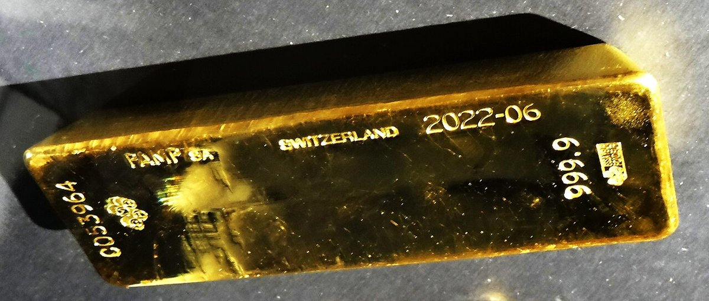
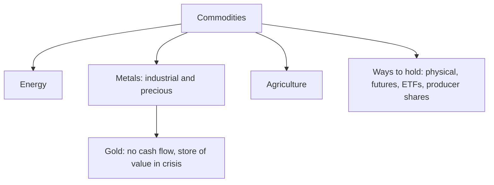

# Commodities and gold

**Prerequisites:** [Forwards and futures](../04-derivatives/02-forwards-and-futures.md), [Inflation and real returns](../../01-foundations/07-inflation-and-real-returns.md).

*A gold bar held at the Banque de France. Credit: Ibex73. License: [CC BY 4.0](https://creativecommons.org/licenses/by/4.0). Source: [File:Gold bar of Banque de France.jpg](https://commons.wikimedia.org/wiki/File:Gold_bar_of_Banque_de_France.jpg).*

**Commodities** are standardised raw materials traded in bulk: energy (crude oil, natural gas), metals (copper, aluminium, gold, silver), agricultural products (wheat, corn, coffee) and others. One barrel of a given grade of oil is interchangeable with another, so price is the main thing that distinguishes sellers.

## Why commodities are different

A share or bond is a claim on future cash flows. A barrel of oil or an ounce of gold produces **no cash flow**. Its value is what someone will pay for it, set by supply and demand, and a commodity can cost money to hold (storage, insurance, spoilage), so the [cost of carry](../04-derivatives/02-forwards-and-futures.md) matters. This means the discounted cash flow method does not apply to a commodity itself.

The main drivers of prices:

- **Supply shocks:** weather and crop failures, mine accidents, conflicts, production cuts by cartels such as OPEC.
- **Demand:** industrial growth, especially from large economies; seasonal patterns.
- **Inventories and storage costs.**
- **The currency:** commodities are mostly priced in US dollars, so a stronger dollar tends to push dollar prices down.
- **Speculation and financial flows.**

Canada's economy has a significant commodity dimension: energy, metals, potash and lumber. The Canadian dollar and the S&P/TSX Composite, with large weights in energy, materials and financials, are both sensitive to commodity prices; Canadians' exposure to resources through their stock market is already high.

## Ways to invest

1. **Physical holding:** bullion, coins and bars. Costs include premiums over the spot price, storage and insurance.
2. **Futures:** the main way to get exposure; see below.
3. **Commodity ETFs and funds:** some hold physical metal (gold and silver ETFs), others hold futures.
4. **Commodity producers:** shares in miners and oil companies, which are equities with commodity-linked profits but also operating, management and financing risks.

### The roll problem

Futures expire, so a fund that holds them must **roll**, selling the expiring contract and buying a later one. In **contango** the later contract costs more, so rolling means buying high; the fund loses a little with each roll even if the spot price does not move. Example: if the next-month contract is 1% more expensive each month, a fund pays roughly 12% a year in roll cost over a flat spot price. In **backwardation**, rolling yields a gain. This is why a futures-based commodity ETF can differ greatly from the spot price over time. See [exchange-traded funds](../03-funds/02-exchange-traded-funds.md).

## Returns and risk

Commodities as an asset class have shown high volatility, no reliable long-term return above inflation and weak, variable correlations with stocks and bonds. They sometimes rose strongly when inflation surprised on the upside, for example in the 1970s, which is why some use them as a partial inflation hedge. But there is no guaranteed link, and many individual commodities have fallen in real terms over decades. Academic discussion of whether commodities offer a risk premium is unresolved; do not assume one.

## Gold

Gold is the most famous commodity and has been money for thousands of years. It is dense, durable, divisible, hard to counterfeit and scarce. Under the classical **gold standard**, currencies were defined as a weight of gold. Under the Bretton Woods system, after 1944, the US dollar was convertible to gold at 35 dollars an ounce for foreign central banks. On 15 August 1971, President Nixon suspended that convertibility, and gold has floated freely ever since; see [Bretton Woods and the postwar order](../../08-history/08-bretton-woods-and-the-postwar-order.md). Central banks still hold large gold reserves.

Investors hold gold as a **store of value in crisis**, a hedge against currency debasement and a diversifier, since it has often been uncorrelated with equities. Critics point out that gold yields nothing: 1,000 dollars in a 4% bond compounds to 1,480 over ten years, while gold only gains if its price rises. Over very long periods gold's real return has been near zero or modest, with long stretches of poor performance (the price fell for much of the 1980s and 1990s, for example). The honest summary: gold is insurance against specific scenarios, not a source of income.

Methods of holding gold: bars and coins; allocated bullion accounts; exchange-traded products backed by physical gold; futures; and gold mining shares, which have extra leverage to the gold price and company-specific risks.

## Key ideas

- Commodities are interchangeable raw materials that produce no cash flow; their prices are set by supply and demand.
- Futures-based exposure suffers from roll costs in contango.
- Commodities are volatile and have no reliable long-run return above inflation, though they can hedge inflation shocks.
- Gold is a monetary metal and crisis insurance; it earns nothing unless its price rises.

## Where this leads

- Next: [foreign exchange](03-foreign-exchange.md).
- Related: [inflation and real returns](../../01-foundations/07-inflation-and-real-returns.md), [asset allocation](../../06-portfolio-theory/06-asset-allocation-and-rebalancing.md).
- Glossary: [[g:commodity|commodity]], [[g:bullion|bullion]], [[g:gold-standard|gold standard]], [[g:roll-yield|roll yield]], [[g:store-of-value|store of value]], [[g:contango|contango]].
