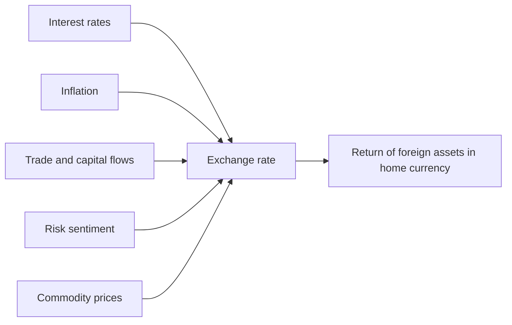

# Foreign exchange

**Prerequisites:** [Money and value](../../01-foundations/01-money-and-value.md), [Inflation and real returns](../../01-foundations/07-inflation-and-real-returns.md).

*The conference room of the Mount Washington Hotel at Bretton Woods, New Hampshire, where the 1944 conference set postwar exchange rates. Credit: Pi3.124. License: [CC BY-SA 4.0](https://creativecommons.org/licenses/by-sa/4.0). Source: [File:Bretton Woods Conference room.jpg](https://commons.wikimedia.org/wiki/File:Bretton_Woods_Conference_room.jpg).*

The **foreign exchange (FX or forex) market** is where one currency is traded for another. It is the largest financial market by volume: the Bank for International Settlements' 2022 survey put average daily turnover above seven trillion US dollars. Most of it is dealers, banks and funds, not tourists.

## Exchange rates

An **exchange rate** is the price of one currency in terms of another. A quote like USD/CAD = 1.35 means 1 US dollar costs 1.35 Canadian dollars. The first currency is the **base**, the second the **quote** currency. If USD/CAD falls to 1.30, the US dollar has **depreciated** against the Canadian dollar (the Canadian dollar has appreciated). The most traded currencies are the US dollar, euro, Japanese yen, British pound and Canadian dollar.

A **spot rate** is for immediate settlement (usually two business days); a **forward rate** is agreed today for a later date. A currency can be bought and sold in the spot market, in forwards, futures, options and swaps, as in the [derivatives](../04-derivatives/01-what-is-a-derivative.md) section.

## Exchange rate systems

- **Fixed (pegged):** the central bank holds the rate at a level, as the Bretton Woods system did against the US dollar and gold from 1944 to the early 1970s.
- **Floating:** the market sets the rate, with the central bank usually not intervening. Canada floated its dollar in 1950 for several years, pegged it from 1962 and has floated it since 1970. It has been one of the few major currencies on a long-standing float.
- **Managed float / hybrid:** the central bank intervenes sometimes.

The US dollar is the main **reserve currency**: central banks hold large dollar reserves, and many commodities and international loans are priced in dollars. See [Bretton Woods](../../08-history/08-bretton-woods-and-the-postwar-order.md) and [central banks](../../05-regulation/06-central-banks-and-monetary-policy.md).

## What moves exchange rates

Exchange rates are hard to forecast; most professional forecasts over short horizons do no better than assuming no change. The main influences:

- **Interest rate differences:** higher rates attract capital, other things equal.
- **Inflation:** over long periods, a currency with persistently higher inflation tends to lose value; this idea is **purchasing power parity** (PPP). It holds loosely over decades, not months. *The Economist's* Big Mac index is a light-hearted illustration.
- **Trade balances and capital flows.**
- **Commodity prices:** for Canada, oil and other resource prices have mattered for the Canadian dollar.
- **Risk sentiment:** in global stress, investors often flee to "safe-haven" currencies such as the US dollar, Swiss franc and yen.
- **Central bank policy and expectations.**

## Interest rate parity

If investors can lend in either currency and lock in the exchange rate with a forward contract, there should be no risk-free profit. **Covered interest rate parity** says the forward rate adjusts to offset interest differences:

> Forward = Spot × (1 + r_quote) ÷ (1 + r_base)

Example: spot USD/CAD = 1.35, one-year Canadian rate 3%, US rate 4%. Forward = 1.35 × 1.03 ÷ 1.04 = 1.337. The US dollar trades at a *forward discount* because US interest rates are higher; the higher US rate is exactly cancelled by the forward loss. If it were otherwise, an arbitrage trade would exist. Notice that the forward is not a forecast of the future spot rate: this is the same lesson as with [forward pricing](../04-derivatives/02-forwards-and-futures.md). Whether high-yield currencies on average depreciate as much as the interest difference suggests, which would remove the profit from borrowing low and lending high (the **carry trade**), is a famous empirical question: they often do not, until a crisis reverses the trade sharply.

## Currency risk for investors

When you hold foreign assets, your return is the asset's return combined with the currency return. If a Canadian investor owns a US stock that gains 10% in US dollars, but USD/CAD falls from 1.35 to 1.30, the return in Canadian dollars is 1.10 × (1.30 ÷ 1.35) − 1 = **5.9%**. The reverse is also true: a falling Canadian dollar boosts foreign returns. You can **hedge** with forwards or hedged ETFs, which cost a little (roughly the interest-rate difference) and remove the currency effect. Whether to hedge is debated: over long periods currency effects have largely washed out for some pairs, and unhedged foreign assets may even diversify during equity crashes if the home currency falls in stress. Canadian investors often choose to leave some US dollar exposure unhedged; other investors choose differently. It also matters for the cost of converting currencies at your broker, discussed in [fees](../03-funds/04-fees-and-the-cost-of-investing.md).

## Currency crises

Fixed exchange rates can break when markets doubt a country can defend them. On 16 September 1992 ("Black Wednesday"), the UK was forced to leave the European Exchange Rate Mechanism after heavy speculative selling of sterling; the Asian financial crisis began in 1997 with the collapse of the Thai baht's peg, as covered in [the 1990s crises](../../08-history/09-1987-ltcm-and-the-1990s-crises.md). Countries with debts in foreign currency are especially vulnerable.

## Key ideas

- An exchange rate is the price of one currency in terms of another; the FX market is the world's largest.
- Rates move with interest differentials, inflation, trade, capital flows and sentiment, and are very hard to forecast.
- Covered interest parity ties the forward rate to the interest-rate gap; forwards are not forecasts.
- A foreign asset's return in your currency is the asset return combined with the currency move, which you can hedge at a cost.

## Where this leads

- Next: [cryptoassets](04-cryptoassets.md).
- Related: [Bretton Woods and the postwar order](../../08-history/08-bretton-woods-and-the-postwar-order.md), [central banks and monetary policy](../../05-regulation/06-central-banks-and-monetary-policy.md).
- Glossary: [exchange rate](../../glossary/alternatives/exchange-rate.md), [spot rate](../../glossary/bonds/spot-rate.md), [reserve currency](../../glossary/history/reserve-currency.md), [purchasing power parity](../../glossary/alternatives/purchasing-power-parity.md), [interest rate parity](../../glossary/alternatives/interest-rate-parity.md), [carry trade](../../glossary/alternatives/carry-trade.md), [currency hedging](../../glossary/alternatives/currency-hedging.md).
